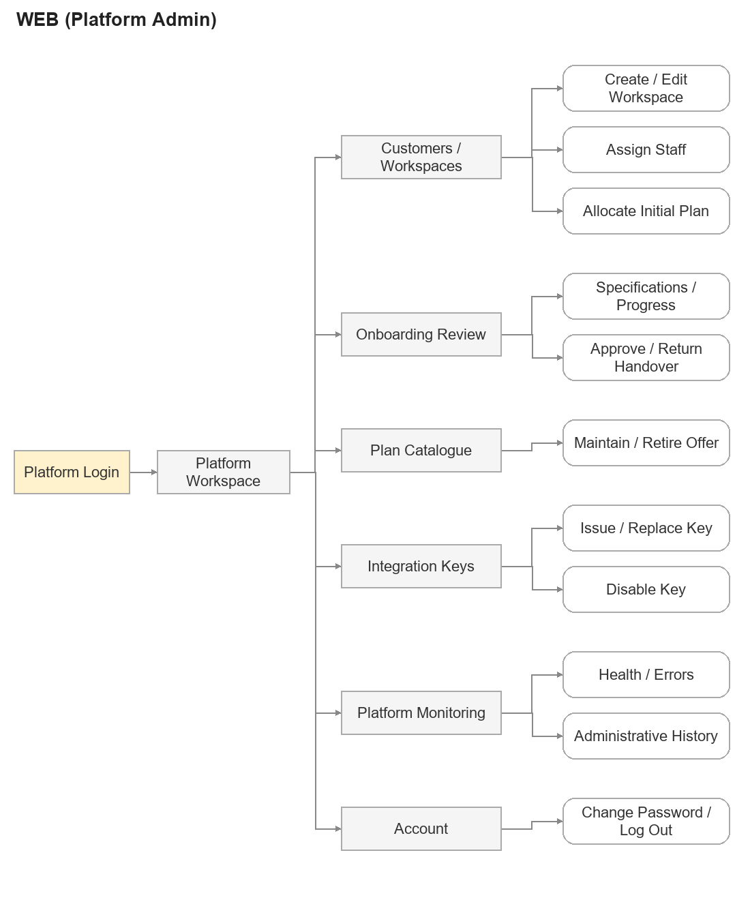
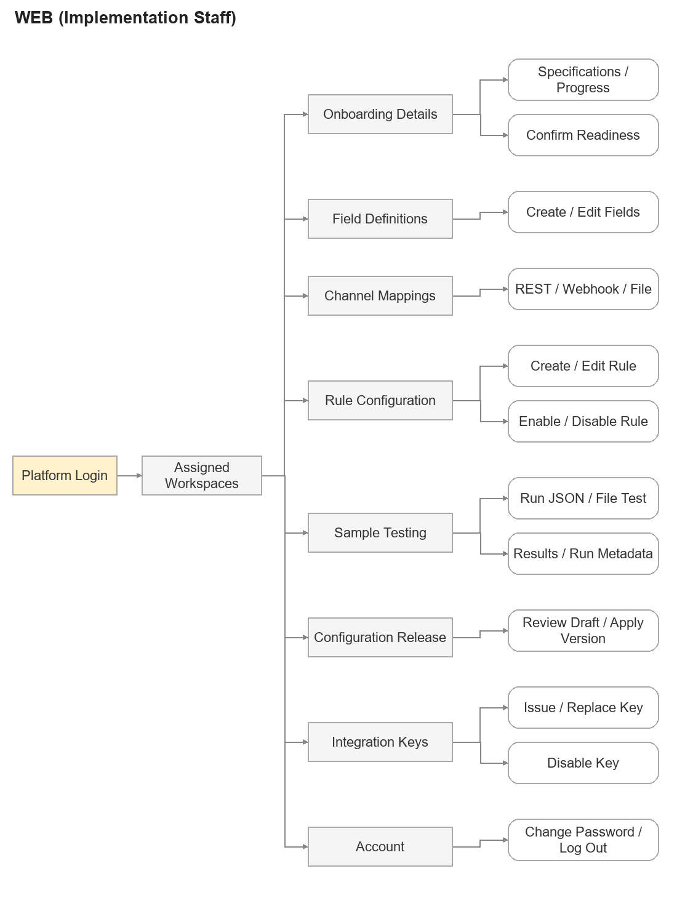
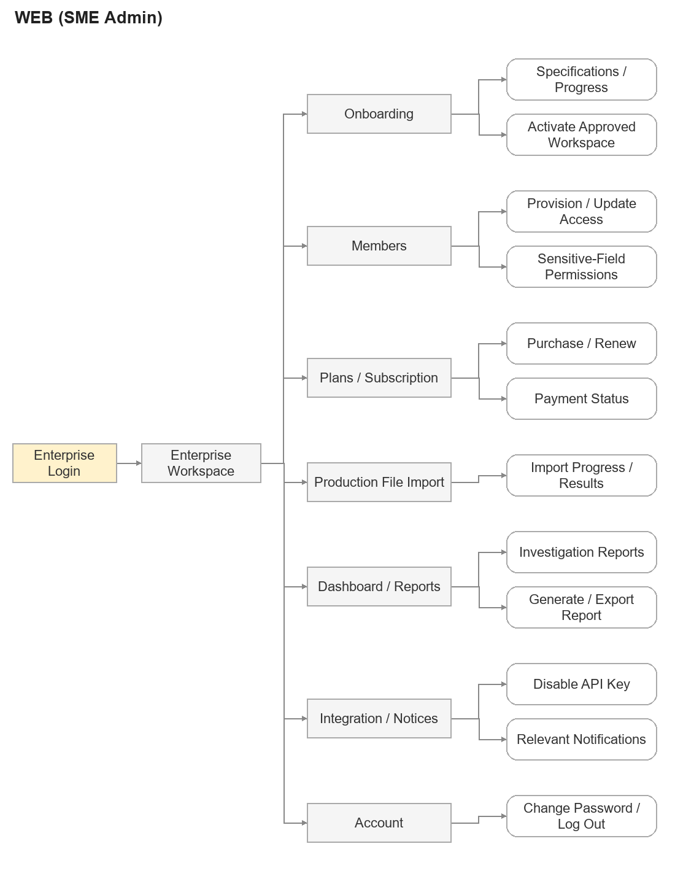
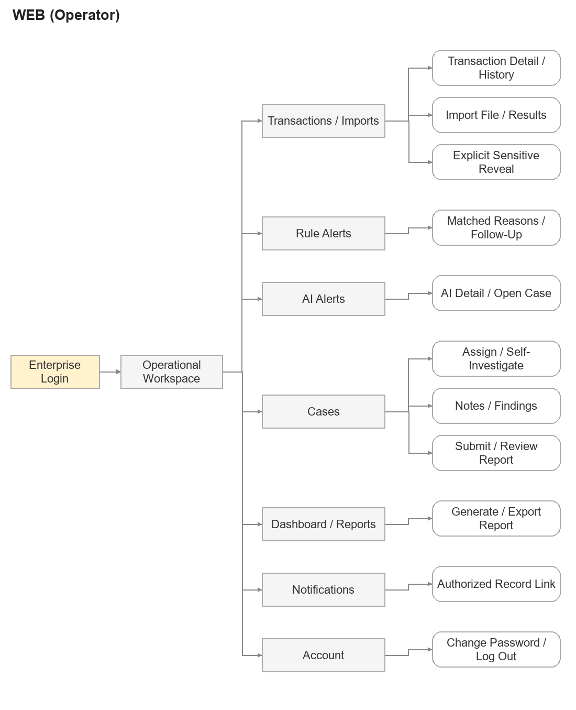
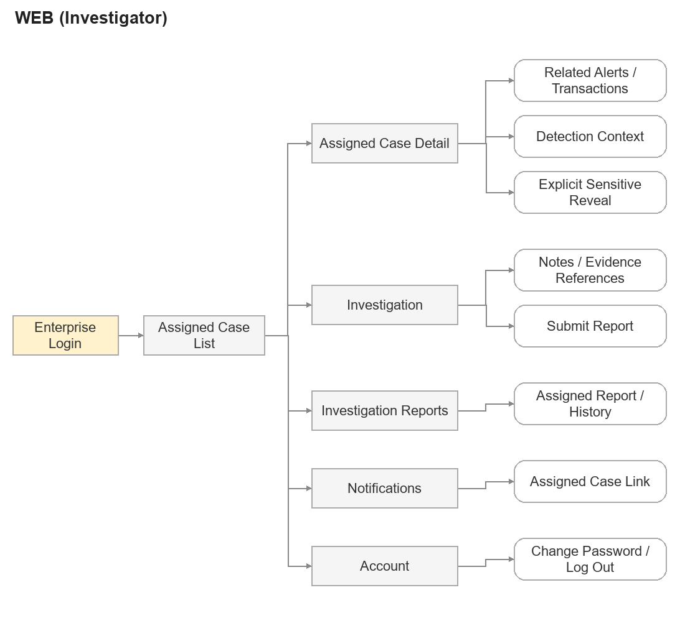
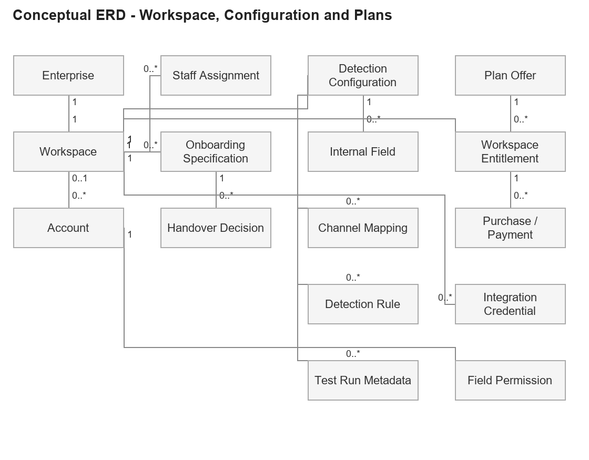
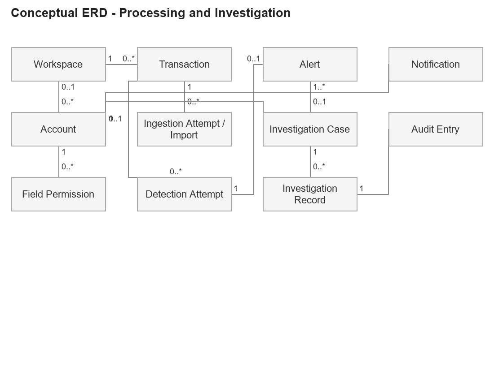

# 3. Functional Requirements

## 3.1 System Functional Overview

This overview describes the agreed target functions and access boundaries. Screen names identify required views/actions; their UI layouts are intentionally left blank for later design. Detailed behaviour is specified in Sections 3.2-3.15.

### 3.1.1 Screens Flow

The following role views use left-to-right screen-flow notation: a pale entry box, rectangular main views, rounded action/detail nodes and orthogonal navigation arrows. Arrows show available navigation, not automatic business-state transitions. All routes require backend authorization; first-login password change precedes protected work.

**WEB (Platform Admin)**

*Figure 3.3. WEB (Platform Admin) screen flow.*

**WEB (Implementation Staff)**

*Figure 3.4. WEB (Implementation Staff) screen flow.*

**WEB (SME Admin)**

*Figure 3.5. WEB (SME Admin) screen flow.*

Onboarding and activation precede production use. Purchase/renewal is available after activation; sensitive-field permission administration does not grant SME Admin plaintext access.

**WEB (Operator)**

*Figure 3.6. WEB (Operator) screen flow.*

Opening a case requires active Subscription and eligible AI Alerts. Existing cases remain available after expiry. Explicit sensitive-field reveal remains subject to separate field/object permission.

**WEB (Investigator)**

*Figure 3.7. WEB (Investigator) screen flow.*

Related transaction/alert/history access exists only through currently assigned cases. Plaintext requires an additional explicit permission check.

### 3.1.2 Screen Descriptions

**Platform Portal**

| ID | Feature | Screen | Description |
| --- | --- | --- | --- |
| P01 | Customer and Workspace | Customer / Workspace List and Detail | Administrative records, Staff responsibility and onboarding context. |
| P02 | Customer and Workspace | Create / Edit Customer and Workspace | Provision isolated workspace/SME Admin and maintain administrative metadata. |
| P03 | Customer and Workspace | Staff Assignment | Assign implementation responsibility and review changes. |
| P04 | Plan | Plan Catalogue and Offer Form | Maintain Free/Subscription offers, period prices and availability. |
| P05 | Plan | Initial Plan Allocation | Allocate the onboarding entitlement without starting production. |
| P06 | Onboarding | Specifications and Progress | Provide/review specification documents and implementation progress. |
| P07 | Onboarding | Readiness Confirmation | Submit Staff's assessed readiness for handover review. |
| P08 | Onboarding | Handover Review | Approve or return implementation with retained comments. |
| P09 | Configuration | Field Definitions | Maintain declared fields, types, requiredness and sensitivity. |
| P10 | Configuration | Channel Mapping Editor | Configure REST, Webhook and shared file mapping/conversions. |
| P11 | Configuration | Rule List and Editor | Maintain typed conditions and enabled status. |
| P12 | Configuration | Sample Test and Results | Submit temporary samples and review validation/rule outcomes. |
| P13 | Configuration | Test Run Metadata | Review safe run counts, runner/time and configuration reference. |
| P14 | Integration | Workspace API Keys | View metadata; issue/replace or disable according to role. |
| P15 | Monitoring | Platform Health and Operations | Inspect safe health, errors and operational/onboarding metadata. |
| P16 | Configuration | Draft Review / Apply Configuration | Review the tested candidate and atomically apply its exact version. |

**Enterprise Portal**

| ID | Feature | Screen | Description |
| --- | --- | --- | --- |
| E01 | Onboarding | Workspace Activation | Review approved handover and explicitly activate production. |
| E02 | Members | Member List and Detail | Review enterprise accounts and roles. |
| E03 | Members | Member Provisioning / Access Form | Provision members and maintain permitted roles/access. |
| E04 | Members | Sensitive-Field Permission Controls | Grant/revoke Operator/Investigator disclosure permissions. |
| E05 | Plan | Plans and Current Subscription | View available offers and current entitlement/validity. |
| E06 | Plan | Purchase / Renewal and Payment Status | Review a quote, initiate gateway checkout and review server status. |
| E07 | Ingestion | Production File Import | Submit CSV/Excel under configured file mapping. |
| E08 | Ingestion | Import Progress and Results | Review stage, reconciled row counts and safe errors. |
| E09 | Review | Transaction List and Detail | Review protected production data, processing and related alerts. |
| E10 | Review | Rule Alert List and Detail | Review aggregated matched reasons and follow-up history. |
| E11 | Review | AI Alert List and Detail | Review anomaly/version context and permitted case origin. |
| E12 | Review | Detection History | Inspect attempt/source/configuration/model history. |
| E13 | Review | Explicit Sensitive-Field Reveal | Request permitted plaintext with audited authorization. |
| E14 | Investigation | Case List and Detail | Review case state, assignment and protected related data. |
| E15 | Investigation | Open Case | Create an eligible AI-Alert case under active Subscription. |
| E16 | Investigation | Case Assignment / Start | Assign Investigator or start Operator self-investigation. |
| E17 | Investigation | Case Notes and Findings | Record investigation findings and evidence references. |
| E18 | Investigation | Report Preparation / Submission | Submit findings/proposed outcome for Operator review. |
| E19 | Investigation | Report Review / Conclusion | Request additional work or confirm and close the case. |
| E20 | Reporting | Enterprise Dashboard | View permitted summaries/trends and authorized drill-downs. |
| E21 | Reporting | Investigation Report List and Detail | Read protected submitted/confirmed reports and history. |
| E22 | Reporting | Report Generation and Export | Generate/download reports under the same access scope. |
| E23 | Notifications | In-App Notification List | Read relevant minimal notices; target links recheck access. |

**Shared Account Access**

| ID | Feature | Screen | Description |
| --- | --- | --- | --- |
| A01 | Authentication | Login | Authenticate a provisioned account in its permitted portal. |
| A02 | Authentication | Initial / Current Password Change | Verify identity and complete required credential changes. |
| A03 | Authentication | Account Menu / Log Out | End the current session and return to login. |

### 3.1.3 Screen Authorization

PA = Platform Admin; IS = Implementation Staff; SA = SME Admin; OP = Operator; IN = Investigator. A dash means no access. Own = own account/workspace; * = assigned workspace for Staff or assigned case for Investigator; † = explicit field permission and object authorization. Case-only access does not grant a workspace-wide transaction/alert list.

| Screen / Action | PA | IS | SA | OP | IN |
| --- | --- | --- | --- | --- | --- |
| P01 Customer / Workspace List and Detail | Manage | View* | — | — | — |
| P02 Create / Edit Customer and Workspace | Manage | — | — | — | — |
| P03 Staff Assignment | Manage | View* | — | — | — |
| P04 Plan Catalogue and Offer Form | Manage | — | — | — | — |
| P05 Initial Plan Allocation | Manage | — | — | — | — |
| P06 Specifications and Progress | Update | Update* | Own | — | — |
| P07 Readiness Confirmation | Review | Submit* | View | — | — |
| P08 Handover Review | Decide | View* | View | — | — |
| P09 Field Definitions | — | Manage* | — | — | — |
| P10 Channel Mapping Editor | — | Manage* | — | — | — |
| P11 Rule List and Editor | — | Manage* | — | — | — |
| P12 Sample Test and Results | — | Run* | — | — | — |
| P13 Test Run Metadata | — | View* | — | — | — |
| P14 Workspace API Keys | Manage | Manage* | Disable | — | — |
| P15 Platform Health and Operations | View | — | — | — | — |
| P16 Draft Review / Apply Configuration | — | Apply* | — | — | — |
| E01 Workspace Activation | — | — | Activate | — | — |
| E02 Member List and Detail | — | — | Manage | — | — |
| E03 Member Provisioning / Access Form | — | — | Manage | — | — |
| E04 Sensitive-Field Permission Controls | — | — | Manage | — | — |
| E05 Plans and Current Subscription | — | — | View | — | — |
| E06 Purchase / Renewal and Payment Status | — | — | Purchase | — | — |
| E07 Production File Import | — | — | Import | Import | — |
| E08 Import Progress and Results | — | — | View | View | — |
| E09 Transaction List and Detail | — | — | — | View | Case only |
| E10 Rule Alert List and Detail | — | — | — | Review / flag | — |
| E11 AI Alert List and Detail | — | — | — | Review | Case only |
| E12 Detection History | — | — | — | View | Case only |
| E13 Explicit Sensitive-Field Reveal | — | — | — | Reveal† | Reveal†* |
| E14 Case List and Detail | — | — | — | View | Case only |
| E15 Open Case | — | — | — | Create | — |
| E16 Case Assignment / Start | — | — | — | Manage | — |
| E17 Case Notes and Findings | — | — | — | Investigate | Case only |
| E18 Report Preparation / Submission | — | — | — | Submit | Submit* |
| E19 Report Review / Conclusion | — | — | — | Decide | — |
| E20 Enterprise Dashboard | — | — | Overview | Operational | — |
| E21 Investigation Report List and Detail | — | — | Reports | View | Case only |
| E22 Report Generation and Export | — | — | Report / export | Report / export | — |
| E23 In-App Notification List | — | — | Relevant | Relevant | Case only |
| A01 Login | Own | Own | Own | Own | Own |
| A02 Initial / Current Password Change | Own | Own | Own | Own | Own |
| A03 Account Menu / Log Out | Own | Own | Own | Own | Own |

Authorization is enforced on every protected backend request, including direct calls, links, downloads and stale browser controls. Current plan gates new detection/case operations; assignment and sensitive-field permissions remain independent. No platform role receives enterprise production-data access.

### 3.1.4 Non-Screen Functions

These shared/system behaviours are triggered by authenticated requests, processing events or recovery work. Their results appear only in authorized views.

| ID | Feature | System Function | Description |
| --- | --- | --- | --- |
| NSF-01 | Authentication | Session and Scope Enforcement | Authenticate and recheck identity, workspace, role, plan and object/assignment access. |
| NSF-02 | Ingestion | REST Submission Processing | Authenticate workspace API keys, validate activation and accept mapped transactions. |
| NSF-03 | Ingestion | Incoming Webhook Verification | Verify sender/delivery, enforce replay rules and process safe retries. |
| NSF-04 | Ingestion | File Parsing and Batch Processing | Validate file structure, process rows and reconcile progress/outcome counts. |
| NSF-05 | Ingestion | Typed Validation and Normalization | Apply declared field mappings/conversions, requiredness and business identity. |
| NSF-06 | Ingestion | Duplicate and Conflict Control | Preserve one workspace transaction across repeated/concurrent channel submissions. |
| NSF-07 | Configuration | Temporary Sample Processing and Cleanup | Use shared validation/rules without production effects; clean sample material and retain safe metadata. |
| NSF-08 | Detection | Rule Evaluation and Alert Aggregation | Evaluate active per-transaction rules and retain one aggregated matched-rule result/alert. |
| NSF-09 | Detection | AI Classification | Validate Normal/Anomaly and model/service version; retain source/attempt. |
| NSF-10 | Detection | AI Failure and Rule Fallback | Preserve failed AI context and evaluate rules without removing Subscription. |
| NSF-11 | Detection | Recovery Reanalysis | Use historical event-time entitlement; add attempts without overwriting earlier results. |
| NSF-12 | Plan | Verified Payment Reconciliation | Verify purchase/amount/currency/provider identity and apply the paid entitlement once. |
| NSF-13 | Plan | Entitlement and Calendar-Term Checks | Apply initial activation, calendar renewal, expiry and current-case-opening gates. |
| NSF-14 | Protection | Sensitive-Data Protection and Disclosure Audit | Protect stored/returned fields and separately authorize/audit plaintext access. |
| NSF-15 | Reporting | Scoped Aggregation and Safe Export | Generate authorized summaries/files and recheck download access. |
| NSF-16 | Notifications | In-App/Email Delivery | Deliver minimal permitted notices; handle delivery failure separately from business effects. |
| NSF-17 | Monitoring | Health Collection and Safe Diagnostics | Collect service/processing health without exposing production payloads. |
| NSF-18 | Audit | Attributable Business History | Persist significant change history without secrets, sample contents or plaintext. |

### 3.1.5 Entity Relationship Diagram

The two views describe logical business entities and relationships at SRS level using entity boxes and relationship connectors. They share Workspace and Account concepts; they do not represent separate copies. Attribute-level tables, keys and implementation constraints belong to Report 4's proposed database design.

**Workspace, configuration and plans**

*Figure 3.8. Conceptual relationships: workspace, configuration and plans.*

**Processing and investigation**

*Figure 3.9. Conceptual relationships: processing and investigation.*

Each enterprise has one workspace. Workspace-owned configuration, transactions, entitlements, alerts and cases retain their scope. Only AI Alerts can be linked as case origins; Rule Alerts retain matched reasons. Detection attempts preserve primary/fallback/recovery history. Sample payloads are temporary and are not entities retained in Test Run Metadata.

**Entities Description**

| No. | Entity | Description |
| --- | --- | --- |
| 1 | Enterprise | Customer information and separate business contact details. |
| 2 | Workspace | Single isolated enterprise scope and activation record. |
| 3 | Account | Platform or enterprise identity, role and first-login/access state. |
| 4 | Staff Assignment | Current implementation responsibility and assignment history. |
| 5 | Onboarding Specification | Retained enterprise business/field documents and descriptions. |
| 6 | Handover Decision | Staff readiness, platform review and enterprise activation history. |
| 7 | Detection Configuration | Traceable workspace fields, mappings and rules. |
| 8 | Internal Field | Declared type, requiredness, business meaning and sensitivity. |
| 9 | Channel Mapping | Approved source-field conversions for REST, Webhook or shared file ingestion. |
| 10 | Detection Rule | Per-transaction typed conditions, combination and enabled status. |
| 11 | Test Run Metadata | Runner, time, configuration reference and counts; excludes sample contents. |
| 12 | Integration Credential | Workspace API key verification material or protected Webhook connection reference. |
| 13 | Transaction | Accepted normalized business transaction with workspace-unique identity. |
| 14 | Ingestion Attempt / Import | Channel receipt, file/batch progress and safe row/delivery outcomes. |
| 15 | Detection Attempt | AI/rule/fallback/recovery result with source, version and outcome. |
| 16 | Alert | Rule or AI review item; Rule Alert retains all matched reasons. |
| 17 | Investigation Case | AI-Alert-based investigation, state, responsibility and related references. |
| 18 | Investigation Record | Notes, evidence references, submitted reports and final conclusion history. |
| 19 | Plan Offer | Free/Subscription catalogue information, period prices and availability. |
| 20 | Workspace Entitlement | Initial/current/historical workspace plan validity. |
| 21 | Purchase / Payment | Quoted purchase and verified provider payment/application history. |
| 22 | Field Permission | Explicit Operator/Investigator disclosure eligibility managed by SME Admin. |
| 23 | Notification | Minimal recipient-scoped in-app/email event and delivery outcome. |
| 24 | Audit Entry | Attributable permitted administrative/configuration/business history. |

## 3.2 Authentication and Account Access

### 3.2.1 Log In

**Related use cases:** UC-01

**Function trigger:** A provisioned user submits credentials from the relevant portal.

**Function description:** Authenticates the account and establishes a session bound to its platform or enterprise scope.

**Actor/roles:** Platform Admin, Implementation Staff, SME Admin, Operator, Investigator

**Purpose:** Provide access to the user's permitted functions.

**Interface:** Platform or enterprise login form; protected authentication interface.

**Data processing:**

- **Input data:** Internal login identifier and password; requested portal/workspace context.
- **Output data:** Authenticated session and permitted entry destination, or a controlled denial.

**Function details and business rules:**

- BR-01, BR-11; CR-02, CR-14.
- Enterprise login identifiers and contact emails are distinct. Backend account membership establishes workspace access.
- An initial-password-change account receives only the access needed for that change. An unactivated workspace routes SME Admin to onboarding.

**Normal case:**

1. The user enters the provisioned identifier and password.
2. The system validates credentials, account availability and portal/workspace scope.
3. The system establishes the scoped session and determines whether initial setup remains required.
4. The system opens mandatory password setup, onboarding or the permitted operational area.

**Abnormal cases:**

- **AC-01:** Invalid credentials or unavailable account: deny login without revealing which credential matched.
- **AC-02:** Wrong workspace or portal scope: deny entry; do not switch membership based on user input.
- **AC-03:** Authentication failure: show a safe error; do not present an authenticated workspace.

**Screen layout:**

### 3.2.2 Complete Initial Password Change

**Related use cases:** UC-02

**Function trigger:** The authenticated account is flagged as requiring its first password change.

**Function description:** Completes mandatory credential setup before other protected work.

**Actor/roles:** All five provisioned human roles

**Purpose:** Ensure initial account access cannot be used as a completed operational session.

**Interface:** Required password-change form.

**Data processing:**

- **Input data:** Verified setup identity, new password and confirmation.
- **Output data:** Updated protected credential and cleared initial-change requirement.

**Function details and business rules:**

- BR-11; CR-14, CR-18.
- The new password must satisfy the credential policy defined for the deployment.
- Only successful persistence clears the setup requirement; passwords are never written to logs.

**Normal case:**

1. The system opens required setup after credential verification.
2. The user supplies and confirms a new password.
3. The system checks the credential policy and persists the protected credential.
4. The system clears the requirement and allows the appropriate scoped destination.

**Abnormal cases:**

- **AC-01:** Password mismatch or policy failure: identify the correction without echoing password contents; keep setup required.
- **AC-02:** Invalid or ended setup session: require identity verification again.
- **AC-03:** Save failure: retain the setup restriction and provide a controlled retry.

**Screen layout:**

### 3.2.3 Change Current Password

**Related use cases:** UC-02

**Function trigger:** The user selects the password-change account action.

**Function description:** Replaces the authenticated user's password after identity verification.

**Actor/roles:** All five authenticated human roles

**Purpose:** Allow users to maintain their own credentials.

**Interface:** Account password-change form.

**Data processing:**

- **Input data:** Current authenticated identity, verification information, proposed password and confirmation.
- **Output data:** Changed credential and operation result.

**Function details and business rules:**

- BR-11; CR-02, CR-14, CR-18.
- The action changes only the authenticated account's credential. It does not grant a role or change workspace membership.

**Normal case:**

1. The user opens the password action and provides required verification.
2. The user enters the new password and its confirmation.
3. The system validates identity and the credential policy.
4. The system saves the protected credential and reports success.

**Abnormal cases:**

- **AC-01:** Verification failure: reject the change without modifying credentials.
- **AC-02:** Invalid password or mismatched confirmation: return corrective validation.
- **AC-03:** Concurrent or persistence failure: report that completion is unconfirmed; never claim the password changed without a committed result.

**Screen layout:**

### 3.2.4 Log Out

**Related use cases:** UC-03

**Function trigger:** The user selects Log Out.

**Function description:** Ends the current authenticated session.

**Actor/roles:** All five authenticated human roles

**Purpose:** Prevent the ended session from authorizing further protected work.

**Interface:** Portal account menu and session-termination interface.

**Data processing:**

- **Input data:** Current session reference.
- **Output data:** Ended session and login destination.

**Function details and business rules:**

- BR-39; CR-14.
- Logout preserves workspace business data. Subsequent requests using the ended session require authentication.

**Normal case:**

1. The user requests logout.
2. The system ends the current session and clears its client authentication state.
3. The portal returns to login.
4. A subsequent protected request is rejected until authentication succeeds again.

**Abnormal cases:**

- **AC-01:** Already ended session: show the logged-out state without recreating a session.
- **AC-02:** Server communication failure: do not claim server-side termination was confirmed; offer retry and clear local access state.

**Screen layout:**

## 3.3 Customer and Workspace Management

### 3.3.1 View Customers and Workspaces

**Related use cases:** UC-04, UC-05

**Function trigger:** The user opens the platform customer/workspace list or selects a workspace.

**Function description:** Lists administrative records and displays permitted workspace setup details.

**Actor/roles:** Platform Admin; Implementation Staff for assigned workspaces

**Purpose:** Locate enterprises and monitor their provisioning and implementation.

**Interface:** Platform customer/workspace list and detail view.

**Data processing:**

- **Input data:** Authorized scope, search/pagination/filter criteria or workspace reference.
- **Output data:** Enterprise contact, workspace, assigned Staff, onboarding and entitlement metadata.

**Function details and business rules:**

- BR-01, BR-12; CR-03.
- Staff lists contain assigned workspaces only. Neither role receives production transactions or investigation reports.

**Normal case:**

1. The user opens the workspace list.
2. The system applies administrative or Staff-assignment scope and validated filters.
3. The user selects an accessible workspace.
4. The system displays permitted setup metadata and available administrative actions.

**Abnormal cases:**

- **AC-01:** No matches: show an empty result within the same scope.
- **AC-02:** Assignment removed or inaccessible reference: deny detail access without exposing another workspace.
- **AC-03:** Data unavailable: show a controlled error rather than a misleading empty list.

**Screen layout:**

### 3.3.2 Create Customer and Workspace

**Related use cases:** UC-04

**Function trigger:** Platform Admin submits a new enterprise's provisioning information.

**Function description:** Creates the enterprise, its single workspace and its initial SME Admin account.

**Actor/roles:** Platform Admin

**Purpose:** Establish an isolated customer environment for onboarding.

**Interface:** Platform provisioning form.

**Data processing:**

- **Input data:** Enterprise name/contact information, unique workspace identifier, initial SME Admin login/contact information.
- **Output data:** Provisioned enterprise/workspace and SME Admin requiring initial password change.

**Function details and business rules:**

- BR-01, BR-11, BR-12, BR-39; CR-05, CR-10.
- One enterprise has one workspace. Provisioning does not activate production or start an onboarding Subscription.
- Secure credential/setup delivery follows the account design; no plaintext password email is prescribed.

**Normal case:**

1. Platform Admin enters enterprise, workspace and initial account information.
2. The system validates required values, uniqueness and role restrictions.
3. The system creates linked records with the initial password-change restriction and records attribution.
4. The system displays provisioning results; initial plan allocation is handled in 3.4.3.

**Abnormal cases:**

- **AC-01:** Duplicate enterprise/workspace or login identifier: reject the conflicting creation.
- **AC-02:** Invalid contact or required information: return field validation.
- **AC-03:** Persistence failure: do not expose a partially provisioned workspace as ready; retain a reconcilable operation result.

**Screen layout:**

### 3.3.3 Update Customer and Workspace Information

**Related use cases:** UC-04

**Function trigger:** Platform Admin edits an existing administrative customer/workspace record.

**Function description:** Updates permitted enterprise and workspace metadata while preserving identity and history.

**Actor/roles:** Platform Admin

**Purpose:** Keep customer administration accurate.

**Interface:** Platform workspace detail/edit form.

**Data processing:**

- **Input data:** Workspace reference, permitted metadata changes and current record version.
- **Output data:** Updated administrative record and audit attribution.

**Function details and business rules:**

- BR-01, BR-12, BR-39; CR-10, CR-11.
- Metadata changes do not move operational records across workspaces, activate production or change case permissions.
- Destructive deletion or a new workspace lifecycle is not inferred from administrative editing.

**Normal case:**

1. Platform Admin loads the record and edits permitted values.
2. The system validates values, uniqueness and the current version.
3. The system persists the change and its history.
4. The view refreshes with the saved administrative data.

**Abnormal cases:**

- **AC-01:** Duplicate or invalid value: reject the relevant change.
- **AC-02:** Stale record: require review of the current values rather than overwriting them.
- **AC-03:** Missing record or save failure: show a controlled outcome and preserve previous data.

**Screen layout:**

### 3.3.4 Assign or Update Implementation Staff

**Related use cases:** UC-05

**Function trigger:** Platform Admin adds, removes or replaces implementation assignments for a workspace.

**Function description:** Assigns eligible platform Staff and records changes to implementation responsibility.

**Actor/roles:** Platform Admin

**Purpose:** Control who may configure and test the workspace.

**Interface:** Workspace Staff-assignment controls.

**Data processing:**

- **Input data:** Workspace, selected eligible Staff and assignment change.
- **Output data:** Current Staff assignments and retained assignment history.

**Function details and business rules:**

- BR-12; CR-05, CR-11, CR-14.
- Configuration/test access follows current assignment and is rechecked on the backend.
- Multiple eligible Staff may be assigned to the same workspace concurrently. Removing one assignment does not remove other Staff assignments or their access.

**Normal case:**

1. Platform Admin opens the workspace's assignment controls.
2. The system displays eligible platform Staff.
3. Platform Admin submits the selected additions/removals; assignments not selected for removal remain active.
4. The system validates the current assignment set, records the changes and applies each Staff member's resulting scope.

**Abnormal cases:**

- **AC-01:** Ineligible account or invalid assignment: reject the change.
- **AC-02:** Concurrent assignment change: require refresh and review.
- **AC-03:** Removed Staff attempts another configuration action: reject the action under current scope.

**Screen layout:**

## 3.4 Plan and Subscription Management

### 3.4.1 View Plan Catalogue

**Related use cases:** UC-06

**Function trigger:** Platform Admin opens plan administration.

**Function description:** Displays plan definitions, monthly/yearly offers, availability and usage references.

**Actor/roles:** Platform Admin

**Purpose:** Review commercial offers without changing workspace permissions.

**Interface:** Platform plan list/detail view.

**Data processing:**

- **Input data:** Plan search/filter/page criteria or plan reference.
- **Output data:** Plan information and permitted catalogue actions.

**Function details and business rules:**

- BR-26, BR-40; CR-03.
- Free and Subscription retain fixed entitlement sets. Catalogue descriptions do not create new permission tiers.

**Normal case:**

1. Platform Admin opens the catalogue.
2. The system returns scoped plan metadata with availability and period-based prices.
3. Platform Admin selects an offer to inspect its details and usage constraints.

**Abnormal cases:**

- **AC-01:** No offers match: show an empty result.
- **AC-02:** Unavailable catalogue: report a load error.
- **AC-03:** Historical purchase prices are not replaced by current catalogue prices.

**Screen layout:**

### 3.4.2 Maintain Plan Offers

**Related use cases:** UC-06

**Function trigger:** Platform Admin creates, edits or retires a plan offer.

**Function description:** Maintains names, descriptions, billing-period prices and offer availability.

**Actor/roles:** Platform Admin

**Purpose:** Control offers available for initial allocation and enterprise purchases.

**Interface:** Plan offer form and availability controls.

**Data processing:**

- **Input data:** Offer reference where applicable, Free/Subscription type, descriptive information, month/year prices and availability.
- **Output data:** Validated offer and retained change history.

**Function details and business rules:**

- BR-26, BR-28, BR-39, BR-40; CR-05, CR-11.
- An offer with usage history is retired rather than deleted. Existing validity and paid/quoted historical values remain unchanged.
- Retired offers cannot be newly sold or renewed. Prices, supported currency and tax treatment are defined in the approved commercial offer.

**Normal case:**

1. Platform Admin enters or changes offer information.
2. The system validates the fixed entitlement type, price fields and current version.
3. The system saves the offer or retires it and records attribution.
4. Subsequent permitted selections use the updated availability and pricing.

**Abnormal cases:**

- **AC-01:** Invalid price/type or incomplete information: reject the save.
- **AC-02:** Deletion of a used offer: reject and offer retirement.
- **AC-03:** Concurrent change: require review; do not alter existing purchase records.

**Screen layout:**

### 3.4.3 Grant Initial Workspace Plan

**Related use cases:** UC-07

**Function trigger:** Platform Admin allocates the initial entitlement during workspace provisioning/onboarding.

**Function description:** Assigns the workspace's initial Free or Subscription plan.

**Actor/roles:** Platform Admin

**Purpose:** Establish the agreed detection entitlement before activation.

**Interface:** Workspace initial-plan allocation.

**Data processing:**

- **Input data:** Workspace, available offer, and month/year term for Subscription.
- **Output data:** Recorded initial allocation; Subscription awaits workspace activation.

**Function details and business rules:**

- BR-16, BR-26, BR-27; CR-04, CR-05, CR-11.
- Initial Subscription starts at SME Admin activation. Initial allocation is distinct from an online purchase/renewal.
- A plan grant does not confirm Staff readiness, approve handover or enable production.

**Normal case:**

1. Platform Admin reviews the workspace and available offers.
2. Platform Admin selects Free or a Subscription term.
3. The system validates the offer and onboarding state.
4. The system records the initial allocation and shows its activation-dependent validity.

**Abnormal cases:**

- **AC-01:** Retired offer or invalid term: reject allocation.
- **AC-02:** Workspace already operational: do not reuse onboarding allocation to bypass purchase/renewal.
- **AC-03:** Concurrent allocation: preserve a single consistent initial entitlement.

**Screen layout:**

### 3.4.4 View Plans and Current Subscription

**Related use cases:** UC-08

**Function trigger:** SME Admin opens Plans and Subscription.

**Function description:** Displays available offers, the workspace's current entitlement, validity and purchase status.

**Actor/roles:** SME Admin

**Purpose:** Allow informed Subscription purchase or renewal.

**Interface:** Enterprise plan comparison/current Subscription view.

**Data processing:**

- **Input data:** Own-workspace context and optional purchase reference.
- **Output data:** Available period-based offers, current plan and validity, permitted purchase actions.

**Function details and business rules:**

- BR-13, BR-26, BR-27, BR-28, BR-31.
- An onboarding allocation is shown as awaiting activation. Pending payment is not active entitlement.
- After expiry, history remains available and the current detection/case-opening restrictions are displayed.

**Normal case:**

1. SME Admin opens the plan view.
2. The system loads authoritative current entitlement and available offers.
3. The system displays the validity and pending/completed purchase references.
4. For an operational workspace, SME Admin may proceed to 3.4.5.

**Abnormal cases:**

- **AC-01:** No available Subscription offer: show that purchasing is unavailable while retaining current entitlement details.
- **AC-02:** Unverified purchase status: show pending/unknown rather than active.
- **AC-03:** Access or load failure: return a controlled error.

**Screen layout:**

### 3.4.5 Purchase or Renew Subscription

**Related use cases:** UC-39

**Function trigger:** SME Admin selects an available Subscription offer and billing period.

**Function description:** Creates a quoted workspace purchase and initiates external checkout.

**Actor/roles:** SME Admin; Payment Gateway supports checkout

**Purpose:** Upgrade or extend an operational workspace's Subscription.

**Interface:** Enterprise checkout initiation, gateway checkout and purchase-status view.

**Data processing:**

- **Input data:** Workspace, available offer, month/year period and explicit purchase request.
- **Output data:** Stored purchase reference/quote, checkout destination and pending or final payment status.

**Function details and business rules:**

- BR-28, BR-29, BR-30; CR-04, CR-07, CR-10.
- Only own-workspace SME Admin purchases after activation. Preserve the quoted price and currency.
- Gateway confirmation in 3.4.6 grants rights; redirects and client success flags do not.
- Renewal extends valid expiry, otherwise starts from successful paid-entitlement activation; use calendar periods.

**Normal case:**

1. SME Admin selects and reviews the offer, period and quoted amount.
2. The system validates eligibility and stores the purchase quote before initiating checkout.
3. SME Admin completes or exits gateway checkout.
4. The portal displays the server-known purchase status; verified application is handled separately.

**Abnormal cases:**

- **AC-01:** Retired offer or changed quote before purchase creation: require refreshed review.
- **AC-02:** Cancelled/failed/pending checkout: retain status without granting entitlement.
- **AC-03:** Interrupted checkout: allow status review or safe retry; a retry must not apply the same purchase twice.

**Screen layout:**

### 3.4.6 Verify Payment and Apply Entitlement

**Related use cases:** UC-40

**Function trigger:** A gateway confirmation or reconciliation result is received.

**Function description:** Verifies payment against the stored purchase and applies its entitlement once.

**Actor/roles:** Payment Gateway; system process

**Purpose:** Prevent forged, mismatched or repeated payment events from granting access.

**Interface:** Server-side payment confirmation/reconciliation interface; purchase status is visible to SME Admin.

**Data processing:**

- **Input data:** Authenticated provider payment identity/status, purchase reference, amount and currency.
- **Output data:** Verified payment record, applied or unapplied entitlement and reconcilable processing outcome.

**Function details and business rules:**

- BR-29, BR-30; CR-04, CR-07, CR-10, CR-19.
- Match provider identity, purchase, workspace, amount and currency. Successful verification must precede entitlement changes. Persist instants in UTC and calculate calendar periods in Asia/Ho_Chi_Minh using start-inclusive, expiry-exclusive validity.
- Duplicate/concurrent confirmations have one paid effect. A local update failure remains recoverable without another charge.

**Normal case:**

1. The system authenticates the gateway message and resolves the stored purchase.
2. The system verifies amount, currency, payment identity and final successful status.
3. The system computes the calendar term from current valid expiry or successful activation.
4. The system commits the payment/entitlement effect once and retains its history.

**Abnormal cases:**

- **AC-01:** Unverifiable, unknown or mismatched message: reject/quarantine under the integration contract; grant no rights.
- **AC-02:** Pending, failed or cancelled payment: record status without activation.
- **AC-03:** Already applied payment: return the existing application result.
- **AC-04:** Verified payment but local persistence failure: retain/recover reconciliation; do not request another payment for the same purchase.

**Screen layout:**

### 3.4.7 Apply Subscription Expiry

**Related use cases:** UC-08, UC-42, UC-27

**Function trigger:** Authoritative entitlement checks determine that Subscription validity has ended.

**Function description:** Applies Free detection and new-case restrictions while preserving historical access.

**Actor/roles:** System process

**Purpose:** Ensure entitlement expiry affects new operations consistently.

**Interface:** Server entitlement checks; current-plan/status displays.

**Data processing:**

- **Input data:** Workspace entitlement validity and authoritative time.
- **Output data:** Effective rules-only path for new transactions and denial of new case creation.

**Function details and business rules:**

- BR-03, BR-30, BR-31; CR-04, CR-14.
- An active period satisfies start <= authoritative time < expiry. A transaction retains the plan and configuration selected at its successful acceptance; a later expiry does not switch that in-flight attempt. New-case creation still checks current Subscription.
- Historical Subscription eligibility for recovery reanalysis is separate from current plan status.

**Normal case:**

1. The system evaluates entitlement at a protected operation or expiry check.
2. When no valid Subscription remains, the system uses active rules for new accepted transactions.
3. New-case requests are denied, including requests using retained AI Alerts.
4. Existing authorized case work and history remain available.

**Abnormal cases:**

- **AC-01:** Concurrent verified renewal: recheck the committed entitlement before denying/processing.
- **AC-02:** Missing/inconsistent entitlement: return a controlled error rather than assuming an active Subscription.
- **AC-03:** An expired plan never deletes cases, payments or detection history.

**Screen layout:**

## 3.5 Workspace Onboarding and Activation

### 3.5.1 Submit and Update Onboarding Specifications

**Related use cases:** UC-10

**Function trigger:** An authorized actor uploads or updates the enterprise's onboarding information.

**Function description:** Retains business specifications, field descriptions, known anomaly conditions and supporting documents for human review.

**Actor/roles:** SME Admin; Platform Admin; assigned Implementation Staff

**Purpose:** Provide the agreed input to configuration work.

**Interface:** Onboarding specification form and document upload.

**Data processing:**

- **Input data:** Workspace reference, specification information and supported documents.
- **Output data:** Retained onboarding information, document references and update attribution.

**Function details and business rules:**

- BR-02, BR-12, BR-13, BR-25; CR-06, CR-13, CR-17.
- Uploading a document does not automatically extract rules, approve configuration or enable production.
- Retained specifications are not temporary test transaction samples.

**Normal case:**

1. The actor opens the authorized workspace's onboarding details.
2. The actor enters or updates specifications and attaches supported documents.
3. The system validates the upload and stores protected references and attribution.
4. The system displays the saved information for Staff and enterprise coordination.

**Abnormal cases:**

- **AC-01:** Unsupported, unreadable or oversized upload: reject the file with safe correction guidance.
- **AC-02:** Unassigned Staff or cross-workspace reference: deny access.
- **AC-03:** Upload/save failure: show which operation failed without marking it submitted.

**Screen layout:**

### 3.5.2 Track Onboarding Progress

**Related use cases:** UC-11

**Function trigger:** The actor opens onboarding progress or refreshes its status.

**Function description:** Displays implementation progress, responsible Staff, decisions, comments and required next actions.

**Actor/roles:** Platform Admin, assigned Implementation Staff, own-workspace SME Admin

**Purpose:** Make handover responsibilities visible.

**Interface:** Workspace onboarding progress/detail view.

**Data processing:**

- **Input data:** Authorized workspace reference.
- **Output data:** Current implementation stage and retained readiness, approval and activation history.

**Function details and business rules:**

- BR-12, BR-13, BR-16; CR-03, CR-05.
- Only recorded server-side decisions determine progress. A plan grant or successful test does not imply completion.

**Normal case:**

1. The actor opens the permitted workspace.
2. The system loads current progress and decision history.
3. The system identifies outstanding configuration, readiness, approval or activation work.
4. The actor follows the permitted next action; progress changes only when that action succeeds.

**Abnormal cases:**

- **AC-01:** No decision yet: display the incomplete stage explicitly.
- **AC-02:** Assignment/access changed: deny subsequent access as appropriate.
- **AC-03:** Progress unavailable: show a load failure rather than an assumed completed stage.

**Screen layout:**

### 3.5.3 Confirm Implementation Readiness

**Related use cases:** UC-15

**Function trigger:** Staff has reviewed specifications/configuration and sample-test outcomes and selects readiness confirmation.

**Function description:** Records Staff's assessment that the workspace is ready for Platform Admin handover review.

**Actor/roles:** Assigned Implementation Staff

**Purpose:** Separate human readiness assessment from test execution.

**Interface:** Assigned workspace readiness submission.

**Data processing:**

- **Input data:** Workspace and assessed configuration reference, readiness decision and relevant comments.
- **Output data:** Recorded readiness submission, Staff identity/time and pending handover review.

**Function details and business rules:**

- BR-16, BR-24, BR-25; CR-05, CR-11.
- A test success cannot submit readiness automatically. Confirmation does not activate production.
- The assessment must refer to the configuration actually reviewed.

**Normal case:**

1. Staff reviews specifications, mappings, rules and test outcomes.
2. Staff submits readiness confirmation and comments.
3. The system rechecks assignment and the assessed configuration's current state.
4. The system records the assessment and exposes it for Platform Admin review.

**Abnormal cases:**

- **AC-01:** Missing required setup or unresolved validation: reject readiness and identify the missing requirement.
- **AC-02:** Configuration changed since assessment: require review of the current configuration.
- **AC-03:** Assignment removed or concurrent submission: prevent unauthorized or stale readiness changes.

**Screen layout:**

### 3.5.4 Approve or Return Workspace Handover

**Related use cases:** UC-16

**Function trigger:** Platform Admin reviews a Staff readiness submission.

**Function description:** Approves handover or returns implementation work with comments.

**Actor/roles:** Platform Admin

**Purpose:** Provide platform approval before enterprise activation.

**Interface:** Platform workspace handover review.

**Data processing:**

- **Input data:** Workspace/readiness reference, approve-or-return decision and comments.
- **Output data:** Retained decision history and updated activation eligibility.

**Function details and business rules:**

- BR-12, BR-16; CR-05, CR-10, CR-11.
- Approval requires Staff readiness. Returning work records explanatory comments and requires renewed readiness/review.
- Approval does not start production or an onboarding Subscription term.

**Normal case:**

1. Platform Admin opens the submitted readiness and onboarding information.
2. Platform Admin reviews the configuration assessment and decides approve or return.
3. The system rechecks the current readiness/state and records the decision and comments.
4. An approval makes SME activation available; returned work remains unavailable for activation.

**Abnormal cases:**

- **AC-01:** No current readiness submission: reject approval.
- **AC-02:** Return without explanatory comments: request correction.
- **AC-03:** Stale review or configuration/readiness change: prevent approval of an outdated submission.

**Screen layout:**

### 3.5.5 Activate Approved Workspace

**Related use cases:** UC-17

**Function trigger:** SME Admin explicitly accepts and activates a workspace after handover approval.

**Function description:** Enables production operation and starts any initially granted onboarding Subscription.

**Actor/roles:** SME Admin

**Purpose:** Make enterprise acceptance the final activation gate.

**Interface:** Enterprise onboarding activation action.

**Data processing:**

- **Input data:** Own workspace reference and explicit activation request.
- **Output data:** Recorded activation time, operational workspace and applicable entitlement start/expiry.

**Function details and business rules:**

- BR-13, BR-16, BR-27; CR-04, CR-07, CR-10, CR-11.
- Require current Staff readiness and Platform Admin approval. Neither a client flag nor plan allocation replaces these gates.
- Repeated activation cannot restart or extend the initial Subscription.

**Normal case:**

1. SME Admin reviews the approved workspace.
2. The system verifies current readiness, handover approval and own-workspace authority.
3. SME Admin requests activation.
4. The system commits activation and any initial Subscription term once, records history and enables permitted production functions.

**Abnormal cases:**

- **AC-01:** Readiness/approval missing or returned: keep production unavailable and show the unmet gate.
- **AC-02:** Concurrent activation: return the already committed result without extending the term.
- **AC-03:** Persistence failure: do not expose an operational workspace with an unrecorded entitlement start.

**Screen layout:**

## 3.6 Enterprise Member and Permission Management

### 3.6.1 View Enterprise Members

**Related use cases:** UC-09

**Function trigger:** SME Admin opens the enterprise member list or member details.

**Function description:** Displays member accounts, roles and administrative availability within the workspace.

**Actor/roles:** SME Admin

**Purpose:** Review who can access enterprise functions.

**Interface:** Enterprise member list/detail view.

**Data processing:**

- **Input data:** Own-workspace search/filter/page criteria and optional member reference.
- **Output data:** Scoped account list and permitted administrative details.

**Function details and business rules:**

- BR-01, BR-11, BR-13; CR-03.
- No platform-role or other-workspace member records are included. Credentials and stored secret values are never returned.

**Normal case:**

1. SME Admin opens Members.
2. The system applies workspace scope and validated filters.
3. SME Admin selects a member.
4. The system displays role and permitted account-management actions.

**Abnormal cases:**

- **AC-01:** No matches: show an explicit empty state.
- **AC-02:** Inaccessible member: deny without disclosing another workspace's records.
- **AC-03:** Load failure: present a controlled error.

**Screen layout:**

### 3.6.2 Provision Enterprise Member

**Related use cases:** UC-09

**Function trigger:** SME Admin submits a new enterprise member account.

**Function description:** Creates an account in the current workspace with a permitted enterprise role.

**Actor/roles:** SME Admin

**Purpose:** Provide enterprise operational and investigation personnel access.

**Interface:** Enterprise member creation form.

**Data processing:**

- **Input data:** Internal login identifier, separate contact information and permitted enterprise role.
- **Output data:** Provisioned member requiring initial password change and administrative history.

**Function details and business rules:**

- BR-11, BR-13, BR-14; CR-05, CR-14.
- An account belongs to one workspace and one role. The form cannot grant Platform Admin or Staff privileges.
- Secure account/setup delivery follows the credential design.

**Normal case:**

1. SME Admin enters member details and selects a permitted role.
2. The system validates uniqueness, role and workspace scope.
3. The system creates the restricted first-login account and records the action.
4. The member appears in the workspace list.

**Abnormal cases:**

- **AC-01:** Duplicate login or invalid details: reject with safe field guidance.
- **AC-02:** Platform role or other-workspace injection: reject the request.
- **AC-03:** Provisioning failure: do not show the member as usable.

**Screen layout:**

### 3.6.3 Update Member Role or Access

**Related use cases:** UC-09

**Function trigger:** SME Admin submits a permitted role/account-access change or removes a member from active access.

**Function description:** Updates enterprise member administration while preserving required attribution and business history.

**Actor/roles:** SME Admin

**Purpose:** Maintain current enterprise access rights.

**Interface:** Member administrative edit/access controls.

**Data processing:**

- **Input data:** Member reference, permitted role/access change and current version.
- **Output data:** Updated access and retained administrative history.

**Function details and business rules:**

- BR-11, BR-13, BR-14, BR-39; CR-05, CR-11, CR-14.
- Role changes remain within allowed enterprise roles. Historical assignments/reports retain actor references.
- Subsequent requests recheck permissions. A role change cannot silently grant case access or rewrite historical authorship.

**Normal case:**

1. SME Admin opens the member record.
2. SME Admin submits the allowed change.
3. The system validates scope, current state and affected access constraints.
4. The system saves history and enforces the updated access on subsequent requests.

**Abnormal cases:**

- **AC-01:** Cross-workspace member or forbidden role: reject.
- **AC-02:** Unresolved case responsibility or administrative continuity constraint: reject the affected removal/change until handled under the agreed member lifecycle.
- **AC-03:** Concurrent edit or save failure: preserve the existing record and request review/retry.

**Screen layout:**

### 3.6.4 Grant or Revoke Sensitive-Field Viewing Permission

**Related use cases:** UC-09, UC-37

**Function trigger:** SME Admin changes an enterprise member's explicit sensitive-field viewing permission.

**Function description:** Grants or revokes plaintext-view eligibility for an Operator or Investigator.

**Actor/roles:** SME Admin

**Purpose:** Separate administrative permission management from actual sensitive-data disclosure.

**Interface:** Member permission controls.

**Data processing:**

- **Input data:** Own-workspace Operator/Investigator reference, permitted sensitive fields and grant/revoke action.
- **Output data:** Updated disclosure permission and audit record.

**Function details and business rules:**

- BR-36, BR-37; CR-05, CR-11, CR-14.
- SME Admin administers this permission but does not obtain plaintext access.
- Permission never overrides workspace/object scope. Investigator additionally requires assignment to the relevant case.

**Normal case:**

1. SME Admin selects an eligible member and reviews current permissions.
2. SME Admin grants or revokes permitted field access.
3. The system rechecks workspace, target role and permission scope.
4. The system records the change and applies it to subsequent disclosure requests.

**Abnormal cases:**

- **AC-01:** Target is outside the workspace or is not an eligible role: reject.
- **AC-02:** Invalid field scope or stale permission state: require correction/review.
- **AC-03:** Revoked user requests plaintext: deny even if the client still displays an old permission.

**Screen layout:**

## 3.7 Detection Configuration Management

### 3.7.1 View Detection Configuration

**Related use cases:** UC-12, UC-13

**Function trigger:** Staff opens an assigned workspace's configuration.

**Function description:** Displays the active configuration and editable candidate draft, including fields, channel mappings, rules and version references.

**Actor/roles:** Assigned Implementation Staff

**Purpose:** Review the configuration used by validation and detection.

**Interface:** Platform workspace configuration list/detail views.

**Data processing:**

- **Input data:** Assigned workspace and optional field, mapping or rule reference.
- **Output data:** Authorized configuration data, enabled status and available history.

**Function details and business rules:**

- BR-02, BR-12, BR-19, BR-20; CR-03, CR-05.
- Configuration access does not expose production transactions or investigations.
- Enterprise actors cannot edit mappings or rules.

**Normal case:**

1. Staff opens the assigned workspace.
2. The system checks current assignment and loads the active version and any candidate draft with their distinct status.
3. Staff reviews the channel mappings, field definitions and rule list.
4. The system exposes permitted edit and sample-test actions.

**Abnormal cases:**

- **AC-01:** Unassigned workspace: deny access.
- **AC-02:** No configuration yet: show the incomplete setup explicitly.
- **AC-03:** Load failure: do not display a stale configuration as current.

**Screen layout:**

### 3.7.2 Maintain Internal Fields

**Related use cases:** UC-12

**Function trigger:** Staff defines or edits a confirmed standard/custom field.

**Function description:** Maintains internal field name, meaning, data type, requiredness and sensitivity.

**Actor/roles:** Assigned Implementation Staff

**Purpose:** Provide consistent typed values for mapping, rules and protection.

**Interface:** Field definition form.

**Data processing:**

- **Input data:** Workspace field identifier/name, meaning, declared type, requiredness and sensitivity.
- **Output data:** Validated candidate field definition and recorded draft change; active configuration remains unchanged.

**Function details and business rules:**

- BR-02, BR-19, BR-36; CR-08, CR-11.
- Rules may select declared fields only. Requiredness/sensitivity apply to custom and standard fields.
- Field edits update a versioned candidate draft. Dependent mappings/rules must remain valid before application. Saving a draft does not change production interpretation or earlier historical results.

**Normal case:**

1. Staff reviews the enterprise's agreed field meaning.
2. Staff enters or edits the field properties.
3. The system validates uniqueness, type and dependent configuration compatibility.
4. The system saves the draft change with attribution and a new draft revision; production continues using the active version.

**Abnormal cases:**

- **AC-01:** Duplicate field name, unsupported type or incomplete meaning: reject.
- **AC-02:** Change would invalidate a mapping/rule: identify affected references and prevent an inconsistent active configuration.
- **AC-03:** Stale configuration or removed assignment: reject the save.

**Screen layout:**

### 3.7.3 Configure Channel Mappings

**Related use cases:** UC-12

**Function trigger:** Staff creates or edits a workspace ingestion-channel mapping.

**Function description:** Maps approved source fields and conversions to declared internal fields.

**Actor/roles:** Assigned Implementation Staff

**Purpose:** Normalize different channel formats to the same business meanings.

**Interface:** REST, incoming Webhook and file-channel mapping editor.

**Data processing:**

- **Input data:** Channel, source paths/column names, target fields, conversion definitions and configuration reference.
- **Output data:** Validated candidate channel mapping and required-column/type contract in the draft.

**Function details and business rules:**

- BR-02, BR-19; CR-08, CR-11.
- One active format per channel; CSV and Excel share file mapping.
- Do not infer business fields or date/amount formats from example fixtures. Required values and parsing rules follow confirmed enterprise specifications.

**Normal case:**

1. Staff selects the channel and reviews declared fields.
2. Staff maps source names/paths to internal fields and specifies conversions.
3. The system checks target fields, required coverage and compatible conversions.
4. The system saves the draft mapping and its revision/history. Applying it requires the tested-configuration action in 3.7.8.

**Abnormal cases:**

- **AC-01:** Undeclared target or missing required mapping: reject.
- **AC-02:** Ambiguous date/time or incompatible conversion: require an explicit agreed format.
- **AC-03:** Concurrent change or incompatible dependencies: prevent an inconsistent active mapping.

**Screen layout:**

### 3.7.4 Create or Edit Detection Rule

**Related use cases:** UC-13

**Function trigger:** Staff submits a new rule or edits an existing rule.

**Function description:** Defines a rule using supported typed comparisons and a non-nested AND/OR combination.

**Actor/roles:** Assigned Implementation Staff

**Purpose:** Express agreed per-transaction anomaly conditions.

**Interface:** Rule editor within workspace configuration.

**Data processing:**

- **Input data:** Name, description, declared fields, compatible operators/values, combination and enabled status.
- **Output data:** Validated candidate rule definition and draft change history.

**Function details and business rules:**

- BR-20, BR-21; CR-08, CR-11.
- Numbers/date-time support =, !=, >, <, >=, <=; strings support =, !=, in/not-in list; Boolean supports true/false; explicit has-value/has-no-value handles emptiness.
- No arbitrary code, risk points, severity, nested groups or historical-window rules.

**Normal case:**

1. Staff selects declared fields and compatible operators.
2. Staff provides typed comparison values and the AND/OR combination.
3. The system validates the complete rule, including empty-value semantics.
4. The system saves the rule in the candidate draft and records its revision/history. Production is unchanged until 3.7.8.

**Abnormal cases:**

- **AC-01:** Undeclared field, incompatible operator/value or empty required condition: reject with a safe field reference.
- **AC-02:** Nested/arbitrary-code/history condition: reject as unsupported.
- **AC-03:** Stale edit: require review of current rule configuration.

**Screen layout:**

### 3.7.5 Enable or Disable Detection Rule

**Related use cases:** UC-13

**Function trigger:** Staff changes a rule's enabled status.

**Function description:** Sets a candidate rule's enabled status for a subsequent configuration release.

**Actor/roles:** Assigned Implementation Staff

**Purpose:** Allow controlled activation/deactivation without losing historical reasons.

**Interface:** Rule list/detail status control.

**Data processing:**

- **Input data:** Workspace rule reference, requested enabled status and current version.
- **Output data:** Updated draft status and retained actor/time/revision history.

**Function details and business rules:**

- BR-06, BR-07, BR-20; CR-05, CR-11.
- Disabled rules do not participate. Enabling requires a valid compatible definition.
- Historical alerts and earlier results retain their original rule/configuration references.

**Normal case:**

1. Staff selects a rule and requests the status change.
2. The system checks assignment, rule validity and current version.
3. The system saves the candidate status and draft history.
4. The change affects new production transactions only after the complete tested draft is applied through 3.7.8.

**Abnormal cases:**

- **AC-01:** Invalid rule being enabled: reject with configuration guidance.
- **AC-02:** Concurrent edit/status change: require refresh.
- **AC-03:** Persistence failure: keep the previous effective status.

**Screen layout:**

### 3.7.6 Run Detection Configuration Test

**Related use cases:** UC-14

**Function trigger:** Staff submits JSON or CSV/Excel samples for an assigned workspace.

**Function description:** Runs temporary samples through the configured mapping, validation and Rule Engine.

**Actor/roles:** Assigned Implementation Staff

**Purpose:** Assess configuration before readiness confirmation or a supported change.

**Interface:** Sample-test form with channel selection and JSON/file input.

**Data processing:**

- **Input data:** Workspace, exact active/candidate configuration revision, selected channel and sample JSON or CSV/Excel.
- **Output data:** Temporary per-sample validation/evaluation outcomes and safe execution summary.

**Function details and business rules:**

- BR-24, BR-25; CR-06, CR-08, CR-17.
- Use production mapping/validation/rule semantics, without production transactions, alerts, cases, feedback or statistics.
- Remove sample payloads/files after processing and during failure recovery; retain only permitted run metadata.

**Normal case:**

1. Staff selects the channel and supplies samples.
2. The system checks assignment, technical upload limits and the exact selected configuration revision; later edits do not change the running test.
3. The system validates/maps each usable sample and evaluates active rules.
4. The system displays temporary results, records safe run metadata and cleans temporary sample material.

**Abnormal cases:**

- **AC-01:** Unreadable file or missing required columns: reject before sample evaluation.
- **AC-02:** Invalid sample fields: show safe row/field errors and evaluate only valid samples.
- **AC-03:** Execution interruption: expose failure and clean abandoned sample artifacts; do not create production records.

**Screen layout:**

### 3.7.7 Review Sample-Test Results and Run History

**Related use cases:** UC-14, UC-15

**Function trigger:** Staff views a completed test result or retained test-run metadata.

**Function description:** Shows temporary sample outcomes and retained execution counts/references for human assessment.

**Actor/roles:** Assigned Implementation Staff

**Purpose:** Support readiness review without long-term sample storage.

**Interface:** Sample-test results and run-history view.

**Data processing:**

- **Input data:** Authorized run reference and scoped history filters.
- **Output data:** Current temporary errors/matched reasons; retained runner/time/configuration/count metadata.

**Function details and business rules:**

- BR-24, BR-25; CR-03, CR-05, CR-17.
- Retained history excludes sample contents. Once temporary results are cleaned, do not reconstruct or promise a persistent sample-detail view.
- A completed or successful test does not automatically apply configuration or confirm readiness. Editing the draft after its test requires testing the changed revision before application.

**Normal case:**

1. Staff reviews sample validation and matched rule reasons while available.
2. The system identifies the tested configuration reference and outcome counts.
3. Staff assesses suitability manually.
4. Later run-history access shows only permitted metadata; readiness uses 3.5.3.

**Abnormal cases:**

- **AC-01:** Temporary details already cleaned: explain their unavailability; retain metadata only.
- **AC-02:** Unassigned/inaccessible run: deny access.
- **AC-03:** Configuration differs from tested version: identify the difference before readiness assessment.

**Screen layout:**

### 3.7.8 Apply Tested Detection Configuration

**Related use cases:** UC-12, UC-13, UC-14, UC-15

**Function trigger:** Staff has tested the saved candidate revision and explicitly requests application.

**Function description:** Promotes a validated, tested candidate to the workspace's single active configuration.

**Actor/roles:** Assigned Implementation Staff

**Purpose:** Release configuration changes without exposing production to partial or untested edits.

**Interface:** Draft configuration review and explicit Apply action.

**Data processing:**

- **Input data:** Workspace, exact draft revision, relevant completed test reference, Staff assessment and expected active-version reference.
- **Output data:** New active configuration/version, retained prior version and attributable application history.

**Function details and business rules:**

- BR-02, BR-06, BR-12, BR-19, BR-20, BR-24, BR-25; CR-05, CR-10, CR-11.
- Require a valid complete draft, a completed relevant test of that exact revision and Staff's explicit readiness assessment. Expected sample validation failures do not by themselves prove a configuration defect; unresolved configuration errors block application.
- Apply atomically: one active version replaces the previous active version. Edits and enabled-status changes stay in the draft until this action.
- Multiple assigned Staff may collaborate, but stale draft/application requests cannot overwrite a newer revision or active version.
- Newly accepted transactions use the new version. Already accepted transactions retain the plan/configuration chosen at acceptance; historical attempts and reasons retain their original versions.
- Initial configuration is applied before readiness confirmation. Applying a later support change does not repeat workspace activation or restart Subscription.

**Normal case:**

1. Staff reviews the complete candidate and its exact-revision test outcome.
2. Staff records the assessment and explicitly selects Apply.
3. The system rechecks assignment, validation, test revision, current draft and active-version reference.
4. The system atomically switches the active version and stores application history; production remains on the old version if application does not commit.

**Abnormal cases:**

- **AC-01:** Missing/mismatched test or invalid configuration: reject application and retain the current active version.
- **AC-02:** Another Staff edits the draft or applies a version first: reject the stale request and require review/testing of the current candidate.
- **AC-03:** Application/history persistence fails: keep the previous active version; do not expose a partial configuration.

**Screen layout:**

## 3.8 Integration and Transaction Ingestion

### 3.8.1 View Integration Key Metadata

**Related use cases:** UC-18, UC-19

**Function trigger:** An authorized actor opens workspace integration keys.

**Function description:** Lists key identifiers, status and administrative history without stored secret values.

**Actor/roles:** Platform Admin, assigned Implementation Staff, own-workspace SME Admin

**Purpose:** Review submission credentials and their availability.

**Interface:** Workspace integration-key list/detail.

**Data processing:**

- **Input data:** Workspace and key-list criteria.
- **Output data:** Key metadata, status and role-permitted issuance/revocation actions.

**Function details and business rules:**

- BR-17, BR-18; CR-03, CR-18.
- SME Admin can receive a newly issued secret and disable keys but cannot issue them.
- A key grants submission only; listing its metadata never retrieves an old secret.

**Normal case:**

1. The actor opens authorized key administration.
2. The system checks administrative scope or Staff assignment.
3. The system returns non-secret key metadata and available actions.

**Abnormal cases:**

- **AC-01:** Inaccessible workspace/key: deny.
- **AC-02:** No keys: show an empty state.
- **AC-03:** Secret retrieval request: reject; offer authorized replacement instead.

**Screen layout:**

### 3.8.2 Issue or Replace Workspace API Key

**Related use cases:** UC-18

**Function trigger:** The actor issues a key or starts replacement for an authorized workspace.

**Function description:** Creates a workspace-bound submission credential and discloses the new full value once.

**Actor/roles:** Platform Admin or assigned Implementation Staff

**Purpose:** Support secure customer-system integration and rotation.

**Interface:** Platform key-issuance/replacement action and one-time disclosure.

**Data processing:**

- **Input data:** Workspace, key purpose/reference and issue/replace request.
- **Output data:** New key metadata and one-time full secret for secure delivery to SME Admin.

**Function details and business rules:**

- BR-17, BR-18; CR-05, CR-18.
- Store verification material, never retrievable old plaintext. Do not log the key.
- Replacement permits controlled overlap until the customer updates/tests its integration and an authorized actor disables the old key.

**Normal case:**

1. The actor requests issue/replacement.
2. The system checks administrative/assignment scope and generates the credential.
3. The system records verification material and safe issuance history.
4. The actor securely delivers the newly disclosed value to SME Admin; old-key revocation is a separate action.

**Abnormal cases:**

- **AC-01:** Unauthorized actor or assignment removed: deny issuance.
- **AC-02:** Generation/save failure: do not show an unpersisted credential as usable.
- **AC-03:** One-time value lost: issue an authorized replacement; do not retrieve the stored secret.

**Screen layout:**

### 3.8.3 Disable Workspace API Key

**Related use cases:** UC-19

**Function trigger:** The actor selects an active key for disabling.

**Function description:** Stops subsequent submissions using that credential.

**Actor/roles:** Platform Admin, assigned Implementation Staff, own-workspace SME Admin

**Purpose:** Revoke an obsolete or compromised submission key.

**Interface:** Workspace key-revocation action.

**Data processing:**

- **Input data:** Authorized key reference and revocation request.
- **Output data:** Disabled credential and retained administrative history.

**Function details and business rules:**

- BR-18, BR-39; CR-05, CR-07, CR-14.
- Revocation preserves accepted transactions. An old client display does not authorize further requests.

**Normal case:**

1. The actor identifies the intended key using safe metadata.
2. The system checks key/workspace authority and current state.
3. The system records revocation.
4. Subsequent authentication using the disabled key fails.

**Abnormal cases:**

- **AC-01:** Already disabled: return the disabled state without another effect.
- **AC-02:** Wrong workspace or unassigned Staff: deny.
- **AC-03:** Save failure: do not claim revocation completed.

**Screen layout:**

### 3.8.4 Submit Transactions through REST API

**Related use cases:** UC-20, UC-41, UC-42

**Function trigger:** The customer system submits JSON using a workspace API key.

**Function description:** Authenticates, validates and accepts new production transactions for detection.

**Actor/roles:** Customer Transaction System

**Purpose:** Provide API-based transaction ingestion.

**Interface:** HTTPS transaction-submission interface using the agreed channel contract.

**Data processing:**

- **Input data:** Workspace-bound credential and payload matching the confirmed REST mapping.
- **Output data:** Safe acceptance/operation reference, duplicate/conflict outcome or validation/authentication error.

**Function details and business rules:**

- BR-16, BR-17, BR-19, BR-22; CR-01, CR-07, CR-19.
- Require activated workspace and a valid key. Caller workspace identifiers cannot change credential scope.
- Submission acceptance and completed detection are distinct outcomes.

**Normal case:**

1. The system authenticates the credential and verifies workspace activation.
2. The system applies REST mapping and shared validation in 3.8.7.
3. A new transaction is durably accepted once and receives its processing reference.
4. The system invokes plan-appropriate detection and returns the known submission result.

**Abnormal cases:**

- **AC-01:** Invalid/disabled key or inactive workspace: reject before production acceptance.
- **AC-02:** Invalid data: return safe field validation and create no accepted transaction.
- **AC-03:** Equivalent duplicate: return its existing reference; conflicting content: reject without overwriting.
- **AC-04:** Processing failure after acceptance: retain the accepted reference and expose failure/progress for safe recovery.

**Screen layout:**

### 3.8.5 Submit Transactions through Incoming Webhook

**Related use cases:** UC-21, UC-41, UC-42

**Function trigger:** The customer system delivers a transaction event to its configured workspace connection.

**Function description:** Verifies the sender/delivery and safely processes authenticated transaction data.

**Actor/roles:** Customer Transaction System

**Purpose:** Support event-based incoming integration.

**Interface:** HTTPS incoming Webhook interface; connection authentication/retry details follow the agreed contract.

**Data processing:**

- **Input data:** Connection-bound authenticated event/delivery identity, authentication information and payload.
- **Output data:** Verified receipt/processing result or controlled rejection.

**Function details and business rules:**

- BR-19, BR-22; CR-07, CR-18, CR-19.
- Authenticate before mapping. Delivery/event identity differs from business transaction identity.
- Prevent replay and duplicate completed effects while allowing valid retries of incomplete processing.

**Normal case:**

1. The system resolves the connection and authenticates the delivery under its contract.
2. The system checks replay/delivery state and workspace activation.
3. The system maps and validates the payload through 3.8.7.
4. The system durably accepts new data, starts detection and acknowledges only the guaranteed processing stage.

**Abnormal cases:**

- **AC-01:** Unverified sender, invalid signature or forbidden replay: reject before production processing.
- **AC-02:** Completed retry: return the known delivery result without another effect.
- **AC-03:** Previously failed/incomplete delivery: follow the safe retry contract rather than assuming completion.
- **AC-04:** Invalid/conflicting transaction: report its outcome without overwriting accepted data.

**Screen layout:**

### 3.8.6 Import Production Transaction File

**Related use cases:** UC-22, UC-23, UC-41, UC-42

**Function trigger:** The actor submits a CSV/Excel file in an activated workspace.

**Function description:** Processes a supported file using the configured file mapping and row-level validation.

**Actor/roles:** SME Admin or Operator

**Purpose:** Accept valid production rows while providing correctable row outcomes.

**Interface:** Enterprise production-import form and progress/result view.

**Data processing:**

- **Input data:** Authorized workspace, supported CSV/Excel file and file-channel configuration.
- **Output data:** Import reference, progress and accepted/duplicate/conflict/invalid row outcomes.

**Function details and business rules:**

- BR-15, BR-19, BR-22, BR-23; CR-06, CR-12, CR-13.
- Reject unreadable files/missing required columns before row processing. CSV and Excel share the file channel.
- Valid rows continue despite independent row validation failures; technical limits are not commercial quotas.

**Normal case:**

1. The actor selects a file and reviews configured format/technical limits.
2. The system validates authorization, activation and file structure.
3. For each readable row, the system maps/validates and distinguishes new, duplicate, conflicting or invalid data.
4. New accepted rows enter detection; the system exposes progress and reconciled row totals.

**Abnormal cases:**

- **AC-01:** Unsupported/unreadable/oversized file or missing required column: reject without production rows.
- **AC-02:** Invalid row: show safe row/field guidance while processing other valid rows.
- **AC-03:** Interrupted run: expose completed versus unfinished work; retry cannot duplicate accepted rows.
- **AC-04:** No plaintext is disclosed in errors or result downloads.

**Screen layout:**

### 3.8.7 Validate, Normalize and Resolve Transaction Identity

**Related use cases:** UC-41

**Function trigger:** Authenticated channel data reaches the configured validation pipeline.

**Function description:** Maps typed values, validates requiredness and resolves workspace business identity.

**Actor/roles:** Shared system process for REST, Webhook, file import and sample testing

**Purpose:** Provide consistent data quality and duplicate/conflict handling across channels.

**Interface:** Shared internal processing; caller-specific safe results.

**Data processing:**

- **Input data:** Channel payload/row, mapping and field definitions, workspace and processing mode.
- **Output data:** Normalized valid data, validation errors, duplicate reference or conflict result.

**Function details and business rules:**

- BR-19, BR-21, BR-22, BR-23, BR-24; CR-07, CR-08, CR-19.
- Do not guess ambiguous date/time or amount formats. Preserve declared numeric precision.
- Equivalent normalized content ignores transport metadata; new delivery IDs do not imply new business transactions.
- Sample mode validates without production persistence or alerts.

**Normal case:**

1. The system resolves the applicable channel mapping and configuration reference.
2. The system converts and validates declared fields and required values.
3. For production, the system checks workspace-scoped identity atomically across channels.
4. New content is accepted once with its selected plan/configuration context; equivalent content is duplicate; different content is conflict and preserves the original.

**Abnormal cases:**

- **AC-01:** Missing required or invalid typed field: reject data before detection.
- **AC-02:** Undeclared/incompatible mapping or conversion: fail with a safe configuration reference.
- **AC-03:** Concurrent duplicate/conflict: preserve one accepted original and return the correct outcome.
- **AC-04:** An infrastructure failure is not reported as successful acceptance or Normal detection.

**Screen layout:**

## 3.9 Rule-Based Detection

### 3.9.1 Evaluate Active Workspace Rules

**Related use cases:** UC-42

**Function trigger:** A newly accepted Free transaction or Subscription fallback requires rule evaluation.

**Function description:** Evaluates all applicable enabled rules against one normalized transaction.

**Actor/roles:** System process

**Purpose:** Produce deterministic matched-rule evidence for the selected configuration.

**Interface:** Internal Rule Engine; permitted evidence appears in alerts/history.

**Data processing:**

- **Input data:** Normalized transaction, workspace configuration/rule reference and primary/fallback context.
- **Output data:** Completed match/no-match outcome, matched conditions and rule-source/version references.

**Function details and business rules:**

- BR-03, BR-04, BR-06, BR-20, BR-21.
- Empty optional fields do not match ordinary comparisons, including != and not-in. Explicit empty-value operators are required.
- Conditions use one non-nested AND/OR combination. Disabled rules are excluded; no risk score is accumulated.

**Normal case:**

1. The system resolves the rule configuration selected for the accepted transaction's processing context.
2. The system evaluates typed conditions for each enabled rule.
3. The system collects every matching rule and safe explanatory condition.
4. The system stores the attempt/source and passes matches to 3.9.2.

**Abnormal cases:**

- **AC-01:** No rule matches: record successful no-match without a Rule Alert.
- **AC-02:** Invalid configuration or evaluation failure: record controlled failure, not no-match.
- **AC-03:** Sensitive compared values: protect them in explanations and errors.

**Screen layout:**

### 3.9.2 Create Aggregated Rule Alert

**Related use cases:** UC-25, UC-42

**Function trigger:** A completed rule evaluation contains one or more matches.

**Function description:** Creates one Rule Alert for the transaction's rule result with all matching reasons.

**Actor/roles:** System process

**Purpose:** Provide a single review item for multiple matched conditions.

**Interface:** Internal alert creation; Operator Rule Alert list/detail.

**Data processing:**

- **Input data:** Stored detection attempt and complete matched-rule list.
- **Output data:** Rule Alert linked to the transaction/attempt and all matched reasons.

**Function details and business rules:**

- BR-06, BR-07, BR-08; CR-07, CR-10.
- One transaction matching several rules produces one aggregated Rule Alert for that evaluation, not one alert per rule.
- Creation is safely repeatable for the same attempt. Rule Alerts cannot originate cases.

**Normal case:**

1. The system collects all matching rules from the completed attempt.
2. The system checks whether the alert for that result already exists.
3. The system persists the aggregated alert and source/condition references.
4. The alert becomes available to the authorized Operator.

**Abnormal cases:**

- **AC-01:** No matches: create no Rule Alert.
- **AC-02:** Repeated completion/retry: reuse the existing alert for that attempt.
- **AC-03:** Alert persistence failure: preserve a recoverable detection result and do not claim alert creation succeeded.

**Screen layout:**

## 3.10 AI Detection and Rule-Based Fallback

### 3.10.1 Classify Subscription Transaction with AI

**Related use cases:** UC-42

**Function trigger:** A new accepted transaction is routed to AI under an active Subscription.

**Function description:** Sends permitted normalized inputs to AI and validates its classification response.

**Actor/roles:** System process

**Purpose:** Detect anomalies using the agreed AI integration.

**Interface:** Internal AI service interface.

**Data processing:**

- **Input data:** Stored normalized transaction, permitted features and entitlement/configuration context.
- **Output data:** Validated Normal/Anomaly classification, model/service version and detection attempt/source.

**Function details and business rules:**

- BR-04, BR-05, BR-06, BR-32; CR-18, CR-19.
- Ordinary Subscription processing uses AI without simultaneous rule evaluation.
- Require classification and model/service version; confidence, severity, 0–100 score and AI explanation are not required.

**Normal case:**

1. The system resolves the AI context for the accepted transaction.
2. The system sends the permitted input through the agreed interface.
3. The system validates the classification and model/service version.
4. The system records the AI attempt; Anomaly creates the appropriate AI Alert, while Normal creates no new AI Alert.

**Abnormal cases:**

- **AC-01:** Timeout/unavailable service or invalid response: use 3.10.2.
- **AC-02:** Unexpected classification or missing version: do not store a fabricated Normal result.
- **AC-03:** Late response after completed fallback: preserve the fallback attempt; do not overwrite it silently.

**Screen layout:**

### 3.10.2 Apply Rule-Based Fallback

**Related use cases:** UC-42

**Function trigger:** The selected AI attempt cannot return a usable result.

**Function description:** Invokes the Rule Engine for the stored transaction and retains the failed AI/fallback context.

**Actor/roles:** System process

**Purpose:** Continue detection during AI failure.

**Interface:** Internal failure/fallback processing and permitted detection history.

**Data processing:**

- **Input data:** Accepted transaction, failed AI reference/reason and applicable active rules.
- **Output data:** Fallback rule result/Rule Alert as applicable, or explicit detection failure.

**Function details and business rules:**

- BR-04, BR-06, BR-07, BR-32.
- AI failure does not cancel Subscription. Fallback retains a distinct source.
- A failed fallback is not a Normal or successful no-match result.

**Normal case:**

1. The system records the unusable AI outcome using safe diagnostics.
2. The system evaluates active rules for the same accepted transaction.
3. The system stores the fallback attempt and aggregated Rule Alert when rules match.
4. The transaction remains identifiable for later eligible AI recovery reanalysis.

**Abnormal cases:**

- **AC-01:** Rules also fail: retain processing failure and operation reference.
- **AC-02:** Retry of completed fallback: do not create another completed effect for the same attempt.
- **AC-03:** AI returns late: keep both attempt references under reconciliation rules, without rewriting history.

**Screen layout:**

### 3.10.3 Reanalyze Eligible Fallback Transactions after AI Recovery

**Related use cases:** UC-38, UC-42

**Function trigger:** AI becomes usable and recovery processing selects an eligible fallback transaction.

**Function description:** Creates a separate AI attempt on the existing transaction while preserving prior results.

**Actor/roles:** System recovery process

**Purpose:** Complete delayed AI detection for historically entitled transactions.

**Interface:** Internal recovery processing; Operator reviews resulting history/alerts.

**Data processing:**

- **Input data:** Stored fallback transaction, transaction event time, historical Subscription periods and recovery reference.
- **Output data:** New AI attempt/version, preserved fallback history and idempotently reconciled AI Alert outcome.

**Function details and business rules:**

- BR-06, BR-31, BR-33; CR-07, CR-19.
- Eligibility follows whether transaction time falls within a valid historical Subscription, even after current expiry.
- Reanalysis is not ingestion and cannot open a case automatically. Preserve the fallback Rule Alert. Anomaly creates or reuses the transaction's single AI Alert; repeated recovery does not create another AI Alert. A later Normal result adds history without deleting an existing alert or case.

**Normal case:**

1. The system identifies a stored fallback transaction and checks historical event-time entitlement.
2. The system creates/reuses the appropriate recovery operation reference.
3. AI processes the transaction and the system stores a separate attempt/version.
4. The system creates/reuses the transaction's AI Alert for Anomaly, retains existing alerts/cases for a later Normal result, and keeps all attempts/source versions.

**Abnormal cases:**

- **AC-01:** No historical entitlement: exclude from recovery AI processing.
- **AC-02:** AI fails again: retain prior results and a controlled recovery failure.
- **AC-03:** Repeated recovery execution: prevent duplicate effects for the same recovery operation.
- **AC-04:** Current Subscription expired: preserve eligible reanalysis but continue denying new cases.

**Screen layout:**

## 3.11 Transaction and Alert Review

### 3.11.1 List and Inspect Production Transactions

**Related use cases:** UC-24

**Function trigger:** Operator opens Transactions or selects a transaction.

**Function description:** Displays scoped production records and their submission/detection context.

**Actor/roles:** Operator

**Purpose:** Review accepted transaction processing and related alerts.

**Interface:** Enterprise transaction list/detail.

**Data processing:**

- **Input data:** Workspace-scoped filters/page parameters and transaction reference.
- **Output data:** Protected transaction fields, channel/acceptance metadata, processing outcome and related-alert links.

**Function details and business rules:**

- BR-01, BR-14, BR-36, BR-37; CR-03, CR-19.
- Default list/detail responses exclude sensitive plaintext. Investigator access is through assigned cases, not this workspace-wide list.

**Normal case:**

1. Operator selects permitted filters.
2. The system returns a bounded scoped list and processing status.
3. Operator opens a transaction.
4. The system displays protected details and authorized alert/history links.

**Abnormal cases:**

- **AC-01:** No matches: show empty state.
- **AC-02:** Inaccessible/missing record: return safe denial/not-found behaviour.
- **AC-03:** Unfinished/failed detection: display its actual state; do not substitute Normal.

**Screen layout:**

### 3.11.2 Review Production Import Results

**Related use cases:** UC-23

**Function trigger:** The actor opens an authorized import's progress or result.

**Function description:** Displays processing stage, reconciled row totals and correctable errors.

**Actor/roles:** SME Admin or Operator

**Purpose:** Identify accepted rows and rows needing correction.

**Interface:** Import progress/detail view.

**Data processing:**

- **Input data:** Authorized import reference and result pagination/filter criteria.
- **Output data:** Accepted, duplicate, conflict and invalid counts; row references and safe errors.

**Function details and business rules:**

- BR-15, BR-23, BR-36; CR-03, CR-09, CR-12.
- Each processed row has one outcome category. Pending rows remain distinct from completed outcomes.
- SME Admin import-result access does not grant unrestricted transaction-detail/plaintext access.

**Normal case:**

1. The actor opens the import reference.
2. The system rechecks workspace/role access and loads progress.
3. The system displays totals, pending work if any and safe row-level outcomes.
4. The actor corrects failed data before a new submission; repeated valid rows remain duplicates.

**Abnormal cases:**

- **AC-01:** Structurally rejected file: show file-level reason and zero production rows.
- **AC-02:** Partial processing failure: distinguish completed rows and unfinished work.
- **AC-03:** Unauthorized result/detail link: deny even if the import reference is known.

**Screen layout:**

### 3.11.3 Review and Flag Rule Alerts

**Related use cases:** UC-25

**Function trigger:** Operator opens Rule Alerts, selects an alert or changes its follow-up flag.

**Function description:** Shows aggregated matched reasons and records review/follow-up history.

**Actor/roles:** Operator

**Purpose:** Support monitoring of rule-detected conditions.

**Interface:** Rule Alert list/detail and follow-up control.

**Data processing:**

- **Input data:** Scoped filters, alert reference and optional review/follow-up action.
- **Output data:** Protected transaction context, rule names/descriptions/conditions, source/time and review history.

**Function details and business rules:**

- BR-07, BR-08, BR-14, BR-36; CR-03, CR-05.
- Do not expose sensitive compared values by default. A Rule Alert never offers an eligible case origin.

**Normal case:**

1. Operator lists or filters Rule Alerts.
2. The system displays the selected alert's complete matched-rule references.
3. Operator reviews context and optionally marks it for follow-up.
4. The system records the review change and preserves alert evidence.

**Abnormal cases:**

- **AC-01:** Missing/inaccessible alert: deny safely.
- **AC-02:** Stale follow-up update: require refresh.
- **AC-03:** Attempt to open a case from the Rule Alert: reject on the backend.

**Screen layout:**

### 3.11.4 Review AI Alerts

**Related use cases:** UC-26

**Function trigger:** Operator opens AI Alerts or selects an AI Alert.

**Function description:** Displays anomaly information, protected transaction context and source/version history.

**Actor/roles:** Operator

**Purpose:** Allow a human to decide whether investigation is warranted.

**Interface:** AI Alert list/detail with permitted case-opening action.

**Data processing:**

- **Input data:** Scoped filters and AI Alert reference.
- **Output data:** AI classification, model/service version, detection time/history and related case reference where present.

**Function details and business rules:**

- BR-05, BR-08, BR-14, BR-31, BR-36; CR-03.
- Anomaly is not confirmed fraud. No score, confidence or explanation is assumed.
- Case creation is separately authorized at action time; retained AI Alerts remain reviewable under permitted scope after expiry.

**Normal case:**

1. Operator opens the authorized alert list.
2. The system displays AI Alert details and the relevant detection attempt/version.
3. Operator reviews available history.
4. Operator may request case creation through 3.12.1 if eligible.

**Abnormal cases:**

- **AC-01:** Inaccessible alert: deny.
- **AC-02:** Expired/Free entitlement: keep permitted history visible but reject new-case creation.
- **AC-03:** Missing/failed later attempt: display actual recorded history without rewriting the alert's original source.

**Screen layout:**

### 3.11.5 Review Detection Attempt History

**Related use cases:** UC-38

**Function trigger:** Operator opens a transaction's detection history.

**Function description:** Lists primary rules, AI, fallback and eligible recovery attempts in their recorded order.

**Actor/roles:** Operator

**Purpose:** Explain which mechanism produced each historical result.

**Interface:** Transaction detection-history view.

**Data processing:**

- **Input data:** Authorized transaction reference and history pagination.
- **Output data:** Attempt identities, source, outcome, time, model/configuration references and related alerts.

**Function details and business rules:**

- BR-06, BR-32, BR-33; CR-03, CR-19.
- An attempt differs from ingestion. Later configuration/model changes never rewrite an earlier result.

**Normal case:**

1. Operator selects the transaction's history.
2. The system checks workspace access and loads attempt records.
3. The system distinguishes failures, fallback and later AI recovery.
4. Operator follows permitted alert links for the relevant attempt.

**Abnormal cases:**

- **AC-01:** No completed detection: show pending/failed history accurately.
- **AC-02:** Missing/inaccessible transaction: deny.
- **AC-03:** Unavailable old configuration detail: retain its recorded reference instead of substituting the current version.

**Screen layout:**

### 3.11.6 View Authorized Sensitive Fields

**Related use cases:** UC-37

**Function trigger:** The actor explicitly requests plaintext for permitted fields.

**Function description:** Discloses only fields allowed by current member permission and object/case scope.

**Actor/roles:** Operator; Investigator assigned to the related case

**Purpose:** Support necessary investigation while protecting default responses.

**Interface:** Explicit reveal action on authorized transaction/case context.

**Data processing:**

- **Input data:** Authenticated identity, transaction/case reference and requested field identifiers.
- **Output data:** Permitted plaintext fields for the authorized response and value-free access audit.

**Function details and business rules:**

- BR-36, BR-37; CR-05, CR-14, CR-16.
- SME Admin manages permission through 3.6.4 but cannot reveal plaintext. Platform Admin and Staff cannot reveal it.
- Investigator must have current case assignment in addition to field permission. Reveal does not expand exports, notifications or unrelated records.

**Normal case:**

1. The actor selects the explicit reveal action and requested fields.
2. The backend checks identity, workspace, role, current field permission and object/case access.
3. The system discloses only allowed fields and records actor/time/object/field references without values.
4. Subsequent requests recheck access rather than relying on a prior reveal.

**Abnormal cases:**

- **AC-01:** Missing/revoked permission or removed assignment: deny disclosure.
- **AC-02:** Disallowed field/object: disclose no unauthorized value.
- **AC-03:** Decryption or audit/persistence failure: return a controlled failure without leaking plaintext through diagnostics.

**Screen layout:**

## 3.12 Case and Investigation Management

Case lifecycle: Open records a newly created case; Investigating identifies active investigation; Pending Review means a submitted report awaits Operator action; Closed means the Operator has confirmed the final conclusion. A request for additional work returns Pending Review to Investigating. Assignment is recorded separately from this lifecycle.
Conclusion meanings: Confirmed Fraud means the enterprise investigation confirms fraud; Anomalous but Legitimate means the unusual activity is accepted as legitimate; False Alert means the alert's suspicion is not supported by investigation; Insufficient Evidence means the available evidence cannot establish a supported outcome. These business conclusions do not automatically establish model-error or training labels.

### 3.12.1 Open Investigation Case from AI Alerts

**Related use cases:** UC-27

**Function trigger:** Operator selects eligible AI Alert information and requests a case.

**Function description:** Creates an Open case linked to permitted AI Alerts/transactions.

**Actor/roles:** Operator

**Purpose:** Start a human-controlled investigation.

**Interface:** AI Alert case-opening action and case creation form.

**Data processing:**

- **Input data:** Same-workspace eligible AI Alert references and case information.
- **Output data:** Open case, linked references and creation history.

**Function details and business rules:**

- BR-08, BR-14, BR-31; CR-07, CR-10, CR-11.
- Require active Subscription at creation. One case may contain multiple AI Alerts; each AI Alert belongs to at most one case under the current proposed data model.
- Only AI Alerts may originate/link as case alerts; no automatic case opening or cross-workspace linkage.

**Normal case:**

1. Operator reviews and selects eligible AI Alert references.
2. The system checks current Subscription, role, scope and existing case links.
3. The system creates the Open case with all valid links and attribution.
4. The case becomes available for assignment or self-investigation.

**Abnormal cases:**

- **AC-01:** Free/expired plan or Rule Alert origin: reject.
- **AC-02:** AI Alert already linked or concurrent case creation: prevent a second case link and return the conflict.
- **AC-03:** Inaccessible/mixed-workspace reference: reject the case request without partial unauthorized links.

**Screen layout:**

### 3.12.2 View Investigation Case List and Detail

**Related use cases:** UC-29

**Function trigger:** The actor opens Cases or a permitted case reference.

**Function description:** Displays case state, assignment, related data, reports and handling history.

**Actor/roles:** Operator; Investigator for assigned cases

**Purpose:** Locate and understand authorized investigation work.

**Interface:** Enterprise case list/detail.

**Data processing:**

- **Input data:** Authorized filters/page criteria and case reference.
- **Output data:** Scoped cases and protected related alert/transaction/evidence/report information.

**Function details and business rules:**

- BR-14, BR-31, BR-36, BR-37; CR-03.
- Operator has workspace case access; Investigator sees assigned cases only.
- Subscription expiry preserves existing case work without granting workspace-wide transaction access to Investigator.

**Normal case:**

1. The actor opens the scoped case list.
2. The system applies role/assignment filters.
3. The actor selects a case.
4. The system displays its protected context and actions valid for the actor/state.

**Abnormal cases:**

- **AC-01:** Unassigned Investigator or cross-workspace reference: deny.
- **AC-02:** No matching cases: show empty state.
- **AC-03:** Assignment changed while viewing: recheck access before subsequent reads/writes.

**Screen layout:**

### 3.12.3 Assign Case or Start Self-Investigation

**Related use cases:** UC-28, UC-29

**Function trigger:** Operator assigns a case, changes its Investigator or elects to investigate personally.

**Function description:** Records investigation responsibility and begins active investigation.

**Actor/roles:** Operator

**Purpose:** Direct work to an authorized enterprise investigator.

**Interface:** Case assignment/start-investigation controls.

**Data processing:**

- **Input data:** Case reference, eligible same-workspace Investigator or self-investigation choice and current version.
- **Output data:** Current responsibility, assignment history and Investigating state when work starts.

**Function details and business rules:**

- BR-14, BR-31; CR-05, CR-11, CR-14.
- Assignment is separate from case state. Reassignment preserves prior authorship and history.
- Investigator cannot assign cases or confirm final conclusions.

**Normal case:**

1. Operator reviews the Open/existing active case.
2. Operator selects an eligible Investigator or self-investigation.
3. The system checks case state, same-workspace eligibility and current version.
4. The system records responsibility; the first assignment or start of self-investigation moves Open to Investigating. Reassignment preserves the current investigation/review state.

**Abnormal cases:**

- **AC-01:** Ineligible member, closed case or forbidden transition: reject.
- **AC-02:** Concurrent assignment: request review of the current responsibility.
- **AC-03:** Removed Investigator: deny subsequent case access even if old links remain visible.

**Screen layout:**

### 3.12.4 Record Investigation Notes and Findings

**Related use cases:** UC-29

**Function trigger:** The actor saves investigation notes or evidence references while investigating.

**Function description:** Records case findings and references to supporting material.

**Actor/roles:** Operator; assigned Investigator

**Purpose:** Maintain an attributable investigation record.

**Interface:** Case notes/findings/evidence-reference controls.

**Data processing:**

- **Input data:** Case reference, note/findings text and permitted evidence references.
- **Output data:** Saved attributable findings and case handling history.

**Function details and business rules:**

- BR-14, BR-31, BR-34, BR-36; CR-05, CR-11, CR-13.
- Case must permit investigation updates. Existing cases may continue after expiry.
- Record findings against the relevant transaction when outcomes differ; do not infer one training label for every transaction in a case.

**Normal case:**

1. The actor opens the authorized Investigating case.
2. The actor records findings and relevant evidence references.
3. The system checks assignment/state and treats supplied content safely.
4. The system saves the findings with authorship/time and updates the case history.

**Abnormal cases:**

- **AC-01:** Removed assignment, closed/non-investigating state or stale edit: reject the affected update.
- **AC-02:** Invalid/unauthorized evidence reference: reject without exposing another record.
- **AC-03:** Save failure: retain unrelated user input and do not present findings as stored.

**Screen layout:**

### 3.12.5 Prepare and Submit Investigation Report

**Related use cases:** UC-30

**Function trigger:** The actor submits a report for an Investigating case.

**Function description:** Stores the investigation findings and proposed conclusion for Operator review.

**Actor/roles:** Operator investigating directly; assigned Investigator

**Purpose:** Separate investigator submission from the enterprise's final decision.

**Interface:** Case report preparation/submission.

**Data processing:**

- **Input data:** Case, findings, evidence references, proposed conclusion and relevant transaction-level findings.
- **Output data:** Retained submitted report and Pending Review case state.

**Function details and business rules:**

- BR-14, BR-31, BR-34, BR-35; CR-05, CR-10, CR-11.
- Submitting does not confirm the final conclusion. Operator may prepare and later confirm its own report.
- Preserve submitted versions and handling history rather than silently replacing an earlier submission.

**Normal case:**

1. The actor prepares findings and a proposed conclusion.
2. The system validates required report content, scope and Investigating state.
3. The actor submits the report.
4. The system retains the submission and changes the case to Pending Review with attribution.

**Abnormal cases:**

- **AC-01:** Missing findings/proposed conclusion: return correctable validation.
- **AC-02:** Assignment/state changed: reject stale submission.
- **AC-03:** Persistence failure: do not leave Pending Review without its report/history.

**Screen layout:**

### 3.12.6 Request Additional Investigation

**Related use cases:** UC-31

**Function trigger:** Operator reviews a Pending Review report and requests additional work.

**Function description:** Returns the case to Investigating with explanatory comments.

**Actor/roles:** Operator

**Purpose:** Resolve insufficient or unclear findings before final confirmation.

**Interface:** Operator report-review action.

**Data processing:**

- **Input data:** Case/submitted report reference, required review comments and current version.
- **Output data:** Investigating case and retained review/request history.

**Function details and business rules:**

- BR-14, BR-34; CR-05, CR-10, CR-11.
- Preserve the submitted report. A request for additional work is not a final conclusion or automatic training label.

**Normal case:**

1. Operator reads the submitted report.
2. Operator enters the required additional-work comments.
3. The system verifies Pending Review and the report/version.
4. The system records the request and moves the case back to Investigating.

**Abnormal cases:**

- **AC-01:** Missing comments or non-reviewable state: reject.
- **AC-02:** Stale report/version: require review of the current submission.
- **AC-03:** Save failure: preserve the previous review state and report.

**Screen layout:**

### 3.12.7 Confirm Final Investigation Conclusion

**Related use cases:** UC-31

**Function trigger:** Operator approves a Pending Review report and records the final conclusion.

**Function description:** Closes the case with an attributable enterprise decision.

**Actor/roles:** Operator

**Purpose:** Complete human investigation without external enforcement.

**Interface:** Operator final review/confirmation action.

**Data processing:**

- **Input data:** Case/report reference, final conclusion and supporting decision information.
- **Output data:** Closed case, retained report/conclusion and confirmation history.

**Function details and business rules:**

- BR-09, BR-14, BR-31, BR-34, BR-35; CR-05, CR-10, CR-11.
- Supported final conclusions: Confirmed Fraud; Anomalous but Legitimate; False Alert; Insufficient Evidence.
- Closed is a lifecycle state; the conclusion is a separate value. No second person is required when Operator investigated.
- Confirmation does not automatically retrain/deploy AI, assign a model-error label or block/cancel customer operations.

**Normal case:**

1. Operator reviews the latest submitted findings and evidence.
2. Operator chooses the supported final conclusion and records its basis.
3. The system rechecks role, Pending Review state and current report.
4. The system commits the conclusion/history and closes the case.

**Abnormal cases:**

- **AC-01:** Investigator/SME Admin attempts confirmation: deny.
- **AC-02:** Invalid/missing conclusion or stale report: reject without closing.
- **AC-03:** Persistence failure: do not close without a retained decision.
- **AC-04:** Reopening is not introduced without a separate confirmed policy.

**Screen layout:**

## 3.13 Dashboard and Reporting

### 3.13.1 View Enterprise Dashboard

**Related use cases:** UC-33

**Function trigger:** The actor opens the dashboard or changes permitted filters.

**Function description:** Aggregates authorized transaction, detection, alert and investigation information.

**Actor/roles:** SME Admin or Operator

**Purpose:** Provide role-appropriate enterprise monitoring.

**Interface:** Enterprise summary dashboard and filters.

**Data processing:**

- **Input data:** Authorized period and available business filters.
- **Output data:** Scoped summary counts/trends and permitted detail links.

**Function details and business rules:**

- BR-13, BR-14, BR-36, BR-38; CR-03, CR-16.
- SME Admin receives overview/reporting information; Operator receives operational summaries.
- Use Normal/Anomaly, Rule/AI source and case/conclusion distinctions; do not introduce risk-score/severity charts.

**Normal case:**

1. The actor selects a permitted reporting period/filter.
2. The system validates filters and aggregates within workspace/role scope.
3. The system presents counts/trends using the same scope.
4. Any drill-down rechecks the actor's access to the target view.

**Abnormal cases:**

- **AC-01:** No data: show an explicit empty state.
- **AC-02:** Unavailable aggregation: show failure rather than zero activity.
- **AC-03:** Unauthorized drill-down: deny even when an aggregate is visible.

**Screen layout:**

### 3.13.2 View Investigation Reports

**Related use cases:** UC-32

**Function trigger:** The actor opens a permitted investigation report.

**Function description:** Displays retained findings, conclusion where confirmed and handling history.

**Actor/roles:** SME Admin, Operator; Investigator for assigned cases

**Purpose:** Support enterprise reporting and authorized case review.

**Interface:** Investigation report list/detail.

**Data processing:**

- **Input data:** Authorized report filters or case/report reference.
- **Output data:** Protected report content, report status and attributable handling history.

**Function details and business rules:**

- BR-13, BR-14, BR-31, BR-34, BR-36, BR-38; CR-03, CR-16.
- SME Admin reporting access grants no investigation actions or plaintext disclosure.
- Investigator remains restricted to assigned cases. A submitted proposal differs from a confirmed conclusion.

**Normal case:**

1. The actor lists reports within its permitted scope.
2. The system applies workspace, role and assignment restrictions.
3. The actor opens a report.
4. The system displays the retained version and its submission/confirmation context.

**Abnormal cases:**

- **AC-01:** Unassigned/inaccessible report: deny safely.
- **AC-02:** No report submitted yet: show the actual case/report state.
- **AC-03:** Expired plan: preserve historical access but do not broaden permissions.

**Screen layout:**

### 3.13.3 Generate Enterprise Report

**Related use cases:** UC-34

**Function trigger:** The actor selects permitted reporting criteria and requests generation.

**Function description:** Produces an authorized enterprise reporting result.

**Actor/roles:** SME Admin or Operator

**Purpose:** Summarize detection and investigation activity for review.

**Interface:** Enterprise report criteria, progress and result view.

**Data processing:**

- **Input data:** Authorized period/filter criteria and report category.
- **Output data:** Report/operation reference, applied criteria and completed or failed generation result.

**Function details and business rules:**

- BR-36, BR-38; CR-03, CR-12, CR-16.
- Report content obeys role, workspace and field restrictions. Generation is not permission to reveal plaintext.
- Do not prescribe unconfirmed output columns or commercial reporting tiers.

**Normal case:**

1. The actor selects criteria.
2. The system validates scope and criteria and starts generation.
3. The system exposes progress where generation continues asynchronously.
4. The completed result records its criteria and is available only after another access check.

**Abnormal cases:**

- **AC-01:** Invalid filter/period: return corrective validation.
- **AC-02:** No matching data: return an explicit empty report.
- **AC-03:** Generation failure: mark failed and do not label incomplete output successful.

**Screen layout:**

### 3.13.4 Export Authorized Report

**Related use cases:** UC-34

**Function trigger:** The actor requests export of an authorized reporting result.

**Function description:** Produces and serves the supported export with the same data-access constraints.

**Actor/roles:** SME Admin or Operator

**Purpose:** Allow controlled offline use of enterprise reports.

**Interface:** Report export action and authorized download.

**Data processing:**

- **Input data:** Report reference, supported export format and current identity.
- **Output data:** Completed authorized export or controlled failure.

**Function details and business rules:**

- BR-36, BR-38; CR-13, CR-16.
- Recheck permission at generation and download. Reveal permission does not automatically authorize a plaintext export.
- Treat cell values/text safely; an export cannot execute supplied spreadsheet formulas.

**Normal case:**

1. The actor selects a supported format for the permitted report.
2. The system rechecks report scope and applies sensitive-field policy.
3. The system generates a complete safe export.
4. The authorized download is served with a recorded result/reference.

**Abnormal cases:**

- **AC-01:** Unsupported format or expired/revoked access: reject.
- **AC-02:** Generation/transfer failure: show failure and do not return another user's cached file.
- **AC-03:** Incomplete file: do not present it as a successful export.

**Screen layout:**

## 3.14 Notifications

### 3.14.1 View Relevant In-App Notifications

**Related use cases:** UC-35

**Function trigger:** The user opens the notification list or a relevant event creates an in-app notification.

**Function description:** Displays minimal notifications addressed to the user's enterprise responsibilities.

**Actor/roles:** SME Admin, Operator, Investigator

**Purpose:** Help users find onboarding/reporting or investigation work relevant to them.

**Interface:** In-app notification list and protected record links.

**Data processing:**

- **Input data:** Current identity/workspace and notification list criteria/reference.
- **Output data:** Authorized notification summaries and permitted links.

**Function details and business rules:**

- BR-14, BR-36, BR-38; CR-03, CR-15.
- Notification receipt does not establish record access. Investigator notifications follow assigned-case responsibilities.
- No sensitive plaintext or secret is included in notification content.

**Normal case:**

1. The system identifies an authorized recipient for a relevant event.
2. The system stores a minimal notification linked by safe reference.
3. The user opens the notification list.
4. Opening the target rechecks current role, workspace and object/assignment scope.

**Abnormal cases:**

- **AC-01:** Assignment/permission changed: deny the target even if the old notification remains.
- **AC-02:** No relevant notifications: show empty state.
- **AC-03:** Delivery/list failure: record/report it separately from the triggering business operation.

**Screen layout:**

### 3.14.2 Deliver Relevant Email Notification

**Related use cases:** UC-35

**Function trigger:** A configured relevant business event requires email delivery.

**Function description:** Sends minimal email to the verified/configured contact for the authorized recipient.

**Actor/roles:** System process; authorized enterprise recipients

**Purpose:** Provide timely awareness outside the portal.

**Interface:** External email service; portal links require authentication.

**Data processing:**

- **Input data:** Business event reference, authorized recipient/contact and configured template.
- **Output data:** Delivery result and value-free retry/failure metadata.

**Function details and business rules:**

- BR-36, BR-38; CR-05, CR-15, CR-18.
- Use the separately stored contact email rather than assuming the internal login identifier is a mailbox.
- Delivery failure never reverses a committed case/payment outcome. Retry delivery without repeating the business effect.

**Normal case:**

1. The system resolves the relevant event and permitted recipient.
2. The system creates minimal safe content with protected links.
3. The system sends through the configured email service.
4. The system records delivery success/failure for independent handling.

**Abnormal cases:**

- **AC-01:** Missing/invalid configured contact: record delivery failure without substituting another recipient.
- **AC-02:** Provider unavailable: retain a safe retry reference.
- **AC-03:** Unauthorized recipient or sensitive template content: prevent the disclosure.

**Screen layout:**

## 3.15 Platform Monitoring and Audit

### 3.15.1 Monitor Platform Operations

**Related use cases:** UC-36

**Function trigger:** Platform Admin opens platform monitoring.

**Function description:** Displays service availability, onboarding progress, ingestion failure counts and major operational errors.

**Actor/roles:** Platform Admin

**Purpose:** Diagnose platform operation using administrative metadata.

**Interface:** Platform health/operations views.

**Data processing:**

- **Input data:** Permitted service/time/status filters.
- **Output data:** Safe health indicators, operational counts and correlation references.

**Function details and business rules:**

- BR-12, BR-36, BR-38; CR-02, CR-03, CR-18.
- Platform monitoring provides no enterprise transaction contents, investigation reports, sample payloads or plaintext.
- An unavailable component is not inferred healthy from absent telemetry.

**Normal case:**

1. Platform Admin selects the operational view and criteria.
2. The system loads permitted health/failure metadata.
3. The system displays current or identified last-known status and safe error references.
4. Platform Admin uses references for support without reading production business contents.

**Abnormal cases:**

- **AC-01:** Telemetry unavailable/stale: identify uncertainty explicitly.
- **AC-02:** Protected payload/log request: deny.
- **AC-03:** Load failure: display a controlled error rather than a healthy status.

**Screen layout:**

### 3.15.2 Record and Review Authorized Audit History

**Related use cases:** UC-36, UC-11, UC-29

**Function trigger:** A significant business action succeeds or an authorized actor opens its history.

**Function description:** Retains attributable changes and displays only the history allowed for the underlying object.

**Actor/roles:** System process; Platform Admin, assigned Staff or enterprise actors only within their existing responsibility

**Purpose:** Support accountability without introducing a new cross-workspace audit privilege.

**Interface:** Object-specific administrative/configuration/case history and permitted monitoring.

**Data processing:**

- **Input data:** Actor/integration identity, action, object, authoritative time and outcome; scoped history criteria.
- **Output data:** Protected immutable historical attribution and authorized history entries.

**Function details and business rules:**

- BR-10, BR-12, BR-14, BR-36, BR-39; CR-05, CR-10, CR-19.
- Audit keys/configuration, handover, plan/payment, case handling and disclosure actions.
- Exclude secrets, decrypted values and test contents. Platform history is administrative; case history remains enterprise/assignment scoped.

**Normal case:**

1. The system correlates the action with its identity/object reference.
2. The system commits the required history with the successful local change.
3. An authorized actor opens the relevant object's history.
4. The system rechecks scope and returns only permitted entries.

**Abnormal cases:**

- **AC-01:** Required history cannot be committed: do not claim the related local business change succeeded.
- **AC-02:** User/account later removed: preserve historical attribution.
- **AC-03:** Unauthorized audit search or protected content request: deny without expanding access.

**Screen layout:**
