# 3. Detailed Design

This section presents the target detailed design derived from Report 3 functional requirements, Sections 3.2-3.15. Class diagrams identify controllers/listeners, service interfaces and implementations, repositories, DTOs and domain types. Sequence diagrams use the same class names and operations, with explicit calls, returns, activation bars and repository/database interactions. These proposed design signatures are not claims of implemented Java classes or approved HTTP routes; cross-module calls use public APIs/ports within the modular monolith.

All operations enforce current identity, role, workspace and object/assignment scope on the backend. Integration authentication establishes workspace scope before mapping or acceptance. Sensitive values remain protected in ordinary results and diagnostics; required writes retain history atomically. Activity diagrams describe workflows and decisions. State machines cover the SRS-defined lifecycles of sessions, purchases, Subscription periods, onboarding, configuration candidates, API keys, import batches, initial detection, recovery, cases, report generation and email delivery. Each figure identifies its object/operation scope and initial/final boundary; completion does not delete retained records. Stage labels outside the explicit case lifecycle are logical design terms, not implemented enums. Read-only views, audit attribution and unspecified review flags do not introduce invented status models. Exact external wire formats, technical limits and retry schedules remain subject to confirmed interface specifications.

## 3.1 Authentication and Account Access

SRS reference: 3.2.1-3.2.4. Sessions bind verified identity to platform or enterprise scope. Mandatory initial password change restricts access until saved; logout ends authorization without deleting business history.

### 3.1.1 Class Diagram

Figure 4.3.1.1.1. Authentication and Account Access Class Diagram.

### 3.1.2 Sequence Diagrams

Figure 4.3.1.2.1. Log In and Select the Permitted Destination Sequence Diagram.

Figure 4.3.1.2.2. Complete Mandatory Initial Password Change Sequence Diagram.

Figure 4.3.1.2.3. Change Current Password Sequence Diagram.

Figure 4.3.1.2.4. Log Out and Reject the Ended Session Sequence Diagram.

### 3.1.3 Activity Diagrams

Figure 4.3.1.3.1. Authenticated Session Lifecycle Activity Diagram.

### 3.1.4 State Machine Diagrams

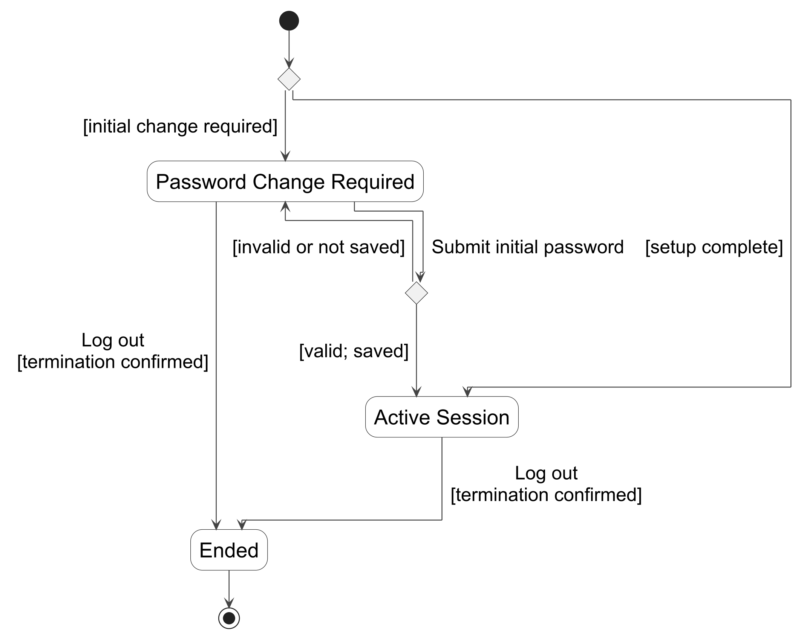

Figure 4.3.1.4.1. Authenticated Session State Machine Diagram.

SRS 3.2.1-3.2.4: this session begins only after successful credential, availability and portal/workspace verification. Setup access permits the initial password change only. Ordinary password changes retain the current scoped session; role, workspace and object permissions are rechecked per protected request. A failed password save preserves the setup restriction. Unconfirmed logout clears local access, offers retry and does not claim server termination. The final node ends this session, not the account or retained business history. Technical session expiry/recovery policy is not invented here.

## 3.2 Customer and Workspace Management

SRS reference: 3.3.1-3.3.4. Platform Admin provisions one workspace per enterprise and its initial SME Admin. Staff accesses assigned setup metadata only; assignment changes never grant production-data access.

### 3.2.1 Class Diagram

Figure 4.3.2.1.1. Customer and Workspace Management Class Diagram.

### 3.2.2 Sequence Diagrams

Figure 4.3.2.2.1. List, Inspect and Update Administrative Workspace Information Sequence Diagram.

Figure 4.3.2.2.2. Provision Enterprise, Workspace and Initial SME Admin Sequence Diagram.

Figure 4.3.2.2.3. Add or Remove Concurrent Implementation Staff Assignments Sequence Diagram.

## 3.3 Plan and Subscription Management

SRS reference: 3.4.1-3.4.7. Free and Subscription have fixed entitlements. Purchases retain quotes and only verified server-side payment applies rights once. Calendar validity uses Asia/Ho_Chi_Minh, UTC storage and [start, expiry).

### 3.3.1 Class Diagram

Figure 4.3.3.1.1. Plan and Subscription Management Class Diagram.

### 3.3.2 Sequence Diagrams

Figure 4.3.3.2.1. Review and Maintain Plan Offers Sequence Diagram.

Figure 4.3.3.2.2. Grant the Initial Workspace Plan Sequence Diagram.

Figure 4.3.3.2.3. View Subscription and Initiate Purchase or Renewal Sequence Diagram.

Figure 4.3.3.2.4. Verify Payment and Apply One Calendar Entitlement Effect Sequence Diagram.

Figure 4.3.3.2.5. Enforce Expiry at New Operations and Preserve Existing Work Sequence Diagram.

### 3.3.3 Activity Diagrams

Figure 4.3.3.3.1. Subscription Entitlement Lifecycle Activity Diagram.

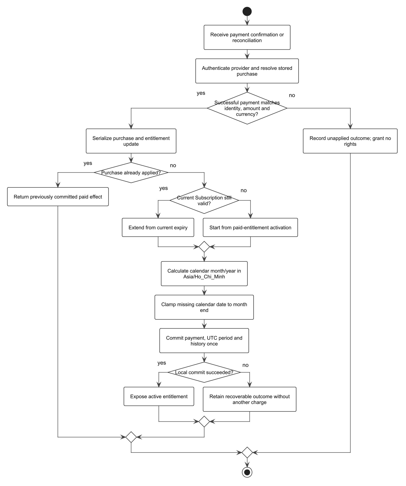

Figure 4.3.3.3.2. Purchase Verification and Local Entitlement Application Activity Diagram.

### 3.3.4 State Machine Diagrams

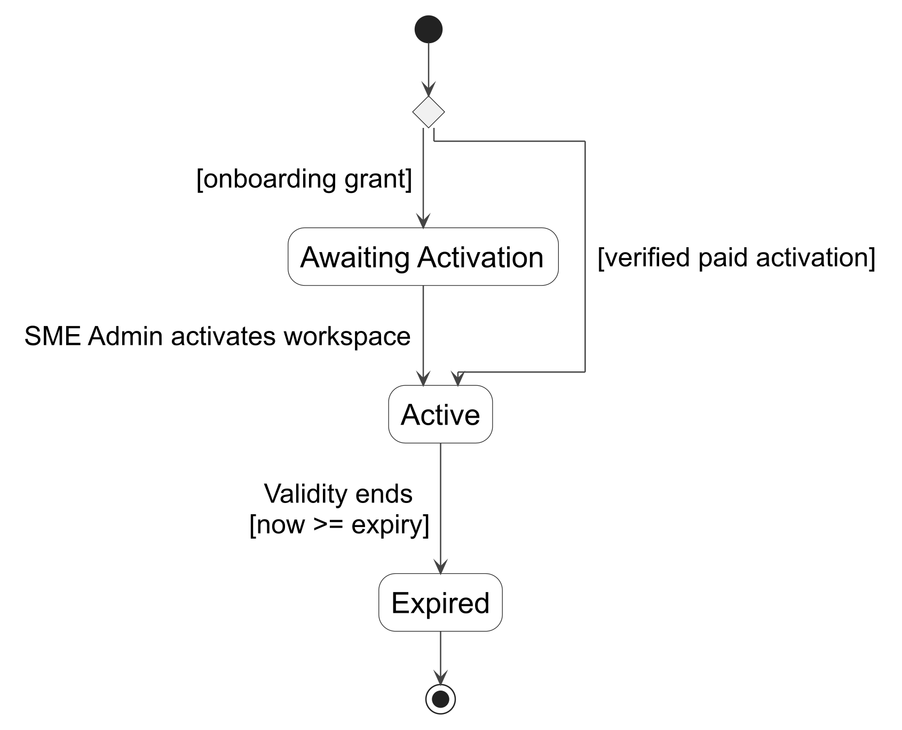

Figure 4.3.3.4.1. Subscription Validity Period State Machine Diagram.

Scope: one continuous Subscription validity period, not the workspace's lifetime or a payment attempt. An initial onboarding grant waits for approved workspace activation; a paid period is created only after verified payment and local entitlement application succeed once. Free has no Subscription period. Active means start <= authoritative time < expiry. A verified renewal before expiry extends the same active period; after expiry it starts a new period, not a transition out of Expired. Calculate calendar months/years in Asia/Ho_Chi_Minh and store instants in UTC. Duplicate payments and repeated workspace activation never extend a period twice. Expiry uses the latest committed validity, keeps accepted transaction context and existing cases/history, and denies new cases. AI failure does not expire Subscription. The final node ends this period; it does not delete history or terminate the workspace.

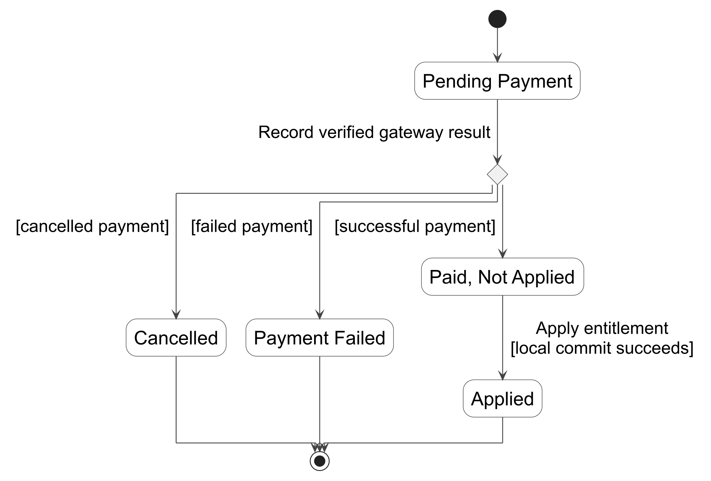

Figure 4.3.3.4.2. Subscription Purchase State Machine Diagram.

SRS 3.4.5-3.4.6: one stored purchase quote for an available offer, owned by SME Admin of an operational workspace. Verify provider identity, purchase/workspace, amount, currency and final status on the server. Pending/unverified/mismatched callbacks do not grant rights or enter a final-result branch; browser redirects are not payment proof. Successful payment with a local application failure remains Paid, Not Applied for reconciliation without another charge. Duplicate/concurrent confirmations have one entitlement effect. Applied ends this purchase's handling; the Subscription validity period is modeled separately. Failed/cancelled checkout grants no rights; safe retry must retain its purchase/payment identity and cannot duplicate an applied effect.

## 3.4 Workspace Onboarding and Activation

SRS reference: 3.5.1-3.5.5. Specifications are retained for human configuration work. Staff readiness, Platform Admin handover approval and SME Admin activation are distinct recorded gates; initial Subscription starts only at activation.

### 3.4.1 Class Diagram

Figure 4.3.4.1.1. Workspace Onboarding and Activation Class Diagram.

### 3.4.2 Sequence Diagrams

Figure 4.3.4.2.1. Maintain Specifications and Track Onboarding Progress Sequence Diagram.

Figure 4.3.4.2.2. Confirm Implementation Readiness Sequence Diagram.

Figure 4.3.4.2.3. Approve or Return Workspace Handover Sequence Diagram.

Figure 4.3.4.2.4. Activate Approved Workspace and Start the Initial Term Once Sequence Diagram.

### 3.4.3 Activity Diagrams

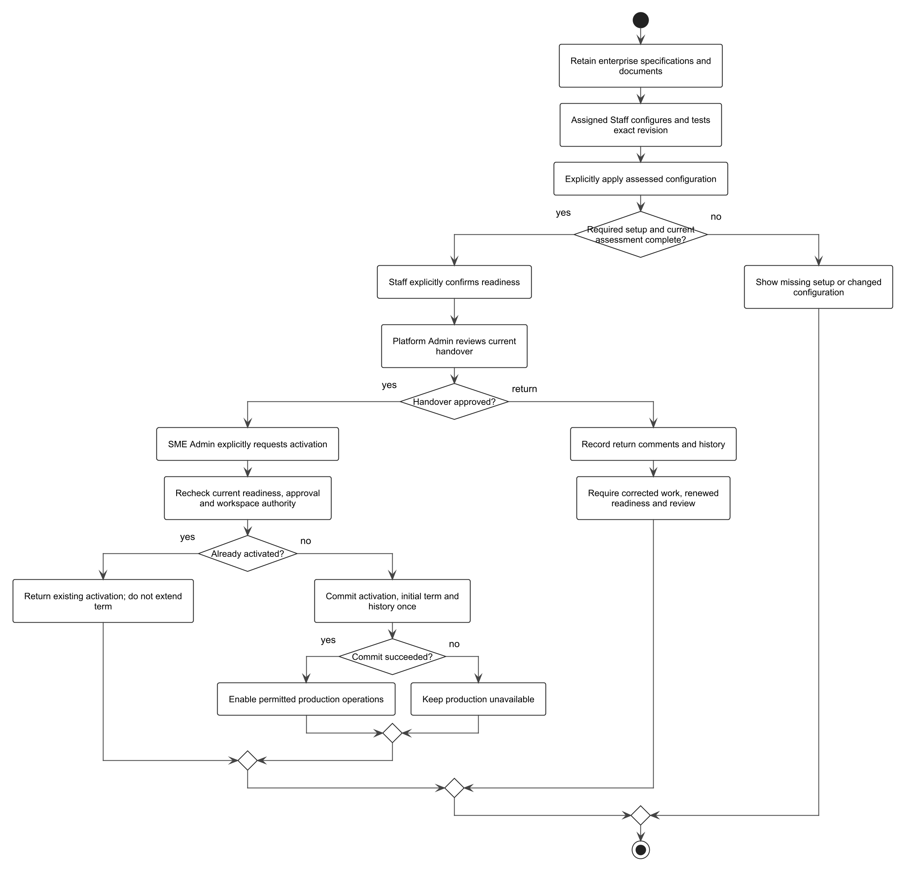

Figure 4.3.4.3.1. Workspace Readiness, Handover and Activation Lifecycle Activity Diagram.

### 3.4.4 State Machine Diagrams

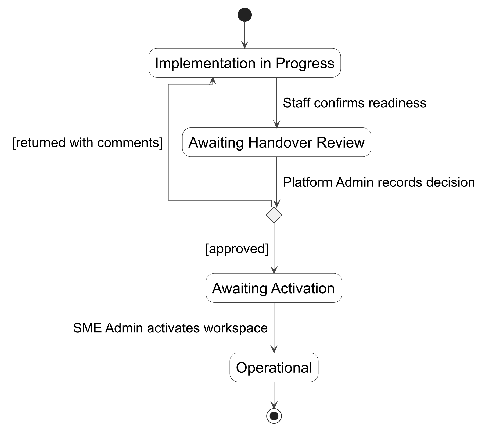

Figure 4.3.4.4.1. Workspace Onboarding State Machine Diagram.

Scope: onboarding of one newly provisioned workspace, ending when it becomes Operational. Platform Admin creates the customer, isolated workspace and initial SME Admin account (SRS 3.3.2); provisioning does not enable production or start an initial Subscription. Specifications, protected onboarding files, Staff assignment, field/mapping/rule configuration and sample testing belong to implementation. Assigned Staff explicitly assesses the current configuration before confirming readiness; test success alone is insufficient. Platform Admin approves current Staff readiness or returns work with required comments. Returned work needs renewed readiness and review. SME Admin activates only with current readiness and approval; activation and the initial entitlement term commit once with history. Missing setup, stale configuration/approval, unauthorized requests or persistence failure leave the last committed stage unchanged. Logical stage labels are design terms, not implemented enums. The final node ends onboarding only; the workspace remains available for ongoing operation and Staff support.

## 3.5 Enterprise Member and Permission Management

SRS reference: 3.6.1-3.6.4. SME Admin manages only own-workspace enterprise accounts and explicit field-view grants. Permission administration does not grant SME Admin plaintext access; history survives role/access changes.

### 3.5.1 Class Diagram

Figure 4.3.5.1.1. Enterprise Member and Permission Management Class Diagram.

### 3.5.2 Sequence Diagrams

Figure 4.3.5.2.1. List, Provision and Update Enterprise Members Sequence Diagram.

Figure 4.3.5.2.2. Grant or Revoke Explicit Sensitive-Field Viewing Permission Sequence Diagram.

## 3.6 Detection Configuration Management

SRS reference: 3.7.1-3.7.8. Assigned Staff edits a versioned candidate containing fields, channel mappings and rules. Testing uses the exact revision and temporary samples; explicit application atomically changes one active version for newly accepted work.

### 3.6.1 Class Diagram

Figure 4.3.6.1.1. Detection Configuration Management Class Diagram.

### 3.6.2 Sequence Diagrams

Figure 4.3.6.2.1. View and Edit Candidate Fields, Mappings and Rules Sequence Diagram.

Figure 4.3.6.2.2. Test an Exact Revision and Review Safe Run History Sequence Diagram.

Figure 4.3.6.2.3. Apply the Tested Candidate Atomically Sequence Diagram.

### 3.6.3 Activity Diagrams

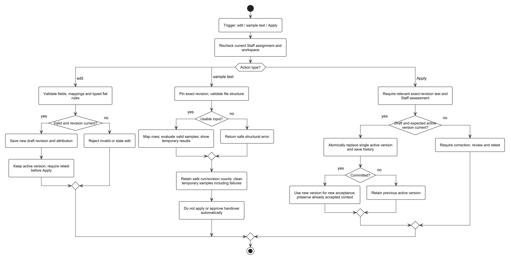

Figure 4.3.6.3.1. Candidate Configuration Testing and Application Lifecycle Activity Diagram.

### 3.6.4 State Machine Diagrams

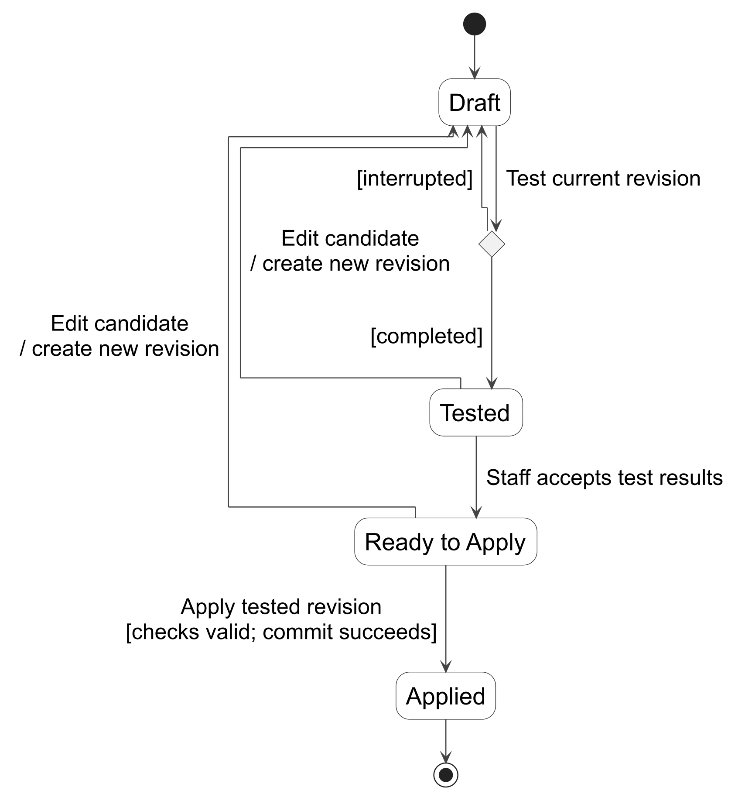

Figure 4.3.6.4.1. Configuration Candidate State Machine Diagram.

SRS 3.7.1-3.7.8: one logical candidate with a current saved revision. A completed test binds to that exact revision and does not imply automatic acceptance; expected sample validation failures alone do not prove a configuration defect. Assigned Staff explicitly assesses suitability. Editing invalidates prior test/assessment applicability and creates a new draft revision. Apply requires complete valid configuration, an exact-revision completed test, Staff assessment and expected active-version checks. Stale/failed application preserves the committed candidate and previous active version; no partial release is exposed. Applied ends this candidate's promotion lifecycle. The applied immutable version and older versions remain traceable, and accepted transactions keep their original plan/configuration. Sample payloads are temporary; only safe test metadata is retained. Logical stages are design labels, not implemented status enums.

## 3.7 Integration and Transaction Ingestion

SRS reference: 3.8.1-3.8.7. Credentials establish integration workspace scope before mapping. REST, Webhook and production file import share normalization and atomic cross-channel business identity. Acceptance is durable and distinct from detection completion.

### 3.7.1 Class Diagram

Figure 4.3.7.1.1. Integration and Transaction Ingestion Class Diagram.

### 3.7.2 Sequence Diagrams

Figure 4.3.7.2.1. Inspect, Issue, Replace and Disable Workspace API Keys Sequence Diagram.

Figure 4.3.7.2.2. Submit Production Transactions through REST API Sequence Diagram.

Figure 4.3.7.2.3. Authenticate Incoming Webhook and Handle Delivery Retries Sequence Diagram.

Figure 4.3.7.2.4. Import Production CSV/Excel with Reconciled Row Outcomes Sequence Diagram.

Figure 4.3.7.2.5. Normalize and Validate Declared Channel Values Sequence Diagram.

Figure 4.3.7.2.6. Atomically Resolve Cross-Channel Business Identity and Accept Once Sequence Diagram.

### 3.7.3 Activity Diagrams

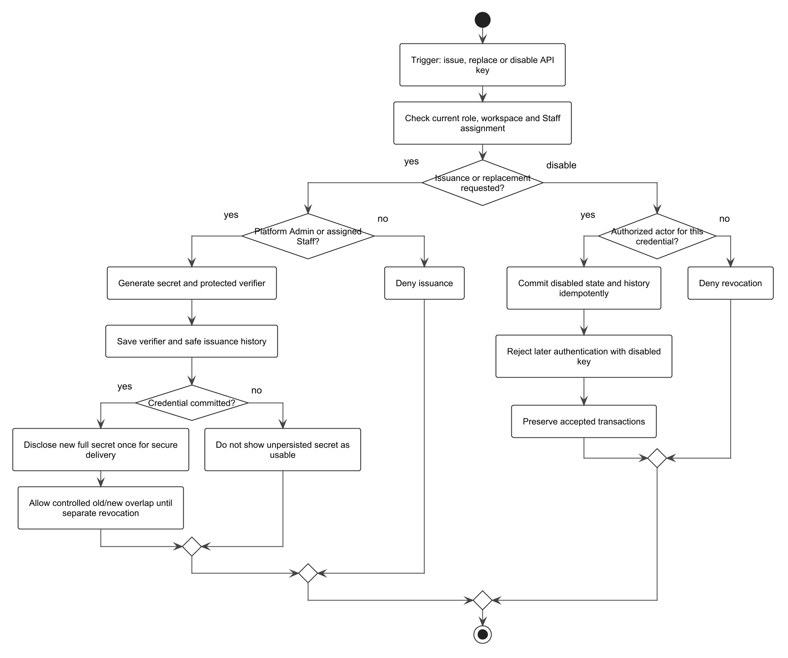

Figure 4.3.7.3.1. Workspace API Credential Lifecycle Activity Diagram.

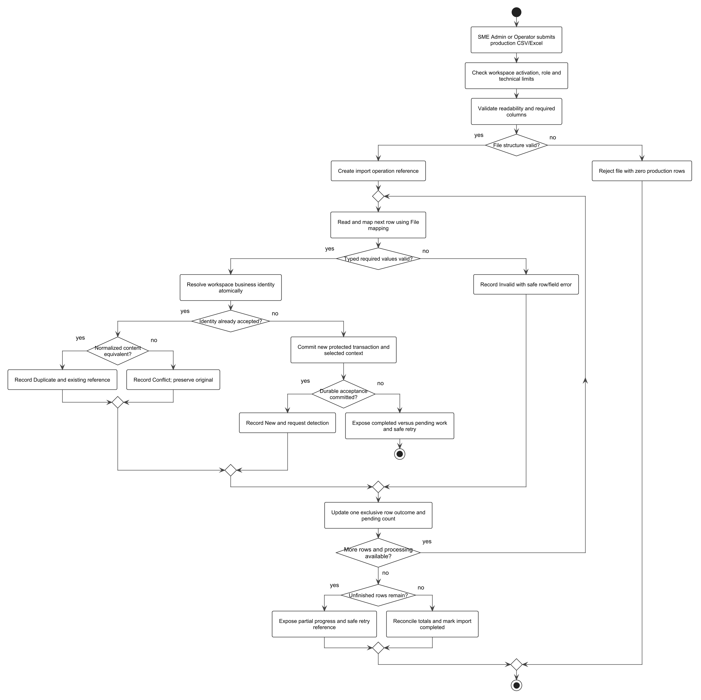

Figure 4.3.7.3.2. Production Import Processing Lifecycle Activity Diagram.

### 3.7.4 State Machine Diagrams

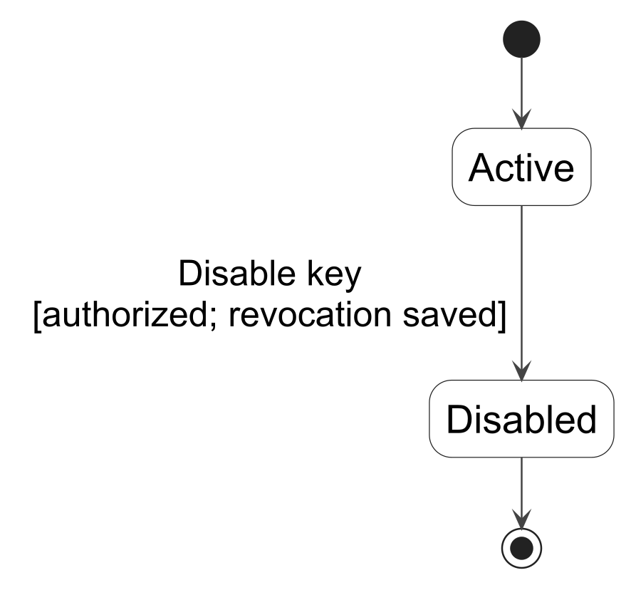

Figure 4.3.7.4.1. Workspace API Credential State Machine Diagram.

SRS 3.8.1-3.8.3: one persisted workspace-bound submission key, issued by Platform Admin or assigned Staff. Disclose its secret once, keep verification material and safe metadata, and do not provide later plaintext retrieval. Replacement creates another key; the old key stays Active until explicitly disabled. Platform Admin, assigned Staff or own-workspace SME Admin may disable the key. Failed revocation leaves the persisted availability unchanged; repeated disable returns the existing result. Subsequent disabled-key authentication fails while accepted transactions and administrative history remain. The final node ends usable-key handling, not metadata retention.

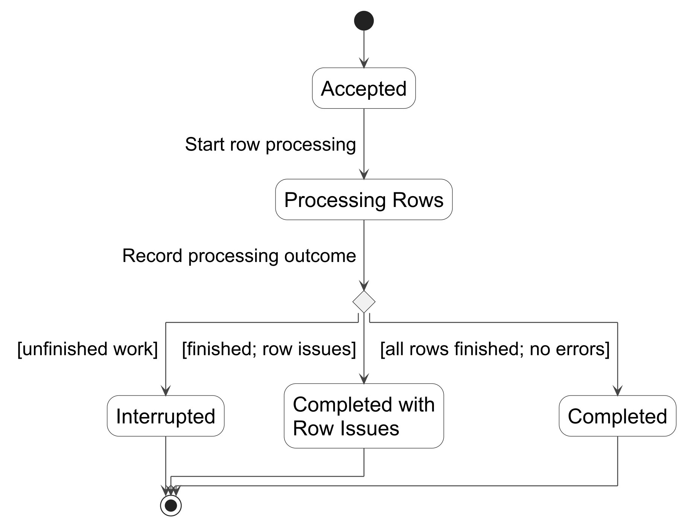

Figure 4.3.7.4.2. Production Import Batch State Machine Diagram.

SRS 3.8.6-3.8.7: one import run starts after SME Admin/Operator authorization, workspace activation and supported-file/required-column validation. Structurally rejected files never reach row processing or create production rows. CSV and Excel share the approved file mapping. Classify each row as accepted, duplicate, conflicting or invalid; totals reconcile without double counting. Process independent valid rows and send newly accepted transactions into detection. Completed means all rows were handled without invalid/conflicting rows; duplicates remain distinct from newly accepted rows. Row processing completion is not a claim that asynchronous detection has finished. Interrupted runs expose finished versus unfinished work. A controlled retry uses retained progress and workspace transaction identity rather than accepting completed rows twice. Final nodes end this processing run's outcome, not the retained batch reference, row summaries or accepted transactions. Safe result access never reveals unauthorized plaintext.

## 3.8 Rule-Based Detection

SRS reference: 3.9.1-3.9.2. Free primary detection and Subscription fallback evaluate the selected configuration with the same typed semantics. All matching rules form one Rule Alert for the completed attempt; no match is distinct from failure.

### 3.8.1 Class Diagram

Figure 4.3.8.1.1. Rule-Based Detection Class Diagram.

### 3.8.2 Sequence Diagrams

Figure 4.3.8.2.1. Evaluate All Enabled Rules and Create One Aggregated Alert Sequence Diagram.

## 3.9 AI Detection and Rule-Based Fallback

SRS reference: 3.10.1-3.10.3. Subscription primary processing calls AI only. Unusable AI responses trigger rules and retain both attempt sources. Recovery reuses the transaction, checks historical event-time entitlement and preserves earlier alerts and cases.

### 3.9.1 Class Diagram

Figure 4.3.9.1.1. AI Detection and Rule-Based Fallback Class Diagram.

### 3.9.2 Sequence Diagrams

Figure 4.3.9.2.1. Classify Subscription Transaction and Fall Back on Unusable AI Sequence Diagram.

Figure 4.3.9.2.2. Recover Historically Eligible Fallback Work and Reconcile AI Alerts Sequence Diagram.

### 3.9.3 Activity Diagrams

Figure 4.3.9.3.1. Transaction Detection and Rule-Based Fallback Processing Activity Diagram.

Figure 4.3.9.3.2. Historically Entitled AI Recovery Processing Activity Diagram.

### 3.9.4 State Machine Diagrams

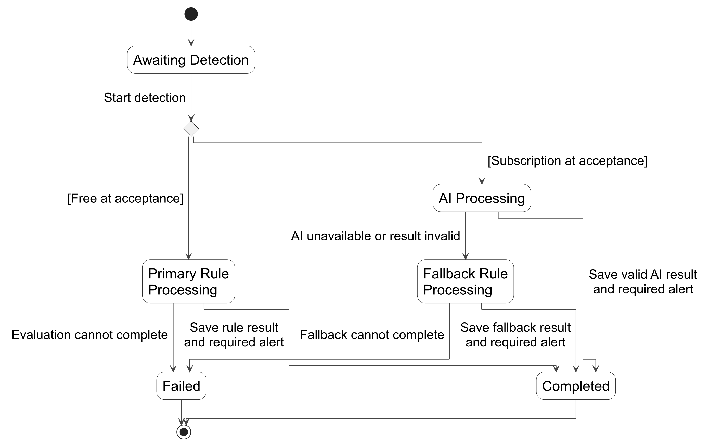

Figure 4.3.9.4.1. Initial Transaction Detection State Machine Diagram.

SRS 3.9.1-3.10.2: one accepted transaction's initial detection operation, not a single immutable detection-attempt record. Keep acceptance-time plan/configuration and record AI, primary-rule and fallback attempts with their own sources/versions. Ordinary Subscription processing does not run AI and rules simultaneously. Normal/Anomaly and rule match/no-match are outcomes, not lifecycle states. A required alert means an AI Alert for Anomaly or one aggregated Rule Alert for matching rules; normal/no-match creates no such alert. A late AI response must not overwrite completed fallback history. Failure is not fabricated Normal/no-match, and AI failure does not remove Subscription. Final nodes complete the initial operation. Later recovery is a separate operation on the same stored transaction; it preserves the original outcomes. Existing transaction/attempt identities govern safe repetition.

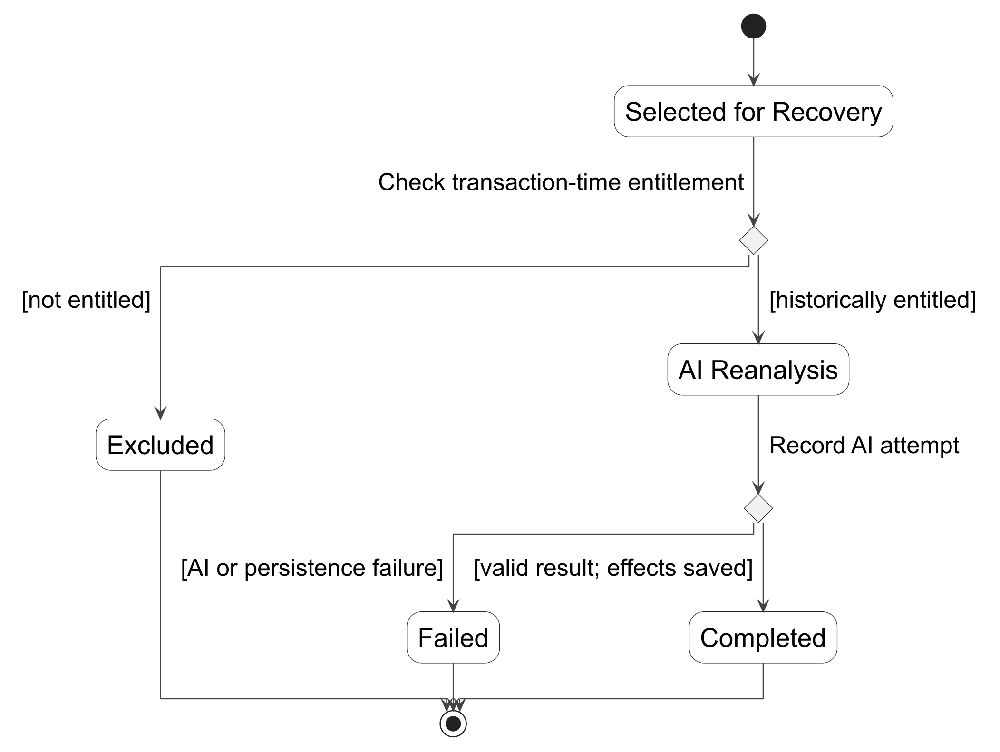

Figure 4.3.9.4.2. AI Recovery Operation State Machine Diagram.

SRS 3.10.3: one recovery operation for an existing fallback-processed transaction. Eligibility uses the transaction event time and historical Subscription validity, even if the current plan expired. Recovery is not new ingestion and cannot open a case automatically. Store a separate attempt/model version, preserve prior fallback and Rule Alert history, and reconcile effects idempotently. Anomaly creates/reuses the transaction's single AI Alert; a later Normal result never deletes an existing alert or case. Repeated execution of the same operation must not duplicate effects. Failed means this operation cannot complete; a later controlled recovery operation keeps its own identity/history instead of rewriting this outcome. Excluded ends selection without AI execution. No timeout, retry schedule or external wire schema is invented.

## 3.10 Transaction and Alert Review

SRS reference: 3.11.1-3.11.6. Operator reviews workspace production transactions, alerts and attempt history. Import results have separate SME Admin/Operator scope. Explicit reveal requires current field grants and, for Investigator, the relevant case assignment.

### 3.10.1 Class Diagram

Figure 4.3.10.1.1. Transaction and Alert Review Class Diagram.

### 3.10.2 Sequence Diagrams

Figure 4.3.10.2.1. Review Transactions and Role-Scoped Import Results Sequence Diagram.

Figure 4.3.10.2.2. Review Rule/AI Alerts, Follow-Up Flags and Attempt History Sequence Diagram.

Figure 4.3.10.2.3. Explicitly Reveal Only Currently Authorized Sensitive Fields Sequence Diagram.

## 3.11 Case and Investigation Management

SRS reference: 3.12.1-3.12.7. Only Operator opens cases from same-workspace AI Alerts under current Subscription. Assignment is separate from lifecycle. Existing case work continues after expiry; Operator may investigate, submit and confirm without a second person.

### 3.11.1 Class Diagram

Figure 4.3.11.1.1. Case and Investigation Management Class Diagram.

### 3.11.2 Sequence Diagrams

Figure 4.3.11.2.1. Open One Case from Eligible AI Alert References Sequence Diagram.

Figure 4.3.11.2.2. View Cases and Assign or Start Self-Investigation Sequence Diagram.

Figure 4.3.11.2.3. Record Findings and Submit an Investigation Report Sequence Diagram.

Figure 4.3.11.2.4. Request Additional Investigation or Confirm the Final Conclusion Sequence Diagram.

### 3.11.3 Activity Diagrams

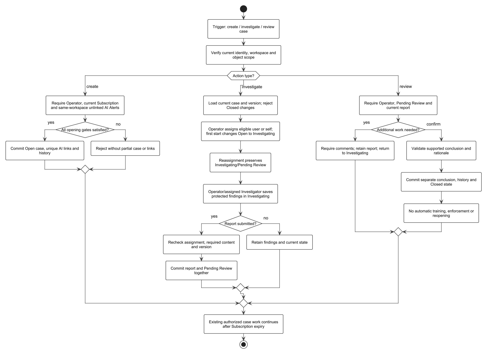

Figure 4.3.11.3.1. Investigation Case Lifecycle Activity Diagram.

### 3.11.4 State Machine Diagrams

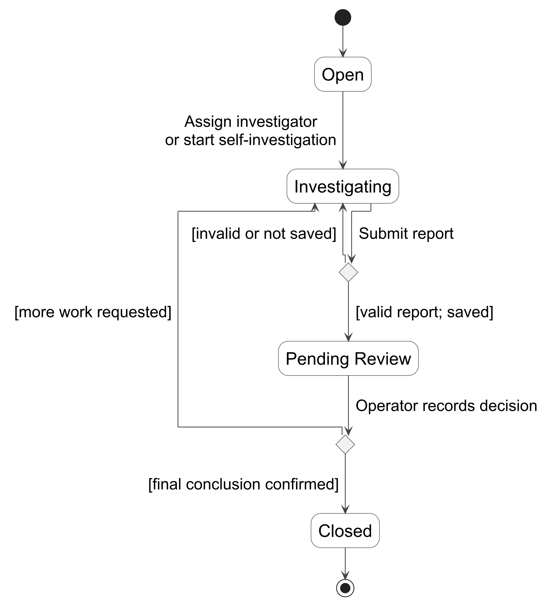

Figure 4.3.11.4.1. Investigation Case State Machine Diagram.

Operator creates an Open case under active Subscription, using eligible, unlinked same-workspace AI Alerts. Operator may assign an eligible Investigator or investigate personally. Operator investigating directly or assigned Investigator submits findings, evidence and a proposed conclusion. Recheck content, assignment and version, then commit report/status/history together. Invalid or failed submissions keep Investigating. Only Operator requests more work with comments or confirms a supported conclusion with its rationale. Invalid review actions or failed persistence keep Pending Review. Findings and reassignment retain current status and attribution; a second reviewer is not required. Conclusion is separate from Closed: Confirmed Fraud, Anomalous but Legitimate, False Alert or Insufficient Evidence. Existing cases survive Subscription expiry. The final node completes handling, retaining history without reopening, automatic AI training or customer-system enforcement.

## 3.12 Dashboard and Reporting

SRS reference: 3.13.1-3.13.4. Aggregates, reports and exports preserve workspace, role, assignment and field restrictions. Generation and download each recheck access; plaintext reveal does not authorize plaintext export.

### 3.12.1 Class Diagram

Figure 4.3.12.1.1. Dashboard and Reporting Class Diagram.

### 3.12.2 Sequence Diagrams

Figure 4.3.12.2.1. View Authorized Dashboard and Investigation Reports Sequence Diagram.

Figure 4.3.12.2.2. Generate and Export a Complete Authorized Enterprise Report Sequence Diagram.

### 3.12.3 Activity Diagrams

Figure 4.3.12.3.1. Enterprise Report Generation Lifecycle Activity Diagram.

### 3.12.4 State Machine Diagrams

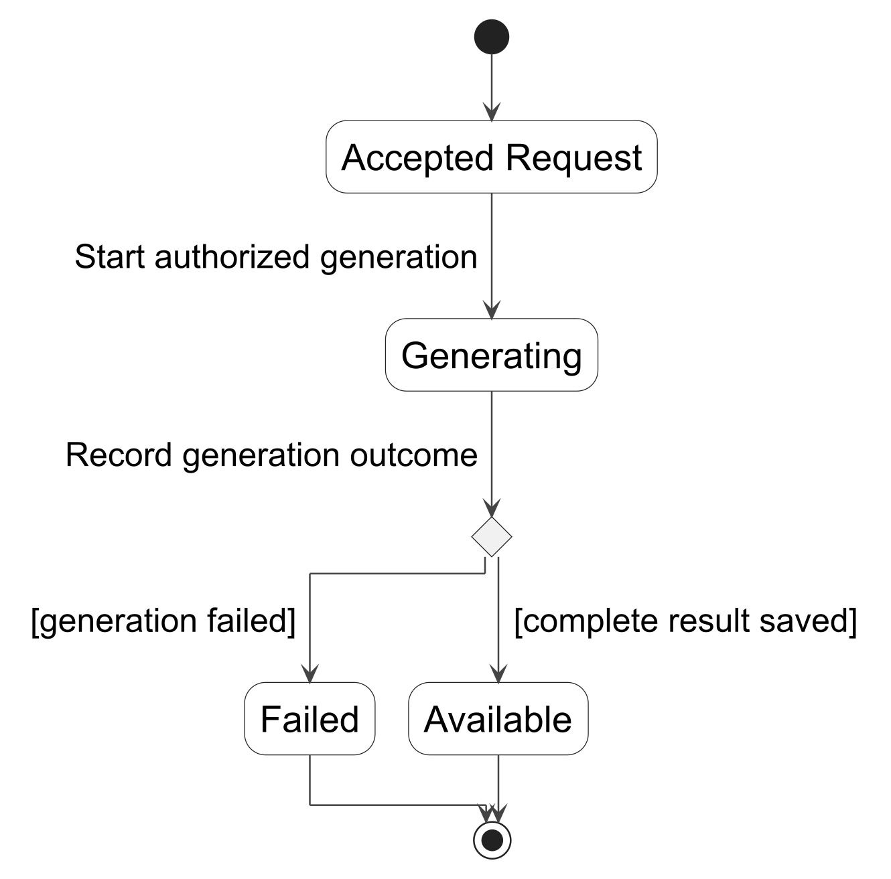

Figure 4.3.12.4.1. Enterprise Report Generation State Machine Diagram.

SRS 3.13.3-3.13.4: one report-generation operation, accepted after scope and filter validation. Available means a complete authorized result, including a valid empty report when nothing matches. Failed/incomplete output is not labeled successful. Apply role, workspace and sensitive-field policy during generation. Recheck access when reading/downloading/exporting the result; availability is not blanket authorization or plaintext permission. Export safely handles cell/text values and reports generation/transfer failures separately. Exporting or viewing does not add another report lifecycle state. Final nodes complete generation handling, not result retention or access checks. A new request has its own operation reference; no unconfirmed export formats, columns, retention policy or reporting tier are introduced.

## 3.13 Notifications

SRS reference: 3.14.1-3.14.2. Relevant enterprise events produce minimal in-app/email content. Recipients and linked records remain scoped; external delivery is retried independently and never reverses or repeats the committed business effect.

### 3.13.1 Class Diagram

Figure 4.3.13.1.1. Notifications Class Diagram.

### 3.13.2 Sequence Diagrams

Figure 4.3.13.2.1. Create and View Relevant In-App Notifications Sequence Diagram.

Figure 4.3.13.2.2. Send Minimal Email and Retry Delivery Independently Sequence Diagram.

### 3.13.4 State Machine Diagrams

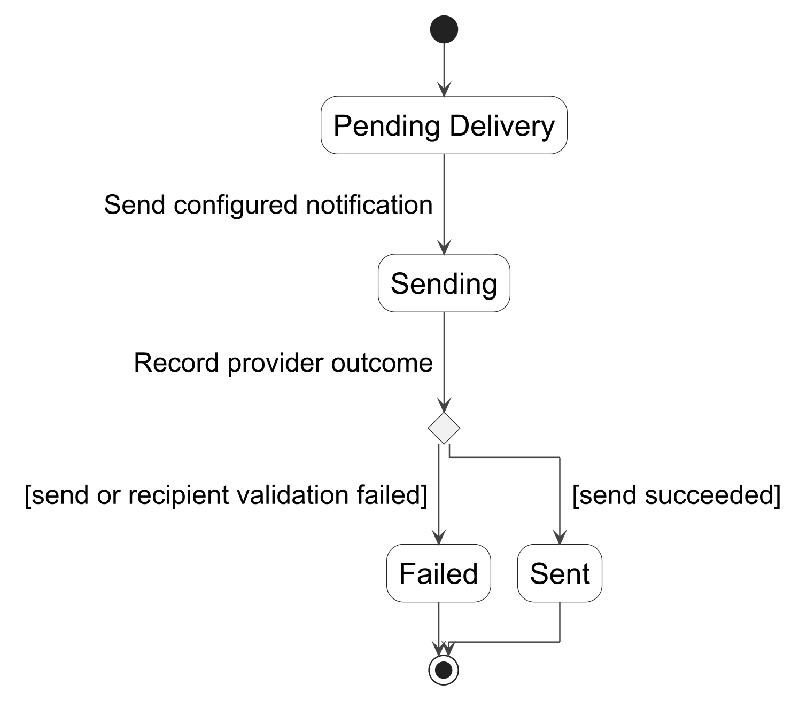

Figure 4.3.13.4.1. Email Delivery Attempt State Machine Diagram.

SRS 3.14.2 and CR-15: one notification delivery attempt for a relevant committed business event. Resolve the authorized recipient's separately stored configured contact, use a minimal safe template and authenticate protected target links. Internal login identifiers are not assumed to be email addresses. Sent records a successful send outcome, not proof that a person read the message. Missing/invalid contact, unavailable provider, unauthorized recipient or sensitive content prevents successful delivery. Recipient/content validation occurs before disclosure; failures may be recorded without making a provider call. Failure is independent from committed case/payment/detection effects. A controlled retry has separate attempt metadata and must not repeat the business event. Final nodes end this delivery attempt while retaining safe outcome/retry references; vendor and retry scheduling remain unspecified.

## 3.14 Platform Monitoring and Audit

SRS reference: 3.15.1-3.15.2. Platform Admin sees operational metadata only. Object history follows the underlying administrative, Staff-assignment or enterprise/case scope. Required local change history commits with the business action and excludes values/secrets.

### 3.14.1 Class Diagram

Figure 4.3.14.1.1. Platform Monitoring and Audit Class Diagram.

### 3.14.2 Sequence Diagrams

Figure 4.3.14.2.1. Monitor Platform Operations without Production Content Sequence Diagram.

Figure 4.3.14.2.2. Commit Required Audit Attribution and Read Scoped Object History Sequence Diagram.
