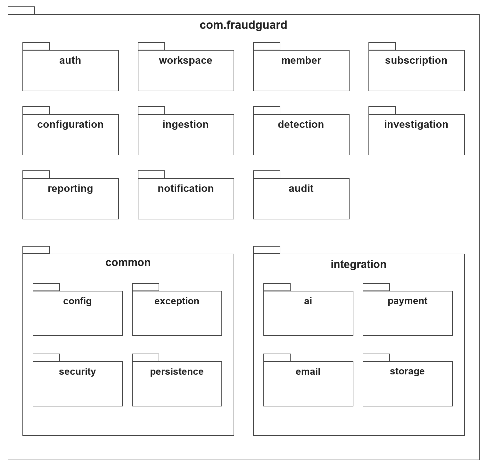
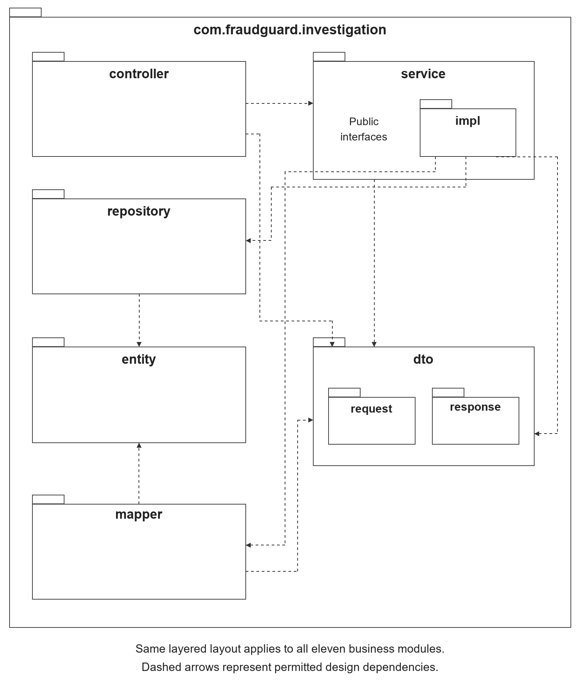

# 1.2 Package Diagram

The backend is organized as one Spring Boot monolith under com.fraudguard. Eleven business modules are accompanied by common infrastructure and external integration adapters. The packages below reflect the current codebase scaffold; business implementations are added in later development.

Figure 4.1.2.1. Backend Package Overview.

Each business module follows the layered structure below. Dashed arrows show permitted design dependencies, not implemented runtime calls. Other modules access service interfaces and DTOs; repositories, entities, mappers and service implementations remain private to their owning module. AI training remains outside this backend.

Figure 4.1.2.2. Layered Package Structure within a Business Module.
