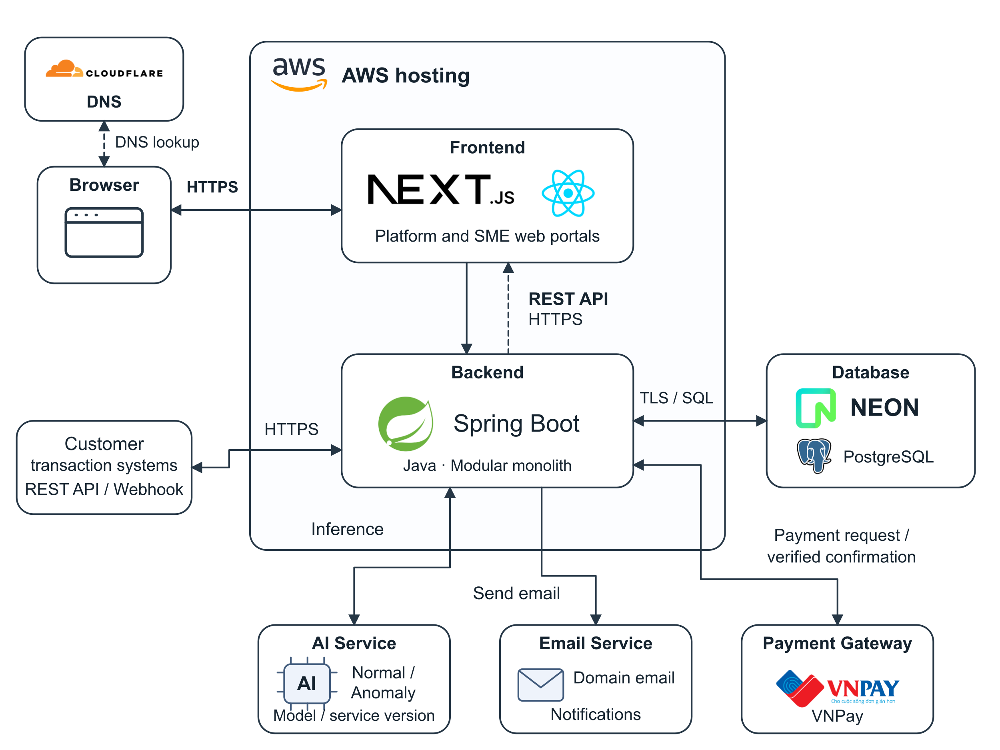

# 1.1 System Architecture

SME-FraudGuard hosts its Next.js/React web portals and Spring Boot modular-monolith backend on AWS. Cloudflare DNS resolves application domain names, while HTTPS carries web and API traffic. The backend uses Neon-hosted PostgreSQL and connects to the AI service, VNPay and a domain-email service. Customer systems submit through REST API or incoming Webhook; SME Admin and Operator upload production CSV/Excel files through the SME portal.

The backend enforces authentication and role-, workspace- and object-based authorization. Portal display state and client-supplied workspace identifiers do not establish permission. Platform Admin and assigned Staff operate on permitted setup/administrative metadata without access to enterprise production transactions or investigation reports.

Figure 4.1. SME-FraudGuard system architecture.

The backend coordinates onboarding, API keys, ingestion, mapping and validation, rule evaluation, detection, alerts, case investigation, reporting, notifications and subscription/payment workflows. These are logical responsibilities within one backend; internal calls respect module API boundaries and do not require independently deployed services.

Neon-hosted PostgreSQL retains workspace-scoped business records, applicable configuration, detection attempts and audit history. Accepted transactions survive downstream processing failure. Workspace-scoped business identifiers and atomic acceptance prevent duplicate initial effects across retries and channels.

The AI adapter validates Normal/Anomaly results and the returned model/service version. Free Plan transactions use rules; active Subscription transactions use AI with rule fallback for unavailable or unusable AI responses. Detection source and history remain available for authorized review. After recovery, a fallback transaction whose event time belongs to a valid Subscription period remains eligible for AI reanalysis even if the current plan has expired; the new-case gate still applies.

The VNPay integration verifies server-side payment confirmations and applies each matching purchase once. Only SME Admin purchases or renews an enterprise subscription. Domain email supports notifications; external delivery failure must not reverse a committed business outcome or grant permissions. Generic AI and email symbols identify functional services rather than specific AI or email vendors.

Sensitive fields remain protected in ordinary responses, reports and exports. Plaintext disclosure requires an explicit authorized Operator or assigned Investigator action and a safe audit record. Temporary onboarding samples remain separate from production data and retained onboarding documents.
