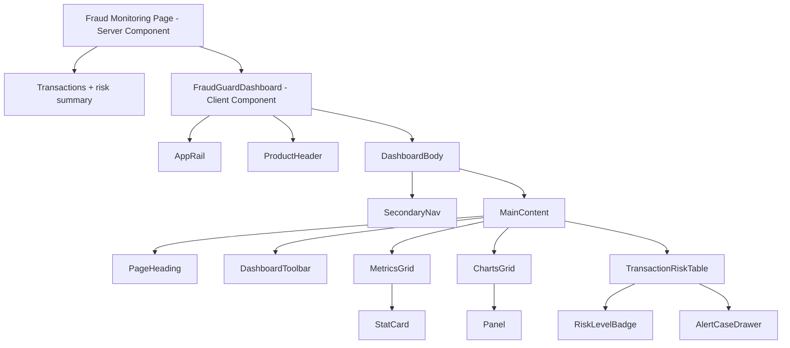
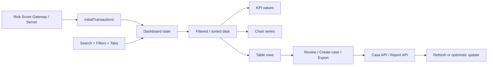

# FraudGuard Dashboard UI System Specification

> HISTORICAL REFERENCE — The current standard is [UI_RULES.md](UI_RULES.md). Some roles, risk scores, quotas and flows in this document are outdated. Do not use it to decide business scope or override UI_RULES.md.

> Current font, dimension and component standards: [DESIGN_SYSTEM.md](DESIGN_SYSTEM.md).

**Version:** 1.1 — updated 16/10/2026\
**Scope:** Multi-tenant SaaS detecting abnormal transactions for SMEs\
**Target tech stack:** React, Next.js App Router, TypeScript, CSS Modules\
**Related documents:** `FRAUDGUARD_DASHBOARD_UI_GUIDE_NEXTJS.md`, `FraudGuard-as-a-Service` proposal

## Current standard 1.1 (takes precedence over conflicting baseline 1.0 content)

### Business rules and data scope

- Do not display or calculate risk scores/risk points/score thresholds. Outcomes are Normal, Abnormal, Undetermined; evaluation errors are separate processing states.
- One matching applicable rule is enough for Abnormal. Display matched/evaluated rule counts and evidence; do not automatically block accounts or cancel transactions.
- Each enterprise has one rule set with multiple versions and a scope spanning multiple projects. Flow: draft → test → review → release → activate → hand over. SMEs see only the handed-over version, not drafts or internal review notes.
- Platform Admin administers the platform, tracks progress and assigns work. Deployment Staff configure/test/release for assigned enterprises. SME Admin manages the enterprise side; Operation handles cases; Investigator works on assigned cases; Viewer only views.
- Dashboards, alerts, cases, reports, filters, drawers and exports must use the same enterprise scope. Do not use all transactions to calculate SME KPIs. The real backend must still check permissions independently.
- The demo user selector is named “Switch demo account” and includes the name, role and enterprise/scope. Two accounts with the same role are not two different roles.

### Layout and components

- Desktop uses the unified LCS sidebar; below 900px, replace it with a mobile-menu button rather than simply hiding it. The menu uses the same permission list as desktop, indicates the current page and closes after navigation.
- Default controls are 40px; mobile minimum is 44px. Compact 34px controls require a density-related reason and still need larger mobile touch targets. An 18px checkbox sits within a sufficiently large interactive label; do not stretch the checkbox graphic to button height.
- Panel radius 5px; controls 4px; badges 3px. Prefer spacing 4/8/12/16/20/24/28/32px. The 14px gap in baseline examples is a historical exception, not a new standard.
- KPIs use responsive grids; avoid inline column counts that disable breakpoints. Cases may use auto-fit 180px, 2 columns on mobile and 1 below 420px.
- CTAs use `--action-bg: #2563eb` and `--action-text: #ffffff`; do not use white text on the bright blue link color in the dark theme.
- States use theme-specific semantic text/bg/border tokens. Do not hard-code yellow #ffd700 for text on light backgrounds. Metadata must be readable at a minimum of 11px; light subtle text uses #64748b.
- Modals/drawers: accessible title, aria-modal, initial focus, Tab/Shift+Tab trapping, Escape and focus restoration to the opener. Use the shared `useDialogFocus`. Explicitly preserve unsaved data or confirm discarding it according to the flow.
- Provide route loading/error/retry, clear empty states and action feedback. Do not create fake loading for synchronous local work.
- The “Detection source distribution” chart shows AI/Rule/Fallback counts/proportions; do not call proportions confidence or accuracy.
- SMEs see business labels first, with technical information in integration/evidence details. Do not mistranslate or rename user-defined rules.
- Login may have its own layout, but action colors use shared tokens. Features without a backend must be clearly marked demo/unsupported; nonfunctional links must not pretend a feature exists.

### Status of the baseline content below

Chapters 1–19 below are retained as references for structure and 1.0 design examples. **Risk scores, thresholds, SME rule-editing rights, Platform Admin rule implementation and old rail/subnav content have been superseded by section 1.1 above.** Do not use those business/code examples as current implementation requirements. Accessibility, data and typography rules that remain appropriate still apply.

---

## 1. UI system goals

This document is the shared standard for designers and frontend developers building FraudGuard. The interface serves four user groups: Platform Admin, SME Admin, Risk/Operation Staff and Viewer/Auditor.

- Color, typography, spacing, dimensions and states.
- Overall dashboard structure.
- Specifications for each component and contracts between components.
- Data, table and chart presentation rules.
- Responsive, loading, error and empty-state behavior.
- Accessibility rules and acceptance criteria.

Experience goals:

1. Users identify high-risk transactions, alerts and cases requiring action within seconds.
2. Users move from overview to transactions, evidence and cases in at most three actions.
3. Filters and navigation states are always easy to recognize.
4. High data density does not obscure visual hierarchy.
5. The interface works reliably from mobile to large desktop screens.
6. Each result clearly displays scoring source `AI`, `RULE` or `RULE_FALLBACK`.
7. The UI maintains human oversight: no automatic transaction cancellation or account blocking.

### Standard business scope

| Domain | UI content |
|---|---|
| Multi-tenancy | Workspace, project, member, role, plan, quota and tenant isolation |
| Onboarding | Draft, Reviewing, Confirmed, Active states; confirmed specifications and custom fields |
| Ingestion | REST API, CSV/Excel, validation result, idempotency and processing status |
| Scoring | Risk score 0–100, risk level, confidence, scoring source, explanation |
| Rule Engine | Conditions, AND/OR groups, risk point, threshold, enable/disable, history |
| Alert & Case | Alerts exceeding thresholds, assignment, notes, timeline and human conclusions |
| Reporting | Dashboard, filters, CSV/PDF export and audit trail |
| Platform health | Backend, AI Service, queue, database, errors and fallback usage |

---

## 2. Design principles

| ID | Principle | Application rule |
|---|---|---|
| DG-01 | Data first | KPIs, risks and security findings appear before lengthy explanations. |
| DG-02 | Meaningful color | Red only for Critical/error, orange for High/warning, green for success/healthy, blue for action/navigation. |
| DG-03 | Hierarchy through brightness | The overall background is darkest, panels one level brighter, and controls brighter than panels during interaction. |
| DG-04 | Controlled density | Tables and charts may be information-dense; spacing and borders must clearly group content. |
| DG-05 | Transparent states | Every filter, tab, loading, empty and error state must be clearly expressed. |
| DG-06 | Progressive disclosure | Dashboards show the overview first; details open through drawers, modals or separate pages. |
| DG-07 | Task-based responsive behavior | On mobile, retain important actions; hide or group secondary navigation. |
| DG-08 | Accessible by default | Do not use color as the only signal; every control works with a keyboard. |
| DG-09 | Consistency over decoration | Use tokens, shared components and existing patterns instead of unique styles per screen. |
| DG-10 | Fast feedback | Local interactions respond immediately; server actions have loading and success/error feedback. |

---

## 3. UI architecture



Data flow:



---

## 3.1 FraudGuard information architecture

| Navigation | Proposed route | Content | Actor |
|---|---|---|---|
| Overview | `/fraud-monitoring` | KPI, risk distribution, trend, scoring source, open alert/case | SME Admin, Risk Staff, Viewer |
| Transactions | `/transactions` | Transaction list, validation status and scoring result | SME Admin, Risk Staff, Viewer |
| Alerts | `/alerts` | Alerts exceeding thresholds and evidence | SME Admin, Risk Staff, Viewer |
| Cases | `/cases` | Assignment, notes, timeline and conclusions | SME Admin, Risk Staff, Viewer read-only |
| Rules | `/rules` | Rule template, conditions, point, threshold, publish history | SME Admin, Platform/Technical Staff |
| Projects | `/projects` | Project, specification, custom field, API key, quota | SME Admin |
| Reports | `/reports` | CSV/PDF export within permission scope | SME Admin, Risk Staff, Viewer |
| Platform | `/platform` | SME account, plan, usage, health and global audit | Platform Admin |

### Minimum permission matrix

| Capability | Platform Admin | SME Admin | Risk Staff | Viewer/Auditor |
|---|:---:|:---:|:---:|:---:|
| View the assigned tenant's dashboard | Within support scope | Yes | Yes | Yes |
| Manage workspace/project/member | Support | Yes | No | No |
| Create/regenerate/revoke API keys | Within support scope | Yes | No | No |
| Adjust permitted rule parameters | Create/initial configuration | Yes | No | No |
| View transactions, scores, explanations | Within support scope | Yes | Yes | Yes |
| Create and assign cases | Within support scope | Yes | Yes | No |
| Update case status and notes | Not by default | As permitted | Yes | No |
| View audit logs | System-wide | Within tenant | As permitted | Read-only |
| Manage plans/quotas/platform health | Yes | View usage/plan only | No | No |

The backend remains the final authority for access control. Hiding frontend buttons serves user experience only and does not replace server-side authorization.

### Scoring result display contract

Each transaction detail must display:

| Field | UI requirement |
|---|---|
| Risk score | Value 0–100, prominent but not used as a fraud conclusion |
| Risk level | Low, Medium, High or Critical with a semantic badge |
| Scoring source | AI, RULE or RULE_FALLBACK; fallback must be emphasized |
| Confidence | Display only when returned by AI; do not simulate it for rule results |
| Evidence | Triggered rules if rule-based; explanation/evidence if AI-based |
| Model/service version | Display in metadata when source is AI |
| Decision time | Timestamp and timezone |
| Alert/case | Link to the alert/case if created |
| Human conclusion | Confirmed Fraud, False Alarm or Resolved, updated by Risk Staff |

### Free and Subscription plans

| Content | Free Plan | Subscription Plan |
|---|---|---|
| Primary scoring | Dynamic Rule Engine | AI Risk Scoring |
| Evidence | Triggered rules | Confidence + explanation/evidence |
| When AI is unavailable | Not applicable | Use the Rule Engine and label `RULE_FALLBACK` |
| Risk Score Gateway | Yes | Yes |
| Alert/case | Yes | Yes |
| Human oversight | Required | Required |

The UI must not make fallback results look like AI results. When AI Service fails, the Platform Admin dashboard must display a health warning and fallback count; the SME Portal only needs clear scoring-source information on transactions/alerts.

### Traceability to functional requirements

| UI capability | Proposal requirement | Frontend components |
|---|---|---|
| Tenant/project-scoped navigation | FR-AUTH-04, FR-ORG-01, FR-ORG-02 | Workspace switcher, route guards, project filter |
| Plan, quota and usage | FR-ORG-03, FR-ORG-04, FR-ORG-06 | Usage card, plan badge, quota progress |
| API key management | FR-INT-01, FR-INT-02, FR-INT-03 | Masked key list, create/regenerate/revoke dialog |
| Specification onboarding | FR-INT-04 through FR-INT-08 | Onboarding stepper and status badge |
| Transaction list/detail | FR-TXN-06, FR-TXN-08 | TransactionRiskTable, transaction drawer |
| Rule configuration | FR-RULE-01 through FR-RULE-09 | Rule list, rule editor, version/history view |
| AI result and fallback | FR-AI-01 through FR-AI-08 | ScoringSourceBadge, confidence, explanation, fallback callout |
| Risk decision | FR-SCORE-01 through FR-SCORE-06 | Score display, threshold marker, risk-level badge |
| Alert/case investigation | FR-CASE-01 through FR-CASE-05 | Alert list, case drawer, assignment, notes, timeline |
| Dashboard filters | FR-DASH-01 through FR-DASH-03 | DashboardToolbar, KPI, charts, evidence panel |
| Export | FR-REPORT-01 | Export dialog and job status |
| Notification settings | FR-NOTI-01 | Channel configuration and delivery status |
| Audit trail | FR-AUDIT-01 | Audit table and entity timeline |
| Platform monitoring | FR-MON-01 | Service health, queue status and error summary |

---

## 4. Layout specification

### 4.1 Layout regions

| Region | Position | Desktop | Tablet | Mobile | Behavior |
|---|---|---:|---:|---:|---|
| App Rail | Fixed left | 56 px | 56 px | 44 px | Always visible; icons and avatar only. |
| Product Header | Top of workspace | 60 px | 60 px | Minimum 60 px | Sticky; may wrap to two rows on mobile. |
| Secondary Nav | Left of content | 200 px | 175 px | Hidden | Sticky relative to the viewport. |
| Main Content | Right of subnav | Fluid | Fluid | Fluid | `min-width: 0`; maximum 1900 px. |
| Page Padding | Around content | 28 px | 18 px | 14 px | Decreases at breakpoints. |
| Content Gap | Between panels | 14 px | 12–14 px | 12 px | No smaller than 8 px. |

### 4.2 Grid

| Area | Desktop | Tablet | Mobile |
|---|---|---|---|
| KPI cards | 4 equal columns | 4 columns or 2×2 | 2 columns; 1 column below 420 px |
| Primary charts | `1.65fr / 1fr` | `1.3fr / 1fr` | 1 column |
| Secondary charts | `1.65fr / 1fr` | `1.3fr / 1fr` | 1 column |
| Transaction/alert detail | Drawer 420–520 px | Drawer 400 px | Full-screen sheet |
| Table | Full width | Full width | Horizontal scrolling or card list |

### 4.3 Breakpoints

| Token | Value | Purpose |
|---|---:|---|
| `--bp-wide` | 1550 px | Increase chart height and breathing room. |
| `--bp-desktop` | 1150 px | Compact subnav and header gap. |
| `--bp-tablet` | 900 px | Hide secondary navigation. |
| `--bp-mobile` | 680 px | Switch charts to one column and wrap the header. |
| `--bp-small` | 420 px | KPIs become one column when content is long. |

---

## 5. Design tokens

### 5.1 Color tokens

| Token | Value | Role | Do not use for |
|---|---|---|---|
| `--security-bg` | `#17181c` | Application background | Cards or inputs |
| `--security-header` | `#1f2025` | Header | Hover states |
| `--security-panel` | `#202126` | Panels, secondary nav | Primary CTAs |
| `--security-panel-hover` | `#292c35` | Row/card hover | Default background |
| `--security-control` | `#292a32` | Inputs, selects, secondary buttons | Large panels |
| `--security-rail` | `#252130` | Icon rail | Main content |
| `--security-border` | `#35363e` | Default borders | Focus rings |
| `--security-text` | `#e5e5ec` | Primary text | Disabled text |
| `--security-muted` | `#9799a7` | Descriptions, metadata | Main headings |
| `--security-blue` | `#71b9f4` | Navigation, links, focus | Risk levels |
| `--security-purple` | `#ad8af3` | Product accent, Medium | Success |
| `--security-green` | `#78c9ac` | Healthy, resolved | General navigation |
| `--security-orange` | `#eda765` | High, warning | Primary CTAs |
| `--security-red` | `#ed6775` | Critical, error | Decoration |

### 5.2 Risk-level tokens

| Risk level | Text | Background | Border | Priority |
|---|---|---|---|---:|
| Critical | `#f68992` | `#512d35` | `#7b3d46` | 1 |
| High | `#efb485` | `#443328` | `#715139` | 2 |
| Medium | `#c5a7f9` | `#372e49` | `#5c4778` | 3 |
| Low | `#8cd5bc` | `#263c36` | `#3f665a` | 4 |

Always display risk levels with text. Do not use a lone colored dot to represent risk levels.

### 5.3 Typography

| Style | Font size | Line height | Weight | Usage |
|---|---:|---:|---:|---|
| Display | 31 px | 1.1 | 600 | KPI values |
| Page title | 26 px | 1.2 | 600 | Page headings |
| Section title | 16 px | 1.35 | 600 | Panel-group headings |
| Panel title | 13 px | 1.4 | 600 | In-card headings |
| Body | 14 px | 1.5 | 400 | Basic content |
| Control | 12 px | 1.4 | 400–500 | Inputs, tabs, selects |
| Metadata | 11 px | 1.5 | 400 | Descriptions, timestamps |
| Label | 10–11 px | 1.4 | 500–600 | Badges, table headings |

Typography rules:

- Only KPIs may use sizes of 30 px or larger.
- Do not uppercase entire headings.
- Uppercase is only for section labels, eyebrows and short badges.
- Important metadata must not be smaller than 11 px.
- Use `font-variant-numeric: tabular-nums` for numbers that need column comparison.

### 5.4 Spacing scale

| Token | Value | Use case |
|---|---:|---|
| `space-1` | 4 px | Small icon–label gap |
| `space-2` | 8 px | Gaps between controls |
| `space-3` | 12 px | Gaps between KPI cards |
| `space-4` | 16 px | Small-card padding |
| `space-5` | 20 px | Small-section spacing |
| `space-6` | 24 px | Toolbar and section spacing |
| `space-7` | 28 px | Desktop page padding |
| `space-8` | 32 px | Large-group spacing |
| `space-10` | 40 px | Separation of special content areas |

Use only multiples of 4 px, except for technical dimensions such as 1 px borders or a 56 px rail.

### 5.5 Borders, radius and elevation

| Element | Border | Radius | Shadow |
|---|---|---:|---|
| Panel | `1px solid --security-border` | 5 px | None |
| Control | `1px solid --security-border-strong` | 4 px | None |
| Badge | Border based on risk level/source | 3 px | None |
| Modal / Drawer | Border strong | 8 px | `0 24px 80px #0009` |
| Tooltip | Border strong | 4 px | `0 8px 24px #0007` |
| Active sidebar item | No additional outer border | 4 px | Inset 2 px accent |

---

## 6. Component inventory

| ID | Component | Role | Main inputs | Main states | Output / Event |
|---|---|---|---|---|---|
| C-01 | `FraudGuardDashboard` | Coordinate state and layout | `initialTransactions`, `initialSummary` | filters, activeView, selectedTransaction | Pass props to child components |
| C-02 | `AppRail` | Application-level navigation | items, activeItem, user | default, hover, active | `onNavigate` |
| C-03 | `ProductHeader` | Module name and top-level tabs | title, tabs, activeTab | active, sticky | `onTabChange`, `onSettings` |
| C-04 | `SecondaryNav` | In-module navigation | sections, activeItem, status | default, active, hidden | `onItemChange` |
| C-05 | `PageHeading` | Breadcrumb, title, description | breadcrumb, title, description, badge | static | None |
| C-06 | `DashboardToolbar` | Filters, time range, export | project, type, risk, source, case status | idle, dirty, loading | `onFilterChange`, `onExport` |
| C-07 | `StatCard` | Display KPIs | label, value, description, tone, trend | loading, ready | Optional `onClick` |
| C-08 | `Panel` | Standard container | title, description, action, children | loading, error, ready | None |
| C-09 | `ChartLegend` | Chart legend | items | default | Optional `onToggleSeries` |
| C-10 | `RiskLevelBadge` | Indicate Low/Medium/High/Critical | riskLevel | default | None |
| C-11 | `ScoringSourceBadge` | Distinguish AI, RULE, RULE_FALLBACK | scoringSource | default, fallback | None |
| C-12 | `SegmentedTabs` | Switch data groups | items, value | default, hover, active | `onValueChange` |
| C-13 | `TransactionRiskTable` | List scored transactions | data, columns, sort, pagination | loading, ready, empty, error | sort, paginate, review |
| C-14 | `AlertCaseDrawer` | Transaction, evidence, alert and case | transaction, alert, case, open | open, closed, mutating | create case, assign, update status |
| C-15 | `SearchInput` | Search the dataset | value, placeholder | default, focus, filled | `onChange`, `onClear` |
| C-16 | `SelectControl` | Select a single filter | value, options | default, open, disabled | `onChange` |
| C-17 | `Toast` | Brief feedback | tone, message | entering, visible, leaving | auto close |
| C-18 | `EmptyState` | No data | title, description, action | static | Optional action |
| C-19 | `ErrorState` | Data loading error | title, detail | static | `onRetry` |
| C-20 | `Skeleton` | Waiting state | variant, dimensions | animated / reduced motion | None |

---

## 7. Component specifications

### C-01 — FraudGuardDashboard

| Property | Specification |
|---|---|
| Type | Client Component |
| Responsibilities | Hold interactive state, calculate derived data, coordinate drawers and toasts. |
| Not responsible for | Fetching secrets client-side, rendering each chart's details, defining its own colors. |
| State | `filters`, `activeView`, `selectedTransaction`, `drawerOpen`. |
| Derived state | `visibleTransactions`, KPIs, grouped data, chart series. |
| Performance | Use `useMemo` for aggregation; `useDeferredValue` or debounce for search. |
| URL sync | Synchronize filters with search params when filtering server-side. |

### C-02 — AppRail

| Property | Specification |
|---|---|
| Dimensions | 56 px desktop; 44 px mobile. |
| Position | Fixed left, with `z-index` above the header. |
| Item | Icon button 38×38 px; minimum click target 36×36 px. |
| Active | Dark purple background, white icon. |
| Tooltip | Required when the rail displays icons only. |
| Keyboard | Tab in top-to-bottom order. |
| Mobile | Retain main routes; move secondary items to an overflow menu. |

### C-03 — ProductHeader

| Property | Specification |
|---|---|
| Height | 60 px desktop. |
| Position | Sticky top 0. |
| Content | Product name, primary tabs, settings/actions. |
| Active tab | White text and 3 px blue underline. |
| Mobile | Product name and actions on the first row; tabs on the second. |
| Overflow | Horizontal tab scrolling when space is insufficient. |

### C-04 — SecondaryNav

| Property | Specification |
|---|---|
| Width | 200 px desktop, 175 px tablet. |
| Active item | Dark blue background, light blue text, 2 px inset line. |
| Secondary content | Health status and documentation links at the bottom. |
| Small tablet | Hidden below 900 px. |
| Mobile replacement | Sheet or menu opened from the header. |

### C-06 — DashboardToolbar

| Property | Specification |
|---|---|
| Control | Project, transaction type, risk level, scoring source, case status, time range, search, refresh, export. |
| Height | At least 34 px desktop; 40–44 px on mobile for frequent touch use. |
| Filter changes | Update data immediately, or debounce when calling an API. |
| Refresh | Show a loading indicator; do not clear current data during refetch. |
| Export | Export the filtered dataset; show file-generation status. |
| Mobile | Wrap into multiple rows; search may take the full width. |

### C-07 — StatCard

| Property | Type | Required | Default | Description |
|---|---|---:|---|---|
| `label` | `string` | Yes | — | KPI name. |
| `value` | `number \| string` | Yes | — | Main value. |
| `description` | `string` | Yes | — | Context for the value. |
| `tone` | `default \| critical \| warning \| success` | No | `default` | Semantic color. |
| `trend` | `{ value: number; direction: "up" \| "down" }` | No | — | Comparison with the previous period. |
| `loading` | `boolean` | No | `false` | Show a skeleton. |
| `onClick` | `() => void` | No | — | Only when the card supports drill-down. |

Rules:

- `value` is always the most prominent area.
- Do not use red for a downward trend when a decrease is positive.
- Trends must include “compared with the previous period”.
- If a card is clickable, render it as `<button>` or `<a>`, rather than attaching clicks to `<div>`.

### C-08 — Panel

| Property | Specification |
|---|---|
| Header | Title on the left; action or info on the right. |
| Description | At most two lines. |
| Padding | 16–18 px desktop; 14–16 px mobile. |
| Min width | `0` to avoid breaking CSS Grid. |
| Loading | Preserve expected dimensions to avoid layout shift. |
| Error | Show the error within the panel, rather than a full-page error if other panels remain usable. |

### C-10 — RiskLevelBadge

| Property | Specification |
|---|---|
| Content | Full risk-level name returned by the Risk Score Gateway. |
| Font size | 10–11 px, weight 600. |
| Padding | 3 px vertically, 6 px horizontally. |
| Radius | 3 px. |
| Sorting | Critical → High → Medium → Low. |
| Accessibility | Text is required; color is only a supplementary signal. |

### C-12 — SegmentedTabs

| State | Description |
|---|---|
| Default | Muted text, transparent bottom border. |
| Hover | Brighter text. |
| Active | Blue text, 2 px blue bottom border. |
| Focus | Blue outer focus ring. |
| Disabled | Reduced opacity; no clicks accepted. |

Use ARIA tabs when tabs change content within the same page. For route changes, use `Link` and active state based on pathname.

### C-13 — TransactionRiskTable

| Property | Specification |
|---|---|
| Header | Sticky if the table exceeds the viewport height. |
| Row height | 48–58 px by default; 36–44 px in compact mode. |
| Cell padding | 13 px vertically, 17 px horizontally. |
| Sorting | Sortable columns have an icon and `aria-sort`. |
| Pagination | Server pagination when total data is large. |
| Selection | Checkboxes appear only if batch actions exist. |
| Row action | Button or menu in the last column. |
| Empty | One row with `colSpan` covering the entire table. |
| Mobile | Horizontal scrolling; pin the name column if needed. |

Proposed column order:

| # | Column | Content | Sortable | Mobile priority |
|---:|---|---|---:|---:|
| 1 | Risk | Risk level badge | Yes | High |
| 2 | Transaction | Reference + masked/hashed entity | Yes | High |
| 3 | Project / Type | Project and transaction type | Yes | High |
| 4 | Score | Risk score 0–100 | Yes | High |
| 5 | Source | AI, RULE or RULE_FALLBACK | Yes | High |
| 6 | Processed at | Timestamp | Yes | Low |
| 7 | Action | Review/menu | No | High |

### C-14 — AlertCaseDrawer

| Property | Specification |
|---|---|
| Desktop width | 420–520 px. |
| Mobile | Full-screen sheet. |
| Content | Transaction, risk score, level, source, confidence, triggered rules or AI explanation, alert and case timeline. |
| Primary action | Create case, assign, add note or update case status. |
| Focus | Focus trap; initial focus on the heading or close button. |
| Close | Close button, Escape and backdrop click if there is no unsaved data. |
| Mutation | Disable actions and show loading while sending the request. Do not provide auto-block or auto-cancel. |

---

## 8. Interaction guidelines

### 8.1 Navigation

- The rail is for top-level system modules.
- Header tabs are for main views within a module.
- Secondary nav is for subsections in the current view.
- Breadcrumbs indicate location only; do not repeat all navigation.
- Only one item is active at each level.

### 8.2 Filter

- Apply filters immediately on selection for local data.
- For APIs, debounce search `250–400ms`; selects may call immediately.
- Active filters must be reflected in the URL when users need to share the view.
- Provide a “Clear filters” button when at least one filter differs from its default.
- Result counts update with the dataset; do not use stale counts.
- Filter changes reset pagination to the first page.

### 8.3 Sorting

- The first click uses the order most useful to the business.
- Default risk-level order: Critical → High → Medium → Low.
- Default date order: newest first.
- Sortable headers must have an up/down indicator and `aria-sort`.

### 8.4 Feedback

| Task | Feedback |
|---|---|
| Change local filters | Immediate update, no toast. |
| Refetch | Small spinner on the refresh button; retain old data. |
| Export | Button loading → toast with file link/name on completion. |
| Update case status | Update after server confirmation; toast states the new status. |
| Mutation error | Keep the drawer open; show an error near the action. |
| Copy value | Brief “Copied” toast. |

### 8.5 Motion

- Hover/focus transition: `120–180ms`.
- Drawer/modal transition: `180–240ms`.
- Do not animate KPI values from 0 on every filter change.
- Respect `prefers-reduced-motion`.
- Do not use looping motion except skeleton loading.

---

## 9. Data visualization guidelines

### 9.1 Choosing chart types

| Question | Suitable chart |
|---|---|
| How do transactions/alerts change over time? | Line chart or area chart. |
| How do transactions progress from ingestion to alert/case? | Funnel or staged flow. |
| What are the case proportions by conclusion? | Donut or stacked bar. |
| Which projects/transaction types have the most alerts? | Horizontal bar or ranked list. |
| What is the risk-level distribution? | Stacked bar or histogram. |
| What are the AI/RULE/RULE_FALLBACK proportions? | Stacked bar or donut with at most three segments. |
| Multiple series over time? | At most 3–5 lines; use filters for more. |

### 9.2 Chart rules

- Charts always have a title and units.
- Legend order matches series order on the chart.
- Tooltips show time, value, unit and series name.
- Axes and grid lines have lower contrast than data lines.
- Do not use 3D effects.
- Do not use pie/donut charts with more than five segments.
- Charts must have their own empty state.
- Important data needs an equivalent text or table representation.
- Critical always uses the same color across charts, badges and KPIs.
- Scoring sources use colors distinct from risk levels to avoid confusion: purple for AI, blue for RULE, orange for RULE_FALLBACK.

### 9.3 Chart palette

| Series | Color |
|---|---|
| Critical | `#ed6775` |
| High | `#eda765` |
| Medium | `#ad8af3` |
| Low / Healthy | `#78c9ac` |
| Production | `#399d9c` |
| Default branch | `#78c9ac` |
| Neutral comparison | `#718096` |

---

## 10. Content guidelines

### 10.1 Naming

| Element | Rule | Good example |
|---|---|---|
| Page title | Noun or short noun phrase | `Transaction risk overview` |
| KPI | Name the exact metric | `High-risk transactions` |
| Button | Verb + object | `Export transactions` |
| Empty state title | State the situation | `No matching transactions` |
| Error title | State the failed task | `Unable to load transactions` |
| Tooltip | Explain the effect | `Refresh data` |

### 10.2 Numbers and time

- Use the user's locale to display dates and numbers.
- Detailed timestamps appear in tooltips or drawers.
- Tables may show `17/09/2026`; tooltips show the time and timezone as well.
- Large numbers use thousands separators.
- Percentages use at most one decimal place unless business requirements specify otherwise.
- Always state the comparison period: “down 18% compared with the previous 30 days”.

### 10.3 Language

- Choose one primary UI language.
- Avoid machine-translating technical terms if it may cause confusion: API, risk score, scoring source, rule fallback, webhook.
- If using Vietnamese, keep terminology consistent throughout the system.
- Avoid mixing English `Open` with Vietnamese “Processed” within the same state group.

---

## 11. UI states matrix

| Component | Loading | Empty | Error | Disabled | Success |
|---|---|---|---|---|---|
| KPI grid | 4-card skeleton | Value `0` with a description | Inline alert above the grid | — | Render metrics |
| Chart panel | Skeleton preserving height | Icon + “No data yet” | Inline retry | Control disabled | Render chart |
| Table | 6–8 skeleton rows | Empty row + clear filter | Panel error + retry | Action disabled | Rows + count |
| Filter | Retain values | — | Do not reset selections | Disabled when options are unavailable | Applied state |
| Export | Spinner in button | Disabled if 0 records | Toast or inline error | Disabled while running | Toast + file |
| Drawer | Detail skeleton | Transaction/alert does not exist | Error + close/retry | Mutation button disabled | Data detail |
| Mutation | Button loading | — | Inline message | Prevent double submit | Toast + updated UI |

### 11.1 Loading pattern

- Initial load: skeleton for the entire region.
- Refetch: retain old data and show an “updating” state.
- Do not replace the entire page with a centered spinner.
- Skeletons should approximate actual content dimensions to reduce layout shift.

### 11.2 Empty state pattern

| Cause | Content | Action |
|---|---|---|
| The system has no data yet | “No security data yet” | “Connect a data source” |
| Filters return no results | “No matching results” | “Clear filters” |
| Search returns no results | Show the search keyword | “Clear search” |
| No open alerts | Positive message | “View all transactions” |

### 11.3 Error pattern

- Use full-page errors only when the route cannot function.
- An error in one panel must not block the others.
- User messages are short and provide a clear action.
- Technical logs belong in the observability system; do not display stack traces.

---

## 12. Accessibility specification

| ID | Requirement | How to check |
|---|---|---|
| A11Y-01 | Every feature works with a keyboard | Navigate the entire page using only Tab/Shift+Tab/Enter/Escape. |
| A11Y-02 | Focus rings are always visible | Check focus on dark backgrounds and panels. |
| A11Y-03 | Icon buttons have accessible names | Inspect the Accessibility Tree or use a screen reader. |
| A11Y-04 | Inputs/selects have labels | `getByRole`/`getByLabel` can find the control. |
| A11Y-05 | Risk levels do not rely on color alone | Badges always have text. |
| A11Y-06 | Modals trap focus | Tab does not escape to the background while a modal is open. |
| A11Y-07 | Tables have correct headers | `<th scope="col">`; sortable headers use `aria-sort`. |
| A11Y-08 | Correct tab semantics | `tablist`, `tab`, `tabpanel`, `aria-selected`. |
| A11Y-09 | Charts have descriptions | `aria-label`, caption or data table. |
| A11Y-10 | Motion can be reduced | Check `prefers-reduced-motion`. |

Contrast targets:

- Normal text: at least 4.5:1.
- Large or bold text: at least 3:1.
- Control boundaries and focus indicators: at least 3:1 against adjacent backgrounds.

---

## 13. Responsive behavior specification

### Large desktop — above 1550 px

- Main content may increase padding to 32–36 px.
- Chart height is 250–280 px.
- Tables retain default density; do not stretch rows.
- Content does not exceed `1900px`.

### Desktop — 901 to 1550 px

- Show the full rail, secondary nav and 4 KPIs.
- Primary charts and grouped lists use two columns.
- The header does not wrap when there is enough room.

### Tablet — 681 to 900 px

- Hide secondary nav.
- Provide a button opening secondary navigation as a sheet if that navigation is needed.
- Charts may retain two columns if each panel has at least 260 px.
- Tables scroll horizontally.

### Mobile — at most 680 px

- Header wraps to two rows.
- Rail shrinks to 44 px or becomes bottom navigation for mobile-first applications.
- KPIs use 2 columns; below 420 px, switch to 1 column when labels are long.
- Charts use one column.
- Toolbar wraps; search uses full width.
- Transaction/alert details use a full-screen sheet.
- Do not hide important actions merely because space is limited; use an overflow menu.

---

## 14. Component API conventions

### Naming

- Boolean props start with `is`, `has`, `can` or a clear noun: `isLoading`, `hasError`, `canResolve`.
- Event callbacks start with `on`: `onFilterChange`, `onInspect`, `onResolve`.
- Do not use vague props such as `data1`, `type2`, `flag`.
- Public components must export their props interface.

### Controlled components

Filters, tabs, dialogs and pagination should use controlled props:

```ts
interface SelectControlProps<T extends string> {
  value: T;
  options: Array<{ label: string; value: T }>;
  onChange: (value: T) => void;
  disabled?: boolean;
}
```

### Styling

- Components do not create colors outside tokens except for chart data series.
- Allow `className` for parent-controlled layout; do not let parents modify child internals.
- Do not pass arbitrary CSS strings through props.
- Variants use union types: `tone="critical"`, rather than `red={true}`.

---

## 15. State ownership

| State | Owner | Stored in URL? | Stored on server? |
|---|---|---:|---:|
| Active product tab | Route/layout | Yes | No |
| Secondary nav item | Route or dashboard | Yes, if an independent view | No |
| Search query | Dashboard/page | Yes | No |
| Project/type/risk/source/case status | Dashboard/page | Yes | No |
| Time range | Dashboard/page | Yes | May store as a preference |
| Table sort/page | Dashboard/page | Yes | No |
| Selected transaction/alert | Dashboard | May use a route segment | No |
| Drawer open | Dashboard | Not required | No |
| Compact mode | User preference | No | Local storage or profile |
| Alert/case status | Backend | No | Yes |
| Toast visibility | Toast provider | No | No |

Principle: state that affects a shareable URL belongs in search params; temporary UI state such as drawers/toasts stays local.

---

## 16. Suggested Next.js boundaries

| File / Component | Server or Client | Reason |
|---|---|---|
| `app/fraud-monitoring/page.tsx` | Server | Fetch transactions/summary and check tenant/project. |
| `app/fraud-monitoring/loading.tsx` | Server-compatible | Route-streaming fallback. |
| `app/fraud-monitoring/error.tsx` | Client | Error boundary with a retry button. |
| `FraudGuardDashboard.tsx` | Client | Filters, tabs, selected transaction. |
| `StatCard.tsx` | Server-compatible | Presentational; may render on either side. |
| `RiskLevelBadge.tsx` | Server-compatible | Presentational. |
| `TransactionRiskTable.tsx` | Client | Sorting, pagination and review actions. |
| `AlertCaseDrawer.tsx` | Client | Open/close, focus management, case mutation. |
| `TransactionRiskTrend.tsx` | Client | Chart libraries usually need browser APIs. |
| `route.ts` / Server Action | Server | Mutations, exports and API calls requiring secrets. |

Keep Client Component boundaries small. Do not add `"use client"` to markup-only components that need no hooks or browser APIs.

---

## 17. Performance guidelines

| Issue | Rule |
|---|---|
| Large dataset | Server-side filtering, sorting and pagination. |
| Search | Debounce or `useDeferredValue`. |
| Aggregation | Calculate on the server or with `useMemo`. |
| Chart library | Dynamic import for heavy charts below the fold. |
| Table exceeding 500 rows | Pagination or virtualization. |
| Refetch | Retain old data; avoid full-screen flicker. |
| Icons | Import specific icons, not the entire package namespace. |
| Images | Use `next/image` for raster assets; prefer SVG components for icons. |
| Layout shift | Skeletons preserve chart/card dimensions. |
| Re-render | Memoize column definitions and derived arrays when needed. |

---

## 18. Test specification

### Unit / component tests

| ID | Test case | Expected result |
|---|---|---|
| T-01 | Render `RiskLevelBadge` for every risk level | Correct text and variant class. |
| T-02 | Search by transaction reference/entity | Only matching rows remain. |
| T-03 | Filter by project/risk/source | Only matching transactions appear. |
| T-04 | Switch status tabs | Dataset and `aria-selected` update. |
| T-05 | Empty dataset | Empty state with correct `colSpan`. |
| T-06 | Sort by risk level | Order Critical → High → Medium → Low. |
| T-07 | Open transaction details | Drawer shows the correct score, source and evidence. |
| T-08 | API mutation fails | Drawer stays open and displays an error. |

### End-to-end tests

| ID | Flow |
|---|---|
| E2E-01 | Open dashboard → filter project + Critical → review alert → create case → update to Reviewing. |
| E2E-02 | Search with no results → clear search → data returns. |
| E2E-03 | Set filters → reload → filters restored from URL. |
| E2E-04 | Export after filtering → file contains only current results. |
| E2E-05 | Navigate the entire dashboard by keyboard. |
| E2E-06 | No page-wide horizontal scrolling in the mobile viewport. |

### Visual regression viewports

```text
1440 × 1000  Desktop
1024 × 768   Small desktop / tablet landscape
768 × 1024   Tablet portrait
390 × 844    Mobile
```

---

## 19. Definition of Done

A dashboard screen meets the standard when:

- It uses the correct tokens instead of scattered hard-coded colors and spacing.
- Desktop, tablet and mobile behavior are complete.
- There is no page-wide horizontal scrolling.
- Search, filters, tabs, sorting and pagination work correctly.
- Loading preserves old data during refetch.
- Empty and error states exist at the appropriate scope.
- Risk levels have consistent text and colors across KPIs, charts, badges and tables.
- URLs retain filters that need sharing.
- Drawers/modals manage focus correctly.
- Icon-only controls have accessible names.
- No secrets or API keys are placed in Client Components.
- Tables handle long data, text overflow and large datasets.
- Important test cases in section 18 are completed.

---

## 20. Pull request review checklist

### Design consistency

- [ ] Does the component already exist in the inventory, or is a new one needed?
- [ ] Do colors, spacing, radius and typography use tokens?
- [ ] Are active, hover, focus and disabled states complete?
- [ ] Do risk level, scoring source and case status use correct semantic colors?
- [ ] Is the copywriting language consistent?

### Responsive

- [ ] Check at 1440, 1024, 768 and 390 px.
- [ ] No page-wide horizontal scrolling.
- [ ] No important table/chart content is clipped.
- [ ] Important actions remain accessible on mobile.

### Accessibility

- [ ] All controls are keyboard-accessible.
- [ ] Focus rings are clearly visible.
- [ ] Inputs have labels.
- [ ] Icon buttons have accessible names.
- [ ] Modals/drawers trap focus and close with Escape.
- [ ] Color is not the only signal.

### Data and behavior

- [ ] Loading, empty, error and success states are handled.
- [ ] Result counts match the displayed dataset.
- [ ] Filters reset pagination.
- [ ] Mutations are not submitted twice.
- [ ] Exports use the correctly filtered data.
- [ ] URL state works after reload/back/forward.

---

## 21. Design decisions requiring agreement before coding

| Decision | Proposed choice |
|---|---|
| UI language | Entirely Vietnamese or English; no arbitrary mixing. |
| Icon library | Lucide React or the existing icon system. |
| Chart library | Recharts for a medium-sized capstone project; ECharts for complex data/analysis. |
| Dialog / Drawer | Radix UI, shadcn/ui or an existing accessible component. |
| Data fetching | Server Components for initial load; TanStack Query/SWR for complex client refetching. |
| Filter ownership | URL search params when calling APIs; local state for small demos. |
| Table strategy | Server pagination for large datasets; local tables for mocks/demos. |
| Styling | CSS Modules + global design tokens. |
| Theme | Dark by default; add a light theme only when required by the product. |

---

## 22. Codebase naming examples

```text
Components:       PascalCase       TransactionRiskTable.tsx
CSS classes:      camelCase        tableControls
Types:            PascalCase       TransactionRisk
State variables:  camelCase        selectedTransaction
Event handlers:   handleX          handleFilterChange
Callback props:   onX              onFilterChange
Boolean props:    is/has/can       isLoading
API fields:       camelCase        affectedInstances
URL params:       kebab-case       time-range=30
```

---

## 23. Implementation contract summary

```ts
type DashboardContract = {
  input: {
    transactions: TransactionRisk[];
    summary?: FraudRiskSummary;
    projects: ProjectOption[];
    transactionTypes: string[];
  };
  uiState: {
    filters: FraudGuardFilters;
    activeView: string;
    selectedTransactionId: string | null;
    isDetailOpen: boolean;
  };
  actions: {
    reviewTransaction(id: string): void;
    createCase(alertId: string): Promise<void>;
    updateCaseStatus(caseId: string, status: CaseStatus): Promise<void>;
    refresh(): Promise<void>;
    exportReport(): Promise<void>;
    clearFilters(): void;
  };
};
```

This contract lets pages, components and APIs develop independently while keeping data and behavior consistent.
